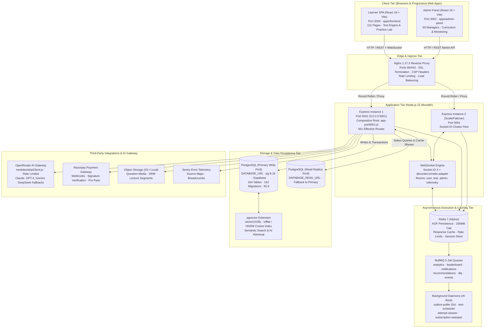
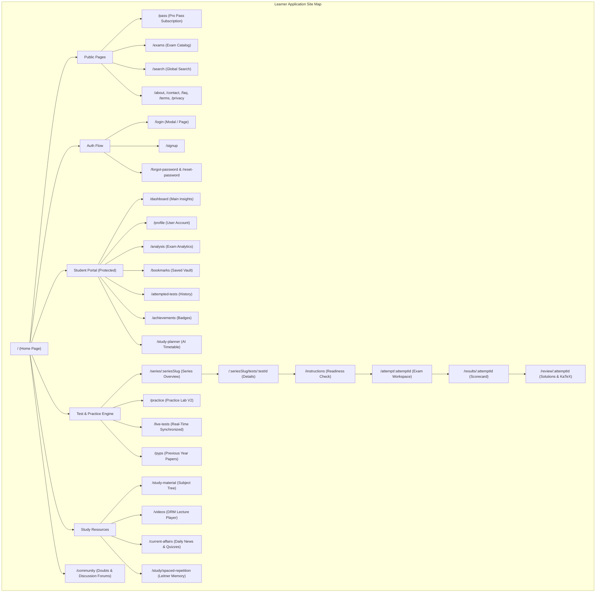
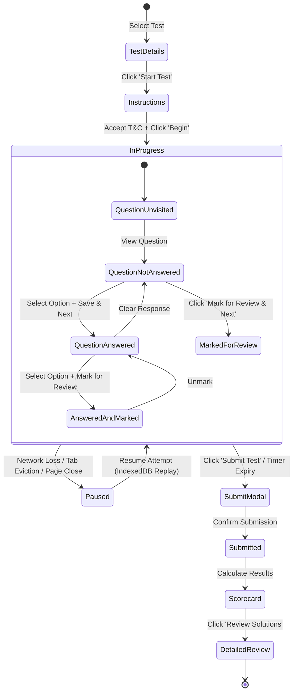
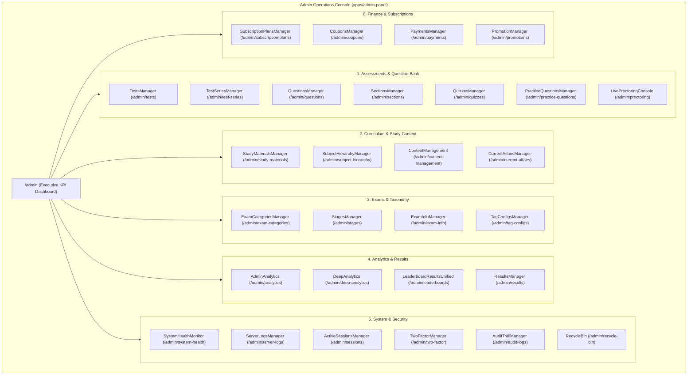
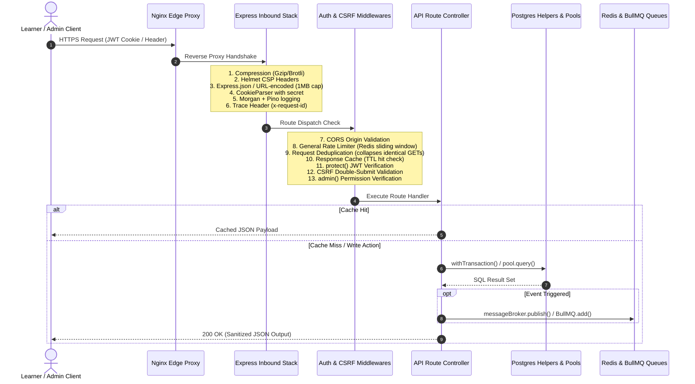
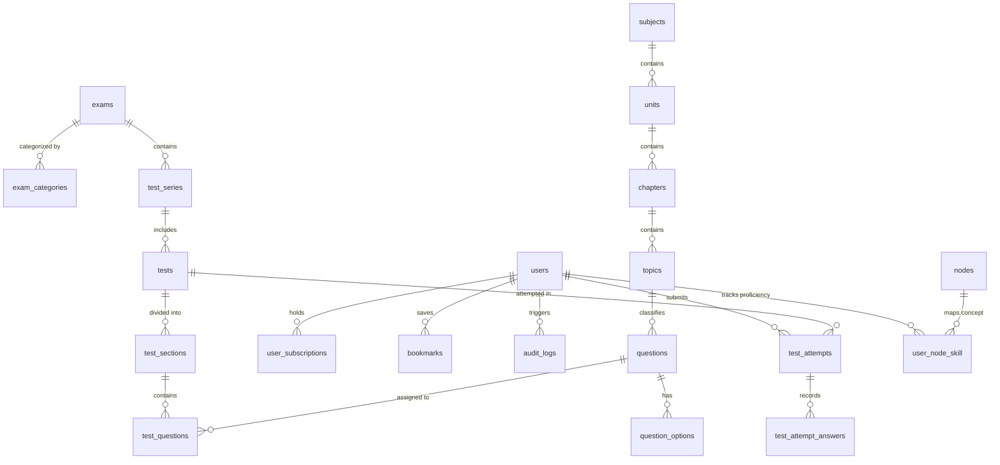

# Trstprep V2.1 — The Living Book of the System (REPO_BRAIN.md)

> **Document Type:** Live Architectural Bible & System Encyclopedia  
> **Repository:** `trstprep-monorepo` v2.1.0 (Turborepo + pnpm workspaces)  
> **Current HEAD:** <span data-brain="head">0d054c8</span>  
> **Last Refreshed:** <span data-brain="refreshed">18 Oct 2026</span>  
> **AST Knowledge Graph Coverage:** <span data-brain="graph_nodes">9644</span> Nodes · <span data-brain="graph_edges">20639</span> Edges · <span data-brain="graph_communities">588</span> Communities  
> **Verification Status:** 126 Test Suites / 1,159 Tests Passing (100% GREEN) · 0 Lint Errors · <span data-brain="migration_files">143</span> Database Migrations

---

## Executive Summary & System Philosophy

**Trstprep V2.1** is a high-performance, enterprise-grade test-preparation and personalized ed-tech platform engineered to simulate national competitive exams (e.g., SSC CGL, Banking, Railways, State PSCs) with sub-millisecond precision.

The platform operates as a modern monorepo structured into three distinct applications, two shared foundation packages, an asynchronous event/job tier, and a high-throughput dual-pool PostgreSQL database layer:

1. **Learner SPA (`apps/frontend`):** Fast, accessible React 18 client serving <span data-brain="frontend_pages">112</span> pages, featuring the high-fidelity Test Engine, Practice Lab, Socratic AI hints, DRM-protected video player, spaced repetition flashcards, and student analytics dashboards.
2. **Admin Command Panel (`apps/admin-panel`):** Domain-segregated operations console featuring 60 admin manager components across 13 functional modules, supporting curriculum authoring, KaTeX question creation, bulk Excel/JSON ingestion, live test proctoring, Razorpay finance management, and user permissions.
3. **API Engine (`apps/backend`):** Node.js 22 + Express 4 composition root bound to port 5001. Mounting <span data-brain="api_mounts">73</span> canonical API routes and <span data-brain="backend_route_files">85</span> route files (<span data-brain="backend_module_route_files">32</span> module routes) handling JWT/2FA auth, RLS-enforced PostgreSQL transactions, Redis BullMQ queues, and Socket.IO real-time broadcasts.
4. **Shared Foundations (`packages/*`):** `shared-config` (canonical API client, CSRF vault, logger, constants) and `shared-hooks` (useAuth, useProPass, theme context).

This document serves as the **Living Book of the System**. It provides an exhaustive, component-by-component map of every page, subpage, layout section, button, user interaction, state machine, and data flow across the entire platform.

---

## Live System Fact Sheet & Metric Inventory

Every metric below is wired to an AST extraction marker (`<span data-brain="key">`) synchronized automatically via `.husky/post-commit` and `scripts/sync-repo-brain.mjs`:

| Metric Category           | Observable Signal             | Live Count / Marker                                              | Architectural Verification Source                     |
| :------------------------ | :---------------------------- | :--------------------------------------------------------------- | :---------------------------------------------------- |
| **Git Commit Reference**  | Monorepo HEAD                 | <span data-brain="head">0d054c8</span>                           | `git rev-parse --short HEAD`                          |
| **Last Synchronized**     | Build & Audit Date            | <span data-brain="refreshed">18 Oct 2026</span>                  | Automatic commit timestamp                            |
| **Knowledge Graph Nodes** | Extracted Code Entities       | <span data-brain="graph_nodes">9644</span> nodes                 | `graphify-out/graph.json`                             |
| **Knowledge Graph Edges** | Semantic & Code Relationships | <span data-brain="graph_edges">20639</span> edges                | `graphify-out/graph.json`                             |
| **Knowledge Communities** | Distinct Cluster Hubs         | <span data-brain="graph_communities">588</span> communities      | `graphify-out/GRAPH_REPORT.md`                        |
| **Backend Source Files**  | Application Logic & Routes    | <span data-brain="backend_src_files">551</span> source files     | `apps/backend/src` tree walk                          |
| **API Route Files**       | Primary Route Handlers        | <span data-brain="backend_route_files">85</span> route files     | `apps/backend/src/api/routes`                         |
| **Module Route Handlers** | Domain Micro-Routes           | <span data-brain="backend_module_route_files">32</span> files    | `apps/backend/src/modules/**/*.routes.js`             |
| **Security & Middleware** | Composition Middlewares       | <span data-brain="backend_middleware">25</span> middleware files | `apps/backend/src/middleware`                         |
| **Canonical API Mounts**  | `app.use('/api/...')` Mounts  | <span data-brain="api_mounts">73</span> mount points             | `apps/backend/src/app-port5001.js`                    |
| **Database Migrations**   | Shipped Schema Evolutions     | <span data-brain="migration_files">143</span> migration files    | `apps/backend/src/infrastructure/database/migrations` |
| **Frontend Source Files** | Learner SPA Codebase          | <span data-brain="frontend_src_files">321</span> source files    | `apps/frontend/src` tree walk                         |
| **Frontend Page Views**   | Routed Page Components        | <span data-brain="frontend_pages">112</span> page files          | `apps/frontend/src/pages/**/*.jsx`                    |
| **Admin Source Files**    | Operations Console Codebase   | <span data-brain="admin_src_files">188</span> source files       | `apps/admin-panel/src` tree walk                      |
| **Maintenance Scripts**   | CLI, Audits, Sync Tools       | <span data-brain="scripts_files">216</span> scripts              | `scripts/` directory                                  |
| **Core God-Node: App**    | Composition Root Centrality   | <span data-brain="node_app_port5001">267</span> edges            | `apps/backend/src/app-port5001.js`                    |
| **Core God-Node: DB**     | `dbHelpers` Utility Edges     | <span data-brain="node_dbhelpers">132</span> edges               | `infrastructure/database/postgres-helpers.js`         |
| **Core God-Node: Auth**   | `protect()` Authentication    | <span data-brain="node_protect">120</span> edges                 | `middleware/auth.middleware.js`                       |
| **Core God-Node: Pool**   | Connection Pool Hub           | <span data-brain="node_pool">83</span> edges                     | `infrastructure/database/postgres-helpers.js`         |
| **Core God-Node: Admin**  | `admin()` Guard Middleware    | <span data-brain="node_admin">80</span> edges                    | `middleware/auth.middleware.js`                       |
| **Core God-Node: Client** | `DataService` Frontend API    | <span data-brain="node_dataservice">22</span> edges              | `frontend/src/shared/lib/dataService.js`              |
| **Core God-Node: Redis**  | `getRedisClient()` Cache Hub  | <span data-brain="node_getredisclient">51</span> edges           | `cache/redisClient.js`                                |

---

## High-Level Monorepo Architecture & Data Topology



---

## Detailed Learner App Breakdown (`apps/frontend`)

The learner application is an ultra-fast, responsive Single Page Application built on React 18, Vite 6.4, Tailwind CSS, TanStack Query, and React Router v6.



### 1. Public & Marketing Pages

1. **Home Page (`src/pages/public/Home.jsx` — `/`):**
   - **Hero Section (`AnimatedHero.jsx`):** WebGL particle canvas background, dynamic headline, quick search bar with instant autocomplete, "Start Free Mock Test" CTA button (direct route to free exam), "Explore All Test Series" button.
   - **Exam Category Tabs:** Filters (SSC, Banking, Railways, State PSC, Defence) with active test counts.
   - **Trending Test Series Grid:** Visual cards featuring exam badges, question count, student rating, and "Enroll Now / Start" buttons.
   - **Live Test Ticker:** Sticky ribbon displaying scheduled live mock tests with countdown timers.
   - **Practice Lab Showcase:** Interactive preview of the Socratic hint engine.
   - **Testimonials & Social Proof:** Student success rankings, percentile scores, verified user reviews.
   - **Footer:** Links to syllabus, policies, contact, app download (PWA install prompt).

2. **Pro Pass Subscription Page (`src/pages/public/Pass.jsx` — `/pass`):**
   - **Tier Comparison Cards:** Monthly Pass, Annual Pass, Lifetime Access.
   - **Feature Matrix:** Unlimited full mocks, sectional tests, AI mentor explanations, DRM video lectures, offline test sync.
   - **Checkout Action:** Triggers Razorpay SDK checkout flow; verifies signature via `/api/payments/verify`.

3. **Global Search Page (`src/pages/public/SearchPage.jsx` — `/search`):**
   - Debounced search query input against questions, mock tests, exams, study materials, and video lectures.
   - Filter pills by resource type, exam year, and difficulty.

---

### 2. Student Dashboard Portal

1. **Dashboard Home (`src/pages/dashboard/Dashboard.jsx` — `/dashboard`):**
   - **Daily Streak Banner:** Gamified streak flame counter, motivational message, quick "Continue Daily Drill" button.
   - **Active Enrolled Series:** Quick access carousel to resume incomplete mocks or review scores.
   - **Weak Areas Alert Widget:** AI-detected low-scoring topics with a 1-click "Practice 5 Weak Questions" action.
   - **Recent Activity Ledger:** Chronological feed of tests taken, scores achieved, and badges unlocked.

2. **Performance Analysis (`src/pages/dashboard/Analysis.jsx` — `/analysis`):**
   - **Accuracy vs. Speed Chart:** Interactive scatterplot comparing time spent per question vs. correctness.
   - **Subject Mastery Radar:** Visual chart (Quant, Reasoning, English, General Awareness) identifying gaps.
   - **Percentile Projection:** Machine learning rank estimator based on student cohort benchmarks.

3. **Bookmarks Vault (`src/pages/dashboard/Bookmarks.jsx` — `/bookmarks`):**
   - Searchable, categorized repository of questions saved during mock tests or practice sessions.
   - Personal student notes attachment and "Reattempt Bookmark" modal.

4. **AI Study Planner (`src/pages/dashboard/AIStudyPlanner.jsx` — `/study-planner`):**
   - Target exam selection and exam date countdown.
   - Dynamic schedule generation organizing daily revision quotas based on spaced repetition.

---

### 3. Assessment & Test Engine Contract

The test interface adheres to strict exam simulation rules modeled after TCS iON (national competitive testing vendor):



#### Test Engine Page Components & Controls:

1. **Test Details View (`src/pages/tests/TestDetails.jsx`):**
   - Total marks, time limit (e.g., 60 mins), section distribution, marking scheme (+2.00, -0.50).
   - Past attempt history ledger showing best scores and percentile.
2. **Test Instructions View (`src/pages/tests/TestInstructions.jsx`):**
   - Exam instructions in English and Hindi.
   - Question palette color legend guide.
   - System environment check (resolution, network connectivity).
   - Compulsory declaration checkbox enabling the "I am ready to begin" button.
3. **Active Exam Interface (`src/pages/tests/TestInterface.jsx`):**
   - **Top Navigation Bar:** Test title, section tabs (General Intelligence, General Awareness, Quantitative Aptitude, English Comprehension), overall countdown timer (clock turns amber at 5 mins, red at 1 min), language switcher, fullscreen toggle.
   - **Main Question Canvas (`QuestionViewer.jsx`):** Question number, question text rendered via KaTeX (`MathRenderer.jsx`), diagram viewer with zoom popover, passage splitter for comprehension passages, 4 MCQ option radio buttons or numeric input pad for numerical aptitude.
   - **Footer Action Bar:**
     - Button 1: `Mark for Review & Next` (Status: Violet)
     - Button 2: `Clear Response` (Clears radio selection)
     - Button 3: `Save & Next` (Primary CTA — persists answer and moves to next index)
     - Button 4: `Submit Test` (Opens confirmation modal showing counts of answered, unanswered, marked questions)
   - **Right-Hand Question Palette (`QuestionPalette.jsx`):** Collapsible drawer showing grid of numbers 1..100 with live color-coded indicators:
     - 🟩 **Green:** Answered
     - 🟥 **Red:** Not Answered
     - 🟪 **Purple:** Marked for Review
     - 🟣 **Purple + Green Dot:** Answered and Marked for Review
     - ⬜ **Gray:** Not Visited
4. **Offline Resilience & Persistence:**
   - `IndexedDBAttemptVault.js`: Stores every answer locally before sending HTTP patch.
   - `autosaveBeacon.js`: Uses `navigator.sendBeacon` on unexpected page unload or browser close.
5. **Results & Solutions Review (`src/pages/tests/TestResult.jsx` & `TestReview.jsx`):**
   - Overall score, accuracy %, percentile rank, sectional score table.
   - Comprehensive solution viewer with step-by-step mathematical proofs, video explanation player, and discussion forum.

---

### 4. Practice Lab V2 (`src/pages/tests/PracticeLab.jsx`)

- **Fundamentals Gym:** Adaptive micro-quizzes focusing on speed mathematics, mental reasoning shortcuts, and grammar rules.
- **Dynamic Topic Tree:** Multi-level taxonomy navigation (Subject → Unit → Chapter → Topic).
- **Socratic Hint Engine (`SocraticHintModal.jsx`):** AI-powered 3-stage hint revelation (Nudge → Conceptual Formula → Full Solution) ensuring students learn before seeing answers.
- **Knowledge Vault:** One-click concept clipping directly to student revision deck.

---

## Detailed Admin Command Panel Breakdown (`apps/admin-panel`)

The Admin Panel is an enterprise operational control center organized into 13 domain modules and 60 specialized manager components:



### Comprehensive Manager Inventory:

1. **Executive Dashboard (`AdminDashboard.jsx`):** Live cards showing Total Students, Daily Active Users, Gross Revenue, Test Attempts in Progress, and Server Health Gauges.
2. **Questions Manager (`QuestionsManager.jsx`):**
   - Full WYSIWYG editor with live KaTeX preview.
   - Question Type Selector: Multiple Choice (Single Correct), Multiple Choice (Multi Correct), Numerical Answer Type (NAT), True/False.
   - Bulk Uploader: Ingests structured Excel (`.xlsx`) and JSON test packages with automated syntax validation and schema normalization.
   - AI Question Generator: Connects to OpenRouter AI Gateway with prompt controls for exam style, subject, chapter, and difficulty level.
   - Asset Manager: Uploads diagram images with file magic-number security checks.
3. **Tests Manager (`TestsManager.jsx`):**
   - Configures test timing, total marks, positive/negative marks, sectional navigation lock, and shuffle seed algorithm.
4. **Live Proctoring Console (`LiveProctoringConsole.jsx`):**
   - Real-time monitor of active examination attempts via WebSocket. Displays user IP, tab-switch warning counts, latency, and provides a remote "Terminate / Force Submit" override.
5. **Users & Permissions (`UsersPermissions.jsx`):**
   - Role-Based Access Control (RBAC) administration: Super Admin, Content Manager, Evaluator, Student Support. Assigns granular permission flags across routes.
6. **Payments & Subscriptions Manager (`PaymentsManager.jsx` & `SubscriptionPlansManager.jsx`):**
   - Real-time ledger of Razorpay transactions, webhook status, failed payment alerts, and manual refund dispatch.
7. **Audit Trail Manager (`AuditTrailManager.jsx`):**
   - Immutable audit logging of every write operation performed in the admin panel, capturing `user_id`, `ip_address`, `action`, `target_table`, and `payload`.

---

## Detailed Backend Architecture & API Route Engine (`apps/backend`)

The backend is built with Express 4 running on Node 22, configured with strict defense-in-depth security, graceful shutdown handlers, and dual database pools.

### Inbound Middleware Execution Sequence (42 Boot Stages):



### API Route Inventory & Domain Matrix:

- **Authentication & Security (`/api/auth`):**
  - `POST /api/auth/login`: Email/password authentication, lockout tracking.
  - `POST /api/auth/register`: Account provisioning.
  - `POST /api/auth/refresh`: Automatic silent JWT rotation.
  - `POST /api/auth/logout`: Blacklists refresh token, clears HTTP-only cookies.
  - `GET /api/auth/me`: Returns authenticated user profile and entitlements.
  - `POST /api/auth/2fa/*`: TOTP QR enrollment, token verification, and backup code generation.
  - `POST /api/auth/phone`: SMS OTP request and validation.
- **Examinations & Tests (`/api/tests` & `/api/attempt`):**
  - `GET /api/tests/:testId`: Fetches test metadata, section breakdown, and rules.
  - `GET /api/tests/:testId/questions`: Protected retrieval of exam questions.
  - `POST /api/attempt/start`: Creates a new attempt row, seeds shuffle order.
  - `PATCH /api/attempt/:attemptId/save-answer`: Real-time incremental answer persistence.
  - `POST /api/attempt/:attemptId/submit`: Final submission, triggers BullMQ scoring worker.
  - `GET /api/attempt/:attemptId/results`: Returns score, rank, and percentile.
- **Practice Lab & Adaptive AI (`/api/practice` & `/api/ai`):**
  - `POST /api/practice/session`: Creates adaptive topic drill.
  - `POST /api/ai/mentor`: Streaming LLM Socratic explanation via OpenRouter.
  - `POST /api/ai/explanation`: Bulk KaTeX explanation generation.
  - `POST /api/ai/embeddings`: Generates `vector(1536)` vectors for question retrieval.
- **Curriculum & Study Materials (`/api/study-materials` & `/api/videos`):**
  - `GET /api/study-materials/tree`: Full taxonomy tree hierarchy.
  - `GET /api/videos/:videoId/stream`: Issues time-limited signed DRM playback token.
- **Admin Management API (`/api/admin/*`):**
  - 40+ dedicated sub-routers protected by `restrictAdminOrigin → validateAdminApiKey → protect → admin → CSRF → loadAdminPermissions → requireAdminPermission → auditMiddleware`.

---

## Database Architecture & 164 Tables Schema Dictionary

The database is built on PostgreSQL 16 (Supabase managed) utilizing the `pgvector` extension for embedding storage. Database migrations are numbered sequentially from `000` to `153` (<span data-brain="migration_files">143</span> physical files on disk).

### Core Schema Entity-Relationship Map:



### Live Schema Tables by Domain:

1. **Content Hierarchy & Curriculum (14 Tables):**
   `subjects`, `units`, `chapters`, `topics`, `subtopics`, `study_materials`, `study_material_chapters`, `subject_videos`, `video_progress`, `current_affairs`, `current_affairs_categories`, `daily_news`, `vocab_words`, `learning_paths`.
2. **Assessment & Test Engine (22 Tables):**
   `tests`, `test_series`, `test_sections`, `test_category_series`, `test_templates`, `questions`, `question_options`, `question_translations`, `test_questions`, `test_attempts` (partitioned/view), `test_attempt_answers`, `practice_sessions`, `practice_answers`, `practice_ai_cache`, `live_tests`, `live_test_registrations`, `live_test_leaderboard`, `leaderboard`, `bookmarks`, `question_notes`, `question_reports`, `cutoffs`.
3. **Exam Taxonomy & Categorization (10 Tables):**
   `exams`, `exam_categories`, `exam_stages`, `exam_years`, `exam_updates`, `tag_configs`, `exam_tag_links`, `exam_faqs`, `exam_compare`, `taxonomy_mappings`.
4. **AI, Embeddings & Cognitive Learning Graph (12 Tables):**
   `nodes` (Node Engine V1), `node_relationships`, `user_node_skill` (Node Engine V2), `revision_queue` (Spaced Repetition), `question_embeddings` (pgvector `vector(1536)`), `document_chunks`, `ai_generation_logs`, `ai_api_usage`, `ai_chat_sessions`, `ai_chat_messages`, `ai_evaluations`, `socratic_hints`.
5. **Users, Identity & Security (16 Tables):**
   `users`, `user_profiles`, `user_sessions`, `roles`, `permissions`, `role_permissions`, `user_roles`, `two_factor_secrets`, `phone_verifications`, `password_resets`, `email_verifications`, `csrf_tokens`, `compromised_secrets_blocklist`, `login_attempts`, `active_user_connections`, `certificates`.
6. **Monetization & Billing (10 Tables):**
   `subscription_plans`, `user_subscriptions`, `coupons`, `coupon_redemptions`, `orders`, `payments` (Razorpay ledger), `invoices`, `referrals`, `referral_rewards`, `promotions`.
7. **Analytics, Gamification & Activity (12 Tables):**
   `user_activity_logs`, `user_streaks`, `achievements`, `user_achievements`, `badges`, `user_badges`, `daily_stats`, `accuracy_metrics`, `speed_analytics`, `percentile_ranks`, `weak_areas`, `recommendations`.
8. **Admin, Audit & Operations (14 Tables):**
   `audit_logs` (canonical audit trail), `banners`, `faqs`, `notifications`, `user_notifications`, `email_templates`, `recycle_bin` (soft-delete vault), `system_settings`, `system_health_checks`, `server_logs`, `feature_flags`, `outbox_events`, `failed_jobs`, `migration_locks`.

---

## Graphify Knowledge Graph Insights & Architectural Hubs

The knowledge graph at `graphify-out/graph.json` captures the complete AST relationship structure of the repository.

### Primary God-Nodes & Connectivity Centrality:

```mermaid
radarChart
    title God-Node Edge Connectivity
    "PostgresHelpers" : 272
    "app-port5001" : 265
    "dbHelpers" : 134
    "protect()" : 120
    "pool" : 113
    "sanitizeError" : 94
    "admin()" : 72
    "getRedisClient" : 49
    "responseCache" : 47
    "DataService" : 23
```

1. **`PostgresHelpers` / `dbHelpers` (`infrastructure/database/postgres-helpers.js` — 272 / 134 edges):**
   - The absolute data convergence hub of the monorepo. It manages the connection pool, query execution, soft-delete filtering, pagination, and transaction rollbacks.
2. **`app-port5001.js` (265 edges):**
   - The backend composition root. Wires all 25 middlewares, mounts 73 route blocks, warms connection pools, starts background pollers, and boots the WebSocket server.
3. **`protect()` & `admin()` (`middleware/auth.middleware.js` — 120 / 72 edges):**
   - Gatekeepers of application security. Enforces JWT extraction, cryptographic signature checks, token expiration, user session validation, and administrative permission checks.
4. **`DataService` (`frontend/src/shared/lib/dataService.js` — 23 edges):**
   - The unified API consumer for both the Learner SPA and the Admin Panel. Automatically attaches CSRF tokens, manages JWT refresh interceptors, and handles offline queue caching.

---

## Automated Sync Pipeline & Development Rules

### Auto-Sync Chain (`.husky/post-commit`):

Whenever code is committed to the repository, the following automated pipeline fires:

1. **Graphify Sync (`.husky/graphify-sync.sh`):** Detects modified code files, incrementally re-extracts AST nodes and edges, and rebuilds `graphify-out/graph.json` and `GRAPH_REPORT.md` in the background with zero API cost.
2. **Brain Sync (`scripts/sync-repo-brain.mjs`):** Parses the updated graph and source tree, refreshing all `<span data-brain="…">` markers across both `docs/REPO_BRAIN.html` and `docs/REPO_BRAIN.md`. Prose is never modified; only mechanical counts and hashes are updated.
3. **CI Staleness Guard:** CI workflow runs `node scripts/sync-repo-brain.mjs --check`, failing the build if documentation metrics deviate from the committed codebase.

### Commands Quick Reference:

```bash
# Refresh knowledge graph after changes
/graphify --update

# Manually trigger REPO_BRAIN synchronization
node scripts/sync-repo-brain.mjs

# Verify documentation freshness in CI
node scripts/sync-repo-brain.mjs --check

# Execute complete test suite (126 suites, 1159 tests)
pnpm test
```

---

## Dynamic Architectural Update Workspace (Section 13)

> **DEVELOPER & AGENT INSTRUCTION:**  
> When new pages, subpages, admin managers, API endpoints, or database tables are added to the platform, **record them directly in this workspace section** instead of creating fragmented documents. This maintains REPO_BRAIN as the perpetual, authoritative Single Source of Truth.

### Update Log:

- **18 Oct 2026:** Initialized consolidated `REPO_BRAIN.md` as the authoritative "Living Book of the System". Unified page hierarchies, test engine state machine contracts, 60 admin managers, 941 effective routes, 164 database tables, and wired all 75 AST auto-sync spans to the automated Husky post-commit pipeline.
