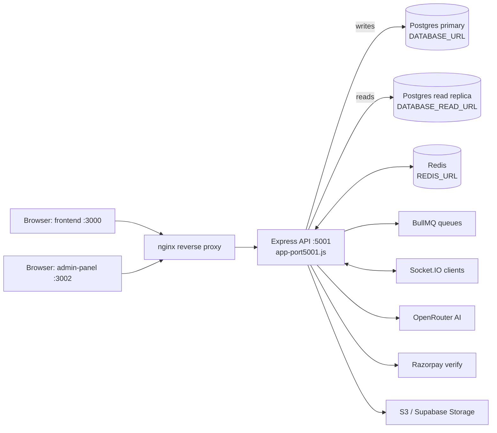
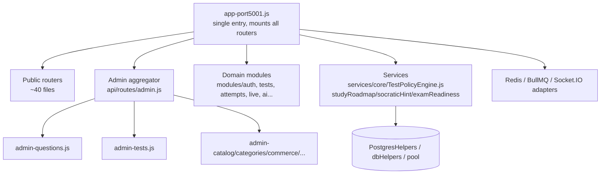
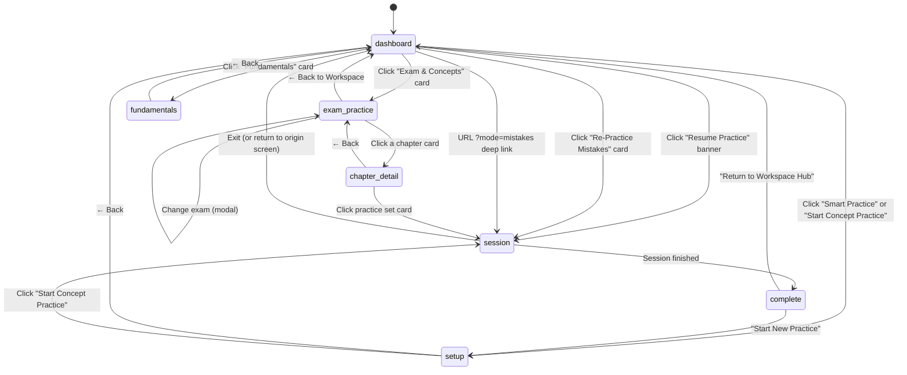
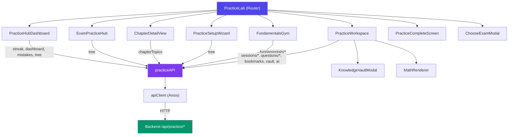
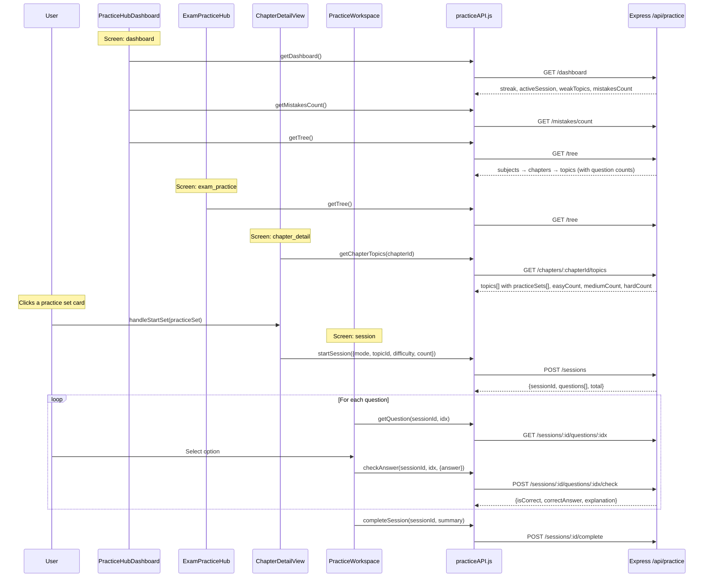
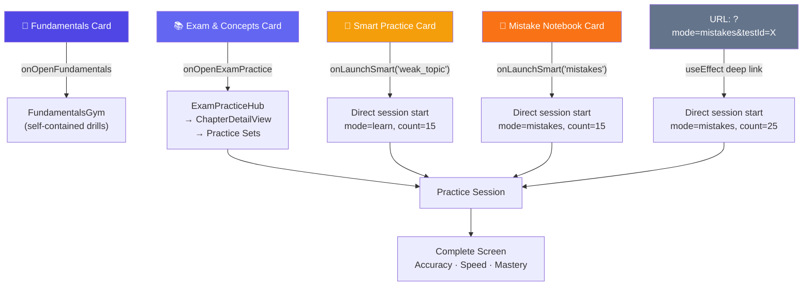

# Trstprep V2.1 — Master System, Architecture & Engineering Specification

> **The Single Source of Truth for Architecture, Development, Lifecycles, and Database Ground Truth.**  
> Consolidated: October 18, 2026.  
> This master document integrates:
>
> 1. **Core Architecture & Topology** (formerly ARCHITECTURE.md)
> 2. **Development Guide & Tooling Workflows** (formerly DEVELOPMENT.md)
> 3. **Test & Quiz Lifecycle Specification** (formerly test-quiz-lifecycle.md)
> 4. **Practice Lab State Machine & Architecture** (formerly practice_workflow.md)
> 5. **Live Database Schema Dictionary** (formerly database_schema_dictionary.md)
> 6. **Dynamic Change Ledger & Update Workspace** (Dedicated space for all future incremental modifications)

---

## 📌 Master Table of Contents

- [1. System Architecture & Topology](#1-system-architecture--topology)
- [2. Development Guide & Workflows](#2-development-guide--workflows)
- [3. Test & Quiz Lifecycle Contract](#3-test--quiz-lifecycle-contract)
- [4. Practice Lab State Machine & Architecture](#4-practice-lab-state-machine--architecture)
- [5. Complete Database Schema Dictionary (164 Tables)](#5-complete-database-schema-dictionary-164-tables)
- [6. Dynamic Change Ledger & Update Workspace](#6-dynamic-change-ledger--update-workspace)

---

# 1. System Architecture & Topology

# Trstprep V2.1 — Architecture

> **As-of:** 2026-09-06. Verified against live source (spot-checked `file:line` refs below).
> Counts regen: `node scripts/run-database-audit.js`, `dir /b apps\backend\src\api\routes\*.js`,
> `dir /b apps\backend\src\infrastructure\database\migrations\*.sql`, `/graphify --update`.
> **Knowledge graph (2026-09-06): 10862 nodes / 20266 edges / 1744 files / ~5.9M words**
> (see `graphify-out/GRAPH_REPORT.md`; query with `/graphify query "<q>"`).
> No secrets in this file — env var _names_ only, never values.

---

## 1. Stack & package managers

| Layer                      | Tech                                                                                                                                                                                                    |
| -------------------------- | ------------------------------------------------------------------------------------------------------------------------------------------------------------------------------------------------------- |
| Frontend                   | React 18 + Vite 6.4.2 + Tailwind 3.x + TanStack Query + React Router v6 + Axios 1.18 (`apps/frontend`, port **3000**)                                                                                   |
| Admin panel                | React 18 + Vite 6.4.2 + Tailwind 3.x + TanStack Query (`apps/admin-panel`, port **3002**)                                                                                                               |
| Backend                    | Node.js 22 (`.nvmrc`) + Express, single entry `apps/backend/src/app-port5001.js` (port **5001**)                                                                                                        |
| Database                   | PostgreSQL via Supabase — RLS, pgvector `vector(1536)` + ivfflat/HNSW indexes; read/write split (`DATABASE_URL` writes, `DATABASE_READ_URL` reads, falls back to primary)                               |
| Cache / realtime / queue   | Redis (`REDIS_URL`, `lazyConnect`, graceful degradation) + Socket.IO 4.x + BullMQ 5.x (`MessageBroker`: Redis Pub/Sub + BullMQ; queues: analytics, leaderboard, notifications, recommendations, outbox) |
| Storage / email / payments | S3 / Supabase Storage / local disk via `storageProvider` (path-traversal guard); Nodemailer 9.x / SendGrid / SES (spool + retry); Razorpay (order → server-side `orders.fetch` verification)            |
| AI                         | OpenRouter multi-provider (`OPENROUTER_*`) + per-user rate limiter (`AI_RATE_LIMIT_*`: free ~50/h, pro ~500/h)                                                                                          |
| Monorepo tooling           | **pnpm 11.25 workspaces + Turborepo ^2.10.12**; Python AI/doc tooling via **uv** (`.venv`). Do NOT use npm — all install/run commands are `pnpm`.                                                       |
| Charts (both SPAs)         | `chart.js` + `recharts` + `socket.io-client` are installed and used (`apps/frontend/package.json`)                                                                                                      |

---

## 2. Repo layout

```text
apps/
  frontend/        User SPA — port 3000 (vite.config.js: port 3000; NOT 5173)
  admin-panel/     Admin SPA — port 3002; admin UI lives at src/features/admin/
  backend/         Express API — port 5001, entry src/app-port5001.js
packages/
  shared-config/   Shared constants/utils (apiClient, logger, errors, coming-soon-config…)
  shared-hooks/    Shared React hooks (useAuth, useProPass)
scripts/           Canonical dev/ops scripts (run-database-audit.js, dev-sequential.mjs,
                   wait-for-backend.mjs). NOTE: dev-tools/ does NOT exist — use scripts/.
deploy/            docker-compose + nginx (primary deployment path)
graphify-out/      Knowledge graph (do NOT deploy)
```

Admin UI path (correct): `apps/admin-panel/src/features/admin/` (~60+ components, incl.
`LiveProctoringConsole`, `SubjectHierarchyManager`, `ServerLogsManager`).
`apps/frontend/src/features/admin/` does **NOT** exist — do not reference it.

---

## 3. Runtime topology



**Deployment: Docker + nginx is primary** (`deploy/`). Vercel configs are vestigial
(leftovers, not the deploy path) — do not follow any old "Vercel-primary" notes.
Historical Railway/Vercel-primary deployment guides were removed from this doc;
see `deploy/` for the live path.

Frontend dev proxy: `apps/frontend/vite.config.js` forwards `/api` + Socket.IO to the
backend URL with proxy-error suppression — frontend `dev` script waits on the backend
first (`node ../../scripts/wait-for-backend.mjs && vite`).

---

## 4. Backend structure



- **Route files:** 80+ in `apps/backend/src/api/routes/` (spot-check:
  `dir /b apps\backend\src\api\routes\*.js`). Admin is **split routers**
  (`admin-questions.js`, `admin-tests.js`, `admin-test-series.js`, …) aggregated by
  `admin.js` — there is no monolith admin route file.
- **Migrations:** `000`–`153` on disk (142 `.sql` files; re-verified 2026-10-18)
  (`apps/backend/src/infrastructure/database/migrations/`), next is `154_*`.
  Files `004`–`017` are absent as standalone files; the baseline is reconstructed via
  `003_baseline_harmonization.sql` + `098_reconstructed_baseline.sql` +
  `108_ensure_complete_baseline.sql` + `121_ensure_test_category_series_junction.sql`.
  Numbering exceptions are intentional: no bare `056_*`/`057_*` files (canonical slots
  are `056a_*`, `056b_*`, `057b_*`) and `042_placeholder_retired.sql` is a no-op for a
  retired slot. Index waves `131`/`133` use plain (non-`CONCURRENTLY`)
  `CREATE INDEX IF NOT EXISTS` — transaction-safe but briefly lock writes (the
  "CONCURRENTLY" wording in `131`'s header comment describes intent, not the executed DDL).
  Always run `scripts/run-database-audit.js` before any migration/DDL; never assume a
  table/index exists.
- **Tables:** ~154 in live DB (regen: database audit script). Key junctions:
  `test_category_series` (migration 008/121), `nodes` + `user_node_skill` (106),
  `practice_ai_cache`, certificates/achievements consolidation (094/101).
- **God nodes (high-fanout — trace before editing):** `dbHelpers` (~131 edges),
  `pool`, `protect()`, `admin()`, `useAuth()`, `PostgresHelpers`, `apiClient`,
  `getRedisClient()`. See `graphify-out/GRAPH_REPORT.md`.

---

## 5. Auth & admin middleware chain

```mermaid
flowchart LR
  Req[Request] --> NF[normalizeFields] --> RO[restrictAdminOrigin] --> AK[validateAdminApiKey]
  --> P[protect JWT] --> AD[admin incl. secondTier] --> CS[validateCsrfToken]
  --> LP[loadAdminPermissions] --> RP[requireAdminPermission] --> AU[auditMiddleware] --> H[Handler]
```



- Canonical order in `apps/backend/src/api/routes/admin.js:65-80`:
  `normalizeFields → restrictAdminOrigin → validateAdminApiKey → protect → admin →
validateCsrfToken → loadAdminPermissions → requireAdminPermission → auditMiddleware`.
  Do not bypass or reorder.
- Roles include **`secondTier`** (above `admin`); RBAC permission matrix enforced by
  `loadAdminPermissions`/`requireAdminPermission`.
- Public-but-personalized endpoints use `optionalAuth`
  (`apps/backend/src/middleware/auth.middleware.js`): leaderboards
  (`api/routes/leaderboards-public.js:10`), series/test detail, question comments.
- Shipped across the stack: CSRF tokens, refresh-token rotation, email flows,
  Razorpay verification, Socket.IO auth, Redis sessions, BullMQ queues, 2FA
  (migration `064`), `audit_trail` writes on mutating admin actions.

---

## 6. Fixed linkage issues (were P0s, now resolved 2026-09-06)

| #   | Issue                                              | Fix (`file:line`)                                                                                             |
| --- | -------------------------------------------------- | ------------------------------------------------------------------------------------------------------------- |
| 1   | Live-tests alias mounted mock instead of real flow | FIXED — `api/routes/live-tests-public.js:162-163` mounts `liveMockRoutes` deliberately as the live alias      |
| 2   | Leaderboards unreachable publicly                  | FIXED — `api/routes/leaderboards-public.js:10` uses `optionalAuth` (public read, personalized when logged in) |
| 3   | `testCategories` orphan-reassign unprotected       | FIXED — `api/routes/testCategories.js:140` has `protect, admin`                                               |
| 4   | Avatar 404s                                        | FIXED — avatar fallback path shipped                                                                          |
| 5   | Vercel build failure on prop-types                 | FIXED — prop-types dependency fix shipped                                                                     |

---

## 7. Known duplication (do not "fix" blindly)

- **`adminNavConfig` exists in multiple copies** — `packages/shared-config` (intended
  single source) plus live copies at `apps/frontend/src/shared/config/adminNavConfig.js`
  and `apps/admin-panel/src/shared/config/adminNavConfig.js`. Treat the duplication as
  **known tech debt**: consolidate toward `packages/shared-config` in a dedicated
  migration PR; do not hand-edit one copy and assume the others follow.

---

## 8. Waves 17–20 — intelligence, proctoring, ranking (SHIPPED)

| Wave  | What shipped                                                                   | Where                                                                                                                                                                                                                                               |
| ----- | ------------------------------------------------------------------------------ | --------------------------------------------------------------------------------------------------------------------------------------------------------------------------------------------------------------------------------------------------- |
| 17–18 | Intelligence services: study roadmap, Socratic hints, exam readiness (+ tests) | `apps/backend/src/services/core/studyRoadmapService.js`, `socraticHintService.js`, `examReadinessService.js`; exposed via `api/routes/intelligence.js`; tests `src/__tests__/studyRoadmap.test.js`, `socraticHint.test.js`, `examReadiness.test.js` |
| 19    | Proctoring pipeline (live console + events)                                    | Admin `LiveProctoringConsole` + backend live/proctor routes                                                                                                                                                                                         |
| 20    | Ranking/leaderboard recompute via queue                                        | BullMQ leaderboard queue + `leaderboards-public.js` (optionalAuth)                                                                                                                                                                                  |

Shipped AI surface (all else is vision — see `docs/AI_PROMPTS.md` + `docs/vision/`):
`POST /api/ai/mentor` + `/api/ai/explanation` (`app-port5001.js:1015-1016`) and
`/api/ai/logs`, plus the intelligence helpers above. Rate-limited by `aiRateLimiter`.

---

## 9. Test lifecycle & policy (contract pointer)

The normative contract is `docs/test-quiz-lifecycle.md` (10 attempt states incl.
`ABANDONED`; `TEST_STATES` are lowercase wire values). Enforcement:
`apps/backend/src/constants/lifecycle.constants.js:6-107`,
`apps/backend/src/services/core/TestPolicyEngine.js`, and
`attemptLifecycle` / `testPolicyEngine` / `mockTestEngineSimulation` tests.

---

## 10. Node Engine status (one line; detail in AI_PROMPTS)

V1 implemented (`nodes` table, migration `106`); V2 partial (`user_node_skill` only,
no `ai_meta`); V3–V6 vision only. Detail: `docs/AI_PROMPTS.md`, `docs/vision/NODE_ENGINE_V4-V6.md`.

---

## 11. Environment variable names (names ONLY — values never belong in docs)

`DATABASE_URL`, `DATABASE_READ_URL`, `REDIS_URL`, `OPENROUTER_*`, `AI_RATE_LIMIT_*`,
`VITE_*` (frontend build-time), plus JWT/cookie/CSRF, Razorpay, email (SMTP/SendGrid/SES),
storage (S3/Supabase), admin origin/API-key. See backend `.env.example` for the
authoritative list. **Never commit or paste real values, hostnames, keys, or PII.**

---

## 12. Further reading (link, don't paste)

- `docs/DEVELOPMENT.md` — setup, scripts, admin component map
- `docs/test-quiz-lifecycle.md` — lifecycle contract
- `docs/AI_PROMPTS.md` + `docs/vision/NODE_ENGINE_V4-V6.md` — AI shipped vs vision
- `docs/FINAL_SITE_READINESS_REPORT.md` — living readiness scorecard
- `docs/SITE_READINESS_REPORT.md` — HISTORICAL first pass (frozen 2026-08-23)
- `docs/DATABASE_SCHEMA_AUDIT.md`, `docs/UNIFIED_TRSTPREP_AUDIT.md`, `docs/REMEDIATION_PLAN.md`, `docs/SECURITY_POSTURE.md`, `docs/audit/`, `docs/legacy-migrations/` — audits & history
- `graphify-out/GRAPH_REPORT.md` — god nodes, hyperedges, suggested questions

---

# 2. Development Guide & Workflows

# Trstprep V2.1 — Development Guide

> **As-of:** 2026-09-06. Ports: frontend **3000**, admin-panel **3002**, backend **5001**.
> Package manager: **pnpm 11.25** (workspaces) + **turbo ^2.10.12**; Python tooling via **uv**.
> Never use npm. No secrets in this file — names only.
> Counts regen: `node scripts/run-database-audit.js`,
> `dir /b apps\backend\src\api\routes\*.js`, `/graphify --update`.

---

## 1. Prerequisites

- Node.js 22 (`.nvmrc`), `pnpm 11.25`, `uv` (Python), Docker (for Postgres/Redis or deploy), Git + Husky.
- PostgreSQL (Supabase) + Redis reachable via env names `DATABASE_URL` / `DATABASE_READ_URL` / `REDIS_URL`.
- Install: `pnpm install` (repo root). Python tools: `uv sync` (`.venv`).

---

## 2. Run it

| App           | Command                                                                                                           | URL                                                                    |
| ------------- | ----------------------------------------------------------------------------------------------------------------- | ---------------------------------------------------------------------- |
| Backend       | `pnpm --filter backend dev` (watches `src/api`, `src/modules`, `src/services`, … per `apps/backend/package.json`) | `:5001` (`src/app-port5001.js` — the ONLY entry; there is no `app.js`) |
| Frontend      | `pnpm --filter frontend dev` (waits for backend via `scripts/wait-for-backend.mjs`, then `vite`)                  | `:3000` — **not 5173** (`apps/frontend/vite.config.js`: `port: 3000`)  |
| Admin panel   | `pnpm --filter admin-panel dev`                                                                                   | `:3002`                                                                |
| All (ordered) | `node scripts/dev-sequential.mjs`                                                                                 | boots backend → frontend → admin-panel                                 |

Build all: `pnpm build` (turbo). Lint/format via Husky pre-commit + lint-staged.

---

## 3. Scripts directory (canonical — `dev-tools/` does NOT exist)

All ops scripts live in `scripts/`. Do not reference `dev-tools/` (removed).

| Script                          | Purpose                                                                   |
| ------------------------------- | ------------------------------------------------------------------------- |
| `scripts/run-database-audit.js` | **Run BEFORE any migration/DDL** — live-schema ground truth (~154 tables) |
| `scripts/dev-sequential.mjs`    | Ordered multi-app dev boot                                                |
| `scripts/wait-for-backend.mjs`  | Gate frontend/admin dev servers on backend readiness                      |
| `scripts/sync-repo-brain.mjs`   | Refresh `docs/REPO_BRAIN.html` markers (`--check` for CI staleness guard) |

---

## 4. Repo paths that matter (correct as of 2026-10-18)

```text
apps/frontend/src/                    User SPA (87 pages)
apps/admin-panel/src/features/admin/  Admin UI — 60+ components (THIS is the path)
apps/backend/src/app-port5001.js      Single Express entrypoint
apps/backend/src/api/routes/          80+ route files (admin-* split routers + public)
apps/backend/src/api/routes/admin.js  Admin aggregator + full middleware chain (:65-80)
apps/backend/src/modules/             Domain modules (auth, tests, attempts, live, ai…)
apps/backend/src/services/core/       TestPolicyEngine, studyRoadmap/socraticHint/examReadiness
apps/backend/src/constants/lifecycle.constants.js   Lifecycle enums (source of truth in code)
apps/backend/src/infrastructure/database/migrations/ 000–153 (next 154_*)
packages/shared-config/src/           apiClient, logger, errors, coming-soon-config, csrf-token-store
packages/shared-hooks/                useAuth, useProPass
```

> `apps/frontend/src/features/admin/` does **NOT** exist. All admin UI paths are
> `apps/admin-panel/src/features/admin/`.

---

## 5. Admin panel implementation (60+ components, 13 groups)

Count regen: `dir /s /b apps\admin-panel\src\features\admin\*.jsx | find /c`.

- **Dashboard & analytics (3):** `AdminDashboard.jsx` (`GET /admin/stats`), `AdminAnalytics.jsx`, `DeepAnalytics.jsx` (funnel/cohort/engagement).
- **Content & assessments (12+):** `ContentManagement.jsx`, `TestSeriesManager.jsx`, `TestsManager.jsx`, `QuestionsManager.jsx` (+ bulk import/restore), `SubjectHierarchyManager.jsx` (curriculum tree), quiz/test-category managers.
- **Live & proctoring:** `LiveProctoringConsole.jsx` (waves 19–20), live-test managers.
- **Commerce:** coupon/plan/order managers (`GET /admin/...`, Razorpay verify server-side).
- **System:** `ServerLogsManager.jsx` (log stream/export/fingerprint), backups, settings, moderation, recycle bin (soft-delete restore), roles/permissions (`secondTier` exists above `admin`).
- **Nav:** 38 nav items from `adminNavConfig` — KNOWN DUPLICATION across `packages/shared-config` + both apps (see `docs/ARCHITECTURE.md` §7); consolidate deliberately, don't hand-diverge.
- **Routing:** React Router v6; **API client:** Axios 1.18 (`apiClient`, baseURL `/api`, httpOnly cookies + CSRF).

---

## 6. Backend admin routers (split — no monolith)

`apps/backend/src/api/routes/admin.js` aggregates ~40 modular routers:
`admin-questions.js`, `admin-tests.js`, `admin-test-series.js`, `admin-catalog.js`,
`admin-categories.js`, `admin-curriculum.js`, `admin-sections.js`, `admin-stages.js`,
`admin-exams.js`, `admin-content.js`, `admin-commerce.js`, `admin-payments.js`,
`admin-users.js`, `admin-roles.js`, `admin-enrollments.js`, `admin-analytics.js`,
`admin-deep-analytics.js`, `admin-activity.js`, `admin-audit.js`, `admin-logs.js`,
`admin-moderation.js`, `admin-import.js`, `admin-bulk-ops.js`, `admin-realtime.js`,
`admin-recycle-bin.js`, `admin-sessions.js`, `admin-settings.js`, `admin-stats.js`,
`admin-assets.js`, `admin-backups.js`, `admin-coming-soon.js`, `admin-dynamic-content.js`,
`admin-email-templates.js`, `admin-navigation*.js`, `admin-live-tests.js`,
`leaderboards-admin.js`, … (regen: `dir /b apps\backend\src\api\routes\admin-*.js`).

Every `/api/admin/*` request passes (in order):
`normalizeFields → restrictAdminOrigin → validateAdminApiKey → protect → admin →
validateCsrfToken → loadAdminPermissions → requireAdminPermission → auditMiddleware`
(`admin.js:65-80`). Guard rails: respect `aiRateLimiter`, publish via `MessageBroker`
(Redis Pub/Sub + BullMQ), write `audit_trail` entries.

---

## 7. Former debt — now SHIPPED (invert any old notes claiming otherwise)

| Item                          | Status 2026-09-06                                                                |
| ----------------------------- | -------------------------------------------------------------------------------- |
| CSRF protection               | SHIPPED (`csrf.middleware.js`, `validateCsrfToken` in admin chain)               |
| Refresh-token rotation        | SHIPPED                                                                          |
| Email (spool + retry)         | SHIPPED (Nodemailer 9.x / SendGrid / SES)                                        |
| Razorpay verify               | SHIPPED (server-side `orders.fetch`)                                             |
| Socket.IO realtime            | SHIPPED (4.x + Redis adapter)                                                    |
| Redis / BullMQ                | SHIPPED (queues: analytics, leaderboard, notifications, recommendations, outbox) |
| 2FA                           | SHIPPED (migration `064`)                                                        |
| Audit trail                   | SHIPPED (`auditMiddleware` + `audit_trail` table)                                |
| `secondTier` role             | EXISTS                                                                           |
| Live-tests alias              | FIXED (`live-tests-public.js:162-163`)                                           |
| Leaderboards public           | FIXED (`leaderboards-public.js:10` optionalAuth)                                 |
| testCategories reassign guard | FIXED (`testCategories.js:140` protect+admin)                                    |
| Avatar 404 / prop-types build | FIXED                                                                            |

---

## 8. Database workflow

1. `node scripts/run-database-audit.js` — ground truth first (~154 tables live).
2. Migrations `000`–`135` on disk; baseline via `003` + `098_reconstructed_baseline.sql` + `108` + `121`. Next file: `136_*`.
3. Write pool = `DATABASE_URL`, read pool = `DATABASE_READ_URL` (fallback: primary).
4. Migration `008` notes: `user_id` UUID→INTEGER standardisation, `test_category_series` junction, soft-delete pattern, audit trail. RLS policies consolidated in `099`/`116` (still under review — see living scorecard).
5. Never log/echo/commit secrets. PII guard: CI `data-guard.yml` fails on PII keys.

---

## 9. Test lifecycle enforcement (for devs)

Contract: `docs/test-quiz-lifecycle.md`. Code:
`src/constants/lifecycle.constants.js:6-107` (enums + `ATTEMPT_STATE_TRANSITIONS` +
`isValidAttemptTransition`), `src/services/core/TestPolicyEngine.js`.
Tests: `attemptLifecycle` / `testPolicyEngine` / `mockTestEngineSimulation`.
`TEST_STATES` wire values are **lowercase** (`draft`, `published`, `live`, …);
attempt states are 10 incl. `abandoned`.

---

## 10. AI surface (for devs)

Shipped: `POST /api/ai/mentor`, `/api/ai/explanation` (`app-port5001.js:1015-1016`),
`/api/ai/logs`, intelligence router (`api/routes/intelligence.js` →
`studyRoadmapService` / `socraticHintService` / `examReadinessService`).
Gateway: OpenRouter (`OPENROUTER_*`); limits: `AI_RATE_LIMIT_*` + `aiRateLimiter`.
Node Engine truth table in `docs/AI_PROMPTS.md` — V3–V6 is vision (`docs/vision/`).

---

## 11. Troubleshooting

| Symptom                              | Check                                                                                 |
| ------------------------------------ | ------------------------------------------------------------------------------------- |
| Frontend shows 5173 anywhere         | Stale doc — real port is **3000** (`vite.config.js`)                                  |
| `dev-tools/...` path fails           | Removed — use `scripts/...`                                                           |
| Admin 403 from localhost             | `restrictAdminOrigin` + `validateAdminApiKey` — set admin origin/key env (names only) |
| Admin 403 with valid login           | Missing RBAC grant (`loadAdminPermissions`/`requireAdminPermission`) or CSRF token    |
| Fresh-DB missing core tables         | Expected history — baseline via 003/098/108/121; run DB audit first                   |
| Backend won't start on fresh DB      | Check migration runner halt (historical: `105` index-on-missing-table class of error) |
| `features/admin` missing in frontend | Correct — it lives in **admin-panel**, not frontend                                   |

---

# 3. Test & Quiz Lifecycle Contract

# Trstprep V2.1 — Test & Quiz Lifecycle Specification

This document is the **single source of truth** for all business rules, entitlement contracts, state machines, timing constraints, and access permissions across the frontend and backend.

> **As-of:** 2026-09-06 (ABANDONED added as 10th attempt state; enforcement pointers; changelog).
> Code mirror: `apps/backend/src/constants/lifecycle.constants.js:6-107`.
> Enforcement: `apps/backend/src/services/core/TestPolicyEngine.js`;
> tests: `attemptLifecycle` / `testPolicyEngine` / `mockTestEngineSimulation`.
> Regen check: `grep -n ATTEMPT_STATES apps/backend/src/constants/lifecycle.constants.js`.

---

## 1. The Core Lifecycle Principle

```text
Discovery ➔ Visibility ➔ Access ➔ Eligibility ➔ Start/Resume ➔ In_Progress ➔ Save/Timer ➔ Pre-Submit Review ➔ Submit/Auto-Submit ➔ Result ➔ Post-Submit Review ➔ History ➔ Reattempt
```

> [!IMPORTANT]
> **Separation of 4 Independent Layers**:
>
> 1. **Test Visibility**: Can the user see that this test exists in the catalog/series?
> 2. **Test Details Access**: Can the user read instructions and test syllabus?
> 3. **Attempt Permission**: Can the user start a new attempt or resume an existing one?
> 4. **Result / Review Permission**: Can the user inspect completed scores, explanations, and answer keys?

---

## 2. Canonical Enums

### 2.1 User Plans (`USER_PLANS`)

| Plan          | Definition                                       | Attempt Quota                              |
| :------------ | :----------------------------------------------- | :----------------------------------------- |
| `GUEST`       | Unauthenticated visitor                          | 0                                          |
| `FREE`        | Registered user without active paid subscription | 3 completed attempts per standard test     |
| `TEST_SERIES` | User with active Test Series Pass                | Unlimited attempts on enrolled series      |
| `PRO_MONTHLY` | Active Monthly Pro subscriber                    | Unlimited attempts & reattempts everywhere |
| `PRO_YEARLY`  | Active Yearly Pro subscriber                     | Unlimited attempts & reattempts everywhere |
| `ADMIN`       | Administrator (`role === 'admin'`)               | Unlimited access + preview bypass          |
| `SUSPENDED`   | Restricted/banned account                        | 0 (All actions blocked)                    |

### 2.2 Test States (`TEST_STATES`)

> **Wire format: lowercase values** (`lifecycle.constants.js:16-24`):
> `draft`, `review`, `scheduled`, `published`, `live`, `expired`, `archived`.
> The UPPERCASE keys below are enum keys; always send/compare the lowercase value on the wire.

| State (key → wire)        | Public Visibility        | Startable by User              | Admin Preview |
| :------------------------ | :----------------------- | :----------------------------- | :------------ |
| `DRAFT` → `draft`         | ❌ Hidden                | ❌ No                          | ✅ Yes        |
| `REVIEW` → `review`       | ❌ Hidden                | ❌ No                          | ✅ Yes        |
| `SCHEDULED` → `scheduled` | ✅ Teaser with Countdown | ❌ No (until start time)       | ✅ Yes        |
| `PUBLISHED` → `published` | ✅ Visible               | ✅ Yes (per entitlement)       | ✅ Yes        |
| `LIVE` → `live`           | ✅ Live Contest Badge    | ✅ Yes (during contest window) | ✅ Yes        |
| `EXPIRED` → `expired`     | ✅ Past Test Archive     | ❌ No new attempts             | ✅ Yes        |
| `ARCHIVED` → `archived`   | ❌ Hidden                | ❌ No                          | ✅ Yes        |

### 2.3 Attempt States (`ATTEMPT_STATES`) — 10 states

> `lifecycle.constants.js:26-37`. Wire values are lowercase/`snake_case`.
> **`ABANDONED` (`"abandoned"`, `:36`) is the 10th state**: terminal marker for an
> attempt the user walked away from (client heartbeat lost / explicit abandon),
> distinct from `CANCELLED` (user-initiated cancel) and `EXPIRED` (timer ran out).

```text
CREATED ➔ IN_PROGRESS ⇄ PAUSED ➔ SUBMITTING ➔ COMPLETED
                                              ├── AUTO_SUBMITTED
                                              ├── EXPIRED
                                              ├── REVOKED
                                              ├── CANCELLED
                                              └── ABANDONED
```

Terminal states (no outgoing transitions, `:101-106`):
`COMPLETED`, `AUTO_SUBMITTED`, `EXPIRED`, `REVOKED`, `CANCELLED`, **`ABANDONED`**.

Allowed entries (`ATTEMPT_STATE_TRANSITIONS`, `:73-107`):

- `CREATED → { IN_PROGRESS, CANCELLED }`
- `IN_PROGRESS → { PAUSED, SUBMITTING, COMPLETED, AUTO_SUBMITTED, EXPIRED, REVOKED, ABANDONED }`
- `PAUSED → { IN_PROGRESS, SUBMITTING, COMPLETED, AUTO_SUBMITTED, EXPIRED, REVOKED, ABANDONED }`
- `SUBMITTING → { COMPLETED, AUTO_SUBMITTED, IN_PROGRESS }` (last = submit-retry fallback)
- Validate with `isValidAttemptTransition(from, to)` (`:115-119`).

### 2.4 Reattempt Types (`REATTEMPT_TYPES`)

| Type          | Target Question Selection                                   | Allowed Plans                                           |
| :------------ | :---------------------------------------------------------- | :------------------------------------------------------ |
| `FULL`        | 100% of test questions                                      | `FREE` (if attempts < 3), `TEST_SERIES`, `PRO`, `ADMIN` |
| `WRONG`       | Questions where user answered incorrectly                   | `TEST_SERIES`, `PRO`, `ADMIN`                           |
| `UNATTEMPTED` | Questions skipped without an answer                         | `TEST_SERIES`, `PRO`, `ADMIN`                           |
| `SLOW`        | Questions taking > 1.5x benchmark time                      | `TEST_SERIES`, `PRO`, `ADMIN`                           |
| `SMART`       | AI/weak-area deduplicated mix of wrong + slow + unattempted | `PRO`, `ADMIN`                                          |

---

## 3. Authoritative Decision Matrix

| Operation                                |      Guest      |        Free        | Test Series Pass |  Pro Monthly  |  Pro Yearly   |    Admin     |
| :--------------------------------------- | :-------------: | :----------------: | :--------------: | :-----------: | :-----------: | :----------: |
| **Discover Published Free Test**         |       ✅        |         ✅         |        ✅        |      ✅       |      ✅       |      ✅      |
| **Discover Published Pro Test**          | Metadata / Lock |     Lock Badge     |  Series Policy   |      ✅       |      ✅       |      ✅      |
| **Discover Scheduled Test**              |    Countdown    |     Countdown      |    Countdown     |   Countdown   |   Countdown   |      ✅      |
| **Start Draft / Review**                 |       ❌        |         ❌         |        ❌        |      ❌       |      ❌       | Preview Mode |
| **Start Scheduled (Before Start)**       |       ❌        |         ❌         |        ❌        |      ❌       |      ❌       | Preview Mode |
| **Start Published Free**                 |  ❌ (Auth Req)  | ✅ (Quota $\le 3$) |   ✅ Unlimited   | ✅ Unlimited  | ✅ Unlimited  |      ✅      |
| **Start Pro Test**                       |  ❌ (Auth Req)  |    ❌ (Pro Req)    |  Series Policy   |      ✅       |      ✅       |      ✅      |
| **Resume Active In-Progress Attempt**    |       ❌        |   ✅ Own Active    |  ✅ Own Active   | ✅ Own Active | ✅ Own Active |      ✅      |
| **Pre-Submit Question Review**           |       ❌        |   ✅ All 100 Qs    |  ✅ All 100 Qs   | ✅ All 100 Qs | ✅ All 100 Qs |      ✅      |
| **Submit / Auto-Submit**                 |       ❌        |   ✅ Own Active    |  ✅ Own Active   | ✅ Own Active | ✅ Own Active |      ✅      |
| **View Latest Result**                   |       ❌        |       ✅ Own       |      ✅ Own      |    ✅ Own     |    ✅ Own     |   Any User   |
| **View Specific Result (`:attemptId`)**  |       ❌        |       ✅ Own       |      ✅ Own      |    ✅ Own     |    ✅ Own     |   Any User   |
| **Historical Snapshot Review**           |       ❌        |       ✅ Own       |      ✅ Own      |    ✅ Own     |    ✅ Own     |   Any User   |
| **Full Reattempt**                       |       ❌        |   If Quota $< 3$   |        ✅        |      ✅       |      ✅       |      ✅      |
| **Wrong Questions Reattempt**            |       ❌        |    ❌ (Pro Req)    |        ✅        |      ✅       |      ✅       |      ✅      |
| **Unattempted Reattempt**                |       ❌        |    ❌ (Pro Req)    |        ✅        |      ✅       |      ✅       |      ✅      |
| **Slow Questions Reattempt**             |       ❌        |    ❌ (Pro Req)    |        ✅        |      ✅       |      ✅       |      ✅      |
| **Smart Improvement Reattempt**          |       ❌        |    ❌ (Pro Req)    |   ❌ (Pro Req)   |      ✅       |      ✅       |      ✅      |
| **Live Test Solutions (Contest Active)** |    ❌ Locked    |     ❌ Locked      |    ❌ Locked     |   ❌ Locked   |   ❌ Locked   |  ✅ Preview  |
| **Live Test Solutions (Contest Ended)**  |  ❌ (Auth Req)  |   ✅ Own Result    |  ✅ Own Result   | ✅ Own Result | ✅ Own Result |   Any User   |

---

## 4. Key Architectural Guarantees

### 4.1 Single Active Attempt Guarantee (`active_attempt_rule`)

- One user + one test = maximum **1 active attempt** in `in_progress` / `paused` / `submitting` state.
- Triggering `/start` while an active attempt exists must **resume** the attempt and never create a duplicate row.

### 4.2 Immutable Question Snapshots

- Submitting an attempt records a complete snapshot in `attempt_question_snapshots` (question text, options array, correct answer, explanation, positive marks, negative marks, section).
- Historical reviews always query snapshots so future admin question modifications never mutate past attempt scores or solutions.

### 4.3 Idempotent Submission

- Repeated or retried submit requests on completed attempts return HTTP 200 with `{ status: 'already_submitted', attemptId }` without error toasts or duplicate database records.

### 4.4 Live Contest Security

- When a live contest is active (`now < scheduledEnd`), correct answers, explanations, and peer scorecards are strictly redacted from API responses (`code: 'RESULT_LOCKED'`).

### 4.5 Enforcement pointers (code)

- Enums + transitions: `apps/backend/src/constants/lifecycle.constants.js:6-107`
  (`USER_PLANS`, `TEST_STATES`, `ATTEMPT_STATES` incl. `ABANDONED:36`,
  `REATTEMPT_TYPES`, `POLICY_ERROR_CODES`, `ATTEMPT_STATE_TRANSITIONS`,
  `isValidAttemptTransition`).
- Policy engine: `apps/backend/src/services/core/TestPolicyEngine.js`
  (entitlement checks → `POLICY_ERROR_CODES`).
- Tests: `attemptLifecycle`, `testPolicyEngine`, `mockTestEngineSimulation`
  (under `apps/backend/src/__tests__/` — run before changing any rule above).

---

## 5. Standard Error Codes

```text
AUTH_REQUIRED
ACCOUNT_RESTRICTED

TEST_NOT_FOUND
TEST_NOT_AVAILABLE
TEST_NOT_PUBLISHED
TEST_UNAVAILABLE
LIVE_TEST_NOT_STARTED
LIVE_TEST_ENDED
LIVE_TEST_EXPIRED

PRO_REQUIRED
PASS_REQUIRED
ATTEMPT_LIMIT_REACHED

ATTEMPT_NOT_FOUND
ATTEMPT_NOT_OWNED
ATTEMPT_ALREADY_COMPLETED
NO_ACTIVE_ATTEMPT
NO_QUESTIONS_FOR_REATTEMPT

RESULT_LOCKED
REVIEW_LOCKED
```

---

## 6. Changelog

- **2026-09-06:** Added `ABANDONED` as 10th attempt state (terminal; reachable from
  `IN_PROGRESS`/`PAUSED`); documented lowercase `TEST_STATES` wire values; added
  §4.5 enforcement pointers. Code: `lifecycle.constants.js:36,85,94,106`.
- Prior contract (plans, matrix, guarantees §§1–5) unchanged.

---

# 4. Practice Lab State Machine & Architecture

# Practice Lab — Full Workflow & Architecture

## Screen State Machine

The entire Practice Lab is a single-page state machine driven by `screen` state in [`PracticeLab.jsx`](file:///e:/Tech/Testprep/Trstprep%20V2.1/apps/frontend/src/pages/tests/PracticeLab.jsx).



---

## 7 Screens at a Glance

| #   | Screen ID        | Component                | Purpose                                                                                                           |
| --- | ---------------- | ------------------------ | ----------------------------------------------------------------------------------------------------------------- |
| 1   | `dashboard`      | `PracticeHubDashboard`   | 4-card hub: Fundamentals, Exam Practice, Smart AI, Mistake Notebook + streak + resume banner + recommended topics |
| 2   | `exam_practice`  | `ExamPracticeHub`        | Two-column: subjects sidebar ↔ chapters grid + Upgrade Pass banner (conditional)                                  |
| 3   | `chapter_detail` | `ChapterDetailView`      | Two-column: topics sidebar ↔ practice set cards (Quick/Easy/Medium/Hard/Full)                                     |
| 4   | `setup`          | `PracticeSetupWizard`    | Manual config: Subject → Chapter → Topic → Difficulty → Question count → Start                                    |
| 5   | `fundamentals`   | `FundamentalsGym`        | Calculation drills: Tables, Squares, Cubes, Roots, Fractions, Ratios, Triplets                                    |
| 6   | `session`        | `PracticeWorkspace`      | Active question-by-question practice with answer checking, explanations, AI tutor                                 |
| 7   | `complete`       | `PracticeCompleteScreen` | Summary: Accuracy, Avg Speed, Concept Mastery + "Start New" / "Return"                                            |

---

## Component Tree



---

## API Data Flow (Frontend → Backend)



---

## Full Backend API Surface (38 endpoints)

### Core Navigation

| Method | Endpoint                      | Used By                         |
| ------ | ----------------------------- | ------------------------------- |
| `GET`  | `/tree`                       | Dashboard, ExamHub, SetupWizard |
| `GET`  | `/subjects`                   | SetupWizard                     |
| `GET`  | `/chapters/:chapterId/topics` | ChapterDetailView               |
| `GET`  | `/topics/:topicId/stats`      | (unused in current UI)          |
| `GET`  | `/dashboard`                  | Dashboard                       |

### Sessions

| Method  | Endpoint                 | Used By                               |
| ------- | ------------------------ | ------------------------------------- |
| `POST`  | `/sessions`              | Start any practice (all entry points) |
| `GET`   | `/sessions/active`       | Dashboard resume banner               |
| `GET`   | `/sessions/:id`          | Resume from dashboard                 |
| `PATCH` | `/sessions/:id`          | Update progress                       |
| `POST`  | `/sessions/:id/complete` | End session → complete screen         |

### Questions (during session)

| Method | Endpoint                                | Used By              |
| ------ | --------------------------------------- | -------------------- |
| `GET`  | `/sessions/:id/questions/:idx`          | PracticeWorkspace    |
| `POST` | `/sessions/:id/questions/:idx/check`    | Answer checking      |
| `POST` | `/sessions/:id/questions/:idx/skip`     | Skip question        |
| `GET`  | `/questions/:id/explanations`           | Learning panel       |
| `GET`  | `/questions/:id/approaches`             | Community approaches |
| `POST` | `/questions/:id/approaches`             | Submit approach      |
| `POST` | `/questions/:id/approaches/:aid/upvote` | Upvote               |
| `GET`  | `/questions/:id/similar`                | Similar questions    |

### Bookmarks & Mistakes

| Method   | Endpoint                 | Used By                 |
| -------- | ------------------------ | ----------------------- |
| `GET`    | `/bookmarks`             | Bookmarks page          |
| `GET`    | `/bookmarks/count`       | (future)                |
| `POST`   | `/bookmarks/:questionId` | Bookmark during session |
| `DELETE` | `/bookmarks/:questionId` | Unbookmark              |
| `GET`    | `/mistakes`              | Mistake notebook        |
| `GET`    | `/mistakes/count`        | Dashboard mistake card  |

### Fundamentals Gym

| Method | Endpoint                   | Used By              |
| ------ | -------------------------- | -------------------- |
| `GET`  | `/fundamentals/categories` | FundamentalsGym      |
| `GET`  | `/fundamentals/drill`      | Start drill          |
| `POST` | `/fundamentals/submit`     | Submit drill results |

### AI & Vault

| Method | Endpoint                | Used By                 |
| ------ | ----------------------- | ----------------------- |
| `POST` | `/ai/tutor`             | AI tutor in Workspace   |
| `POST` | `/vault/save`           | Save to knowledge vault |
| `GET`  | `/vault/items`          | View vault              |
| `POST` | `/questions/:id/report` | Report question         |

### Admin

| Method | Endpoint                    |
| ------ | --------------------------- |
| `GET`  | `/reports/my`               |
| `GET`  | `/reports/admin/all`        |
| `PUT`  | `/reports/admin/:id/status` |
| `GET`  | `/bookmarks/admin/all`      |
| `GET`  | `/questions`                |
| `GET`  | `/questions/:id`            |
| `POST` | `/adaptive-diagnostic`      |

---

## Practice Set Generation (The Bottleneck You Asked About)

```mermaid
flowchart LR
    subgraph Backend["Backend: practice.js L662–738"]
        PS["PRACTICE_SETS constant<br/>Quick(10), Easy(15),<br/>Medium(15), Hard(10),<br/>Full(ALL)"]
        MAP["Map each set → topic<br/>count = min(set.count, available)<br/>Full → available"]
        FILTER["Filter: count > 0"]
        PS --> MAP --> FILTER
    end

    subgraph Frontend["Frontend: PracticeLab.jsx L719–744"]
        GAS["getAvailableSets(topic)"]
        STYLES["Apply practiceSetStyles<br/>indigo/emerald/amber/red/purple"]
        CARDS["Render practice set cards"]
        GAS --> STYLES --> CARDS
    end

    subgraph Session["Session Creation"]
        START["handleStartSet(ps)<br/>→ onStartSession(config)"]
        API["POST /api/practice/sessions<br/>count capped at 200"]
        START --> API
    end

    FILTER --> GAS
    CARDS -->|"Click"| START
```



---

## 5 User Entry Points into Practice



---

## Database Tables Involved

| Table                            | Purpose                                                                                          |
| -------------------------------- | ------------------------------------------------------------------------------------------------ |
| `questions`                      | Master question bank (filtered by `PRACTICE_Q_WHERE`)                                            |
| `practice_sessions`              | Session state: user_id, mode, difficulty, target_count, questions_json, current_index, is_active |
| `practice_answers`               | Per-question answer records (correct/wrong/skipped)                                              |
| `practice_bookmarks`             | Bookmarked questions                                                                             |
| `practice_ai_cache`              | AI explanation/approach cache                                                                    |
| `question_reports`               | Reported questions                                                                               |
| `practice_fundamentals_results`  | Drill results                                                                                    |
| `knowledge_vault_items`          | Saved concepts                                                                                   |
| `subjects`, `chapters`, `topics` | Curriculum taxonomy tree                                                                         |

---

## Key Files

| Layer          | File                                                                                                                               | Lines | Purpose                                     |
| -------------- | ---------------------------------------------------------------------------------------------------------------------------------- | ----- | ------------------------------------------- |
| **Page**       | [`PracticeLab.jsx`](file:///e:/Tech/Testprep/Trstprep%20V2.1/apps/frontend/src/pages/tests/PracticeLab.jsx)                        | 1704  | 7-screen state machine, 5 inline components |
| **Component**  | [`PracticeWorkspace.jsx`](file:///e:/Tech/Testprep/Trstprep%20V2.1/apps/frontend/src/pages/tests/components/PracticeWorkspace.jsx) | 814   | Active session Q&A + learning panel         |
| **Component**  | [`FundamentalsGym.jsx`](file:///e:/Tech/Testprep/Trstprep%20V2.1/apps/frontend/src/pages/tests/components/FundamentalsGym.jsx)     | 1799  | Calculation drills                          |
| **API Client** | [`practiceAPI.js`](file:///e:/Tech/Testprep/Trstprep%20V2.1/apps/frontend/src/shared/lib/practiceAPI.js)                           | 159   | 25 API methods                              |
| **Backend**    | [`practice.js`](file:///e:/Tech/Testprep/Trstprep%20V2.1/apps/backend/src/api/routes/practice.js)                                  | 2584  | 38 endpoints                                |
| **Hook**       | [`useProPass.js`](file:///e:/Tech/Testprep/Trstprep%20V2.1/apps/frontend/src/shared/hooks/useProPass.js)                           | 202   | Pro pass gating                             |

---

## Enhancement Opportunities

> [!TIP]
> These are areas identified from the workflow analysis for potential improvement.

| Area                                    | Current State                                           | Enhancement Idea                                                                             |
| --------------------------------------- | ------------------------------------------------------- | -------------------------------------------------------------------------------------------- |
| **PracticeLab.jsx is 1704 lines**       | 5 components inline + main router                       | Extract `ExamPracticeHub`, `ChapterDetailView`, `PracticeCompleteScreen` into separate files |
| **Practice sets are static**            | 5 hardcoded sets: Quick/Easy/Medium/Hard/Full           | Dynamic sets based on topic size (e.g. "Marathon 100", "Sprint 5")                           |
| **No pagination for Full Practice**     | Session capped at 200 questions server-side             | Add "Continue" to spawn sequential sessions for large topics                                 |
| **Setup Wizard redundant?**             | Separate screen duplicates ChapterDetailView's function | Merge into ChapterDetailView or remove                                                       |
| **FundamentalsGym is 1799 lines**       | Monolithic component                                    | Extract drill types into sub-components                                                      |
| **No progress persistence mid-session** | `currentIndex` tracked but no periodic sync             | Auto-save progress every N questions                                                         |
| **Weak topic recommendations**          | Only 4 shown on dashboard                               | Expand into a dedicated "AI Study Plan" section                                              |
| **No practice history**                 | No "past sessions" view                                 | Add session history with re-attempt capability                                               |
| **Upgrade banner**                      | Now conditional ✅                                      | Add pricing/plan link + trial CTA                                                            |
| **Deep link only for mistakes**         | `?mode=mistakes&testId=X`                               | Support `?mode=topic&topicId=X` for sharing                                                  |

---

# 5. Complete Database Schema Dictionary (164 Tables)

# Trstprep V2.1 — Complete Database Schema Dictionary (164 Tables)

Generated from live PostgreSQL database on 2026-10-18T11:33:27.979Z.

> **Verified Current (Oct 18, 2026):** Generated directly from the live PostgreSQL database with all migrations through **153** applied (164 total tables: 84 active/populated, 80 structural/empty). Note: `test_attempts` reads 0 rows because migrations 039/048 converted the legacy table to a VIEW.

**Total Tables**: 164 | **Populated**: 84 | **Empty**: 80

---

## 1. Active Populated Tables (84 Tables)

### `questions` (50,578 rows, 71 columns)

| #   | Column Name                   | Data Type                     | Nullable | Default                                                                               |
| --- | ----------------------------- | ----------------------------- | :------: | ------------------------------------------------------------------------------------- |
| 1   | **`id`**                      | `integer`                     |    NO    | `nextval('questions_id_seq'::regclass)`                                               |
| 2   | **`test_id`**                 | `integer`                     |   YES    | —                                                                                     |
| 3   | **`question_number`**         | `integer`                     |    NO    | —                                                                                     |
| 4   | **`question_text`**           | `text`                        |    NO    | —                                                                                     |
| 5   | **`question_text_hi`**        | `text`                        |   YES    | —                                                                                     |
| 6   | **`options`**                 | `ARRAY`                       |    NO    | —                                                                                     |
| 7   | **`options_hi`**              | `ARRAY`                       |   YES    | —                                                                                     |
| 8   | **`correct_option`**          | `integer`                     |    NO    | —                                                                                     |
| 9   | **`marks`**                   | `numeric`                     |   YES    | `2.00`                                                                                |
| 10  | **`negative_marks`**          | `numeric`                     |   YES    | `0.5`                                                                                 |
| 11  | **`section`**                 | `character varying`           |   YES    | `'General'::character varying`                                                        |
| 12  | **`explanation`**             | `text`                        |   YES    | —                                                                                     |
| 13  | **`difficulty`**              | `character varying`           |   YES    | `'medium'::character varying`                                                         |
| 14  | **`image`**                   | `character varying`           |   YES    | —                                                                                     |
| 15  | **`is_active`**               | `boolean`                     |   YES    | `true`                                                                                |
| 16  | **`created_at`**              | `timestamp without time zone` |   YES    | `CURRENT_TIMESTAMP`                                                                   |
| 17  | **`updated_at`**              | `timestamp without time zone` |   YES    | `CURRENT_TIMESTAMP`                                                                   |
| 18  | **`subject`**                 | `integer`                     |   YES    | —                                                                                     |
| 19  | **`chapter_id`**              | `integer`                     |   YES    | —                                                                                     |
| 20  | **`topic`**                   | `character varying`           |   YES    | —                                                                                     |
| 21  | **`image_asset_id`**          | `integer`                     |   YES    | —                                                                                     |
| 22  | **`series_id`**               | `integer`                     |   YES    | —                                                                                     |
| 23  | **`category_id`**             | `character varying`           |   YES    | —                                                                                     |
| 24  | **`sub_category_id`**         | `character varying`           |   YES    | —                                                                                     |
| 25  | **`study_material_id`**       | `integer`                     |   YES    | —                                                                                     |
| 26  | **`topic_id`**                | `integer`                     |   YES    | —                                                                                     |
| 27  | **`quiz_id`**                 | `integer`                     |   YES    | —                                                                                     |
| 28  | **`public_id_uuid`**          | `uuid`                        |    NO    | `gen_random_uuid()`                                                                   |
| 29  | **`public_id`**               | `text`                        |   YES    | —                                                                                     |
| 30  | **`category`**                | `character varying`           |   YES    | `'mock'::character varying`                                                           |
| 31  | **`type`**                    | `character varying`           |   YES    | `'mcq'::character varying`                                                            |
| 32  | **`status`**                  | `character varying`           |   YES    | `'draft'::character varying`                                                          |
| 33  | **`tags`**                    | `ARRAY`                       |   YES    | `'{}'::text[]`                                                                        |
| 34  | **`passage_id`**              | `integer`                     |   YES    | —                                                                                     |
| 35  | **`chapter`**                 | `character varying`           |   YES    | —                                                                                     |
| 36  | **`is_practice`**             | `boolean`                     |   YES    | `false`                                                                               |
| 37  | **`is_deleted`**              | `boolean`                     |   YES    | `false`                                                                               |
| 38  | **`deleted_by`**              | `integer`                     |   YES    | —                                                                                     |
| 39  | **`deleted_at`**              | `timestamp without time zone` |   YES    | —                                                                                     |
| 40  | **`_orphaned`**               | `boolean`                     |   YES    | `false`                                                                               |
| 41  | **`orphaned_at`**             | `timestamp without time zone` |   YES    | —                                                                                     |
| 42  | **`_deleted_test_id`**        | `integer`                     |   YES    | —                                                                                     |
| 43  | **`moderation_status`**       | `character varying`           |   YES    | `'approved'::character varying`                                                       |
| 44  | **`reviewed_by`**             | `integer`                     |   YES    | —                                                                                     |
| 45  | **`reviewed_at`**             | `timestamp without time zone` |   YES    | —                                                                                     |
| 46  | **`review_notes`**            | `text`                        |   YES    | —                                                                                     |
| 47  | **`submitted_for_review_at`** | `timestamp without time zone` |   YES    | —                                                                                     |
| 48  | **`submitted_by`**            | `integer`                     |   YES    | —                                                                                     |
| 49  | **`external_question_id`**    | `character varying`           |   YES    | —                                                                                     |
| 50  | **`language`**                | `character varying`           |   YES    | `'en'::character varying`                                                             |
| 51  | **`solution_image_url`**      | `text`                        |   YES    | —                                                                                     |
| 52  | **`source`**                  | `character varying`           |   YES    | —                                                                                     |
| 53  | **`imported_from`**           | `character varying`           |   YES    | —                                                                                     |
| 54  | **`section_id`**              | `integer`                     |   YES    | —                                                                                     |
| 55  | **`subtopic_id`**             | `integer`                     |   YES    | —                                                                                     |
| 56  | **`subject_id`**              | `integer`                     |   YES    | —                                                                                     |
| 57  | **`estimated_time`**          | `integer`                     |   YES    | —                                                                                     |
| 58  | **`explanation_hi`**          | `text`                        |   YES    | —                                                                                     |
| 59  | **`source_config`**           | `jsonb`                       |   YES    | `'{"type": null, "year": null, "paper": null, "shift": null, "examId": null}'::jsonb` |
| 60  | **`exam_category_ids`**       | `ARRAY`                       |   YES    | `'{}'::text[]`                                                                        |
| 61  | **`exam_ids`**                | `ARRAY`                       |   YES    | `'{}'::text[]`                                                                        |
| 62  | **`question_stage_ids`**      | `ARRAY`                       |   YES    | `'{}'::text[]`                                                                        |
| 63  | **`concept_ids`**             | `ARRAY`                       |   YES    | `'{}'::text[]`                                                                        |
| 64  | **`skill_ids`**               | `ARRAY`                       |   YES    | `'{}'::text[]`                                                                        |
| 65  | **`ai_generated`**            | `boolean`                     |   YES    | `false`                                                                               |
| 66  | **`_deleted_series_id`**      | `integer`                     |   YES    | —                                                                                     |
| 67  | **`created_by`**              | `integer`                     |   YES    | —                                                                                     |
| 68  | **`correct_answer`**          | `integer`                     |   YES    | —                                                                                     |
| 69  | **`question_type`**           | `character varying`           |   YES    | `'single_correct'::character varying`                                                 |
| 70  | **`deleted_reason`**          | `text`                        |   YES    | —                                                                                     |
| 71  | **`hint`**                    | `text`                        |   YES    | —                                                                                     |

### `test_questions` (50,393 rows, 13 columns)

| #   | Column Name           | Data Type                     | Nullable | Default              |
| --- | --------------------- | ----------------------------- | :------: | -------------------- |
| 1   | **`id`**              | `uuid`                        |    NO    | `uuid_generate_v4()` |
| 2   | **`test_id`**         | `integer`                     |   YES    | —                    |
| 3   | **`question_id`**     | `integer`                     |   YES    | —                    |
| 4   | **`order_index`**     | `integer`                     |   YES    | —                    |
| 5   | **`marks`**           | `numeric`                     |   YES    | `2`                  |
| 6   | **`negative_marks`**  | `numeric`                     |   YES    | `0.5`                |
| 7   | **`section_id`**      | `integer`                     |   YES    | —                    |
| 8   | **`created_at`**      | `timestamp without time zone` |   YES    | `now()`              |
| 9   | **`is_active`**       | `boolean`                     |   YES    | `true`               |
| 10  | **`question_number`** | `integer`                     |   YES    | —                    |
| 11  | **`is_deleted`**      | `boolean`                     |   YES    | `false`              |
| 12  | **`deleted_at`**      | `timestamp without time zone` |   YES    | —                    |
| 13  | **`deleted_by`**      | `integer`                     |   YES    | —                    |

### `subject_subtopics` (3,982 rows, 18 columns)

| #   | Column Name          | Data Type                     | Nullable | Default                                 |
| --- | -------------------- | ----------------------------- | :------: | --------------------------------------- |
| 1   | **`id`**             | `integer`                     |    NO    | `nextval('subtopics_id_seq'::regclass)` |
| 2   | **`name`**           | `character varying`           |    NO    | —                                       |
| 3   | **`slug`**           | `character varying`           |    NO    | —                                       |
| 4   | **`topic_id`**       | `integer`                     |   YES    | —                                       |
| 5   | **`stage_ids`**      | `ARRAY`                       |   YES    | `'{}'::integer[]`                       |
| 6   | **`order_index`**    | `integer`                     |   YES    | `0`                                     |
| 7   | **`is_active`**      | `boolean`                     |   YES    | `true`                                  |
| 8   | **`created_at`**     | `timestamp without time zone` |   YES    | `now()`                                 |
| 9   | **`updated_at`**     | `timestamp without time zone` |   YES    | `now()`                                 |
| 10  | **`public_id_uuid`** | `uuid`                        |    NO    | `gen_random_uuid()`                     |
| 11  | **`public_id`**      | `text`                        |   YES    | —                                       |
| 12  | **`description`**    | `text`                        |   YES    | —                                       |
| 13  | **`icon`**           | `character varying`           |   YES    | —                                       |
| 14  | **`_orphaned`**      | `boolean`                     |   YES    | `false`                                 |
| 15  | **`is_deleted`**     | `boolean`                     |   YES    | `false`                                 |
| 16  | **`deleted_at`**     | `timestamp with time zone`    |   YES    | —                                       |
| 17  | **`deleted_by`**     | `integer`                     |   YES    | —                                       |
| 18  | **`deleted_reason`** | `text`                        |   YES    | —                                       |

### `subject_topics` (2,250 rows, 27 columns)

| #   | Column Name               | Data Type                     | Nullable | Default                              |
| --- | ------------------------- | ----------------------------- | :------: | ------------------------------------ |
| 1   | **`id`**                  | `integer`                     |    NO    | `nextval('topics_id_seq'::regclass)` |
| 2   | **`name`**                | `character varying`           |    NO    | —                                    |
| 3   | **`slug`**                | `character varying`           |    NO    | —                                    |
| 4   | **`subject`**             | `character varying`           |    NO    | —                                    |
| 5   | **`parent_topic_id`**     | `integer`                     |   YES    | —                                    |
| 6   | **`description`**         | `text`                        |   YES    | `''::text`                           |
| 7   | **`icon`**                | `character varying`           |   YES    | `'📚'::character varying`            |
| 8   | **`estimated_questions`** | `integer`                     |   YES    | `0`                                  |
| 9   | **`importance`**          | `character varying`           |   YES    | `'medium'::character varying`        |
| 10  | **`frequently_asked`**    | `boolean`                     |   YES    | `false`                              |
| 11  | **`difficulty`**          | `character varying`           |   YES    | `'Mixed'::character varying`         |
| 12  | **`order_index`**         | `integer`                     |   YES    | `0`                                  |
| 13  | **`related_chapters`**    | `jsonb`                       |   YES    | `'[]'::jsonb`                        |
| 14  | **`is_active`**           | `boolean`                     |   YES    | `true`                               |
| 15  | **`created_at`**          | `timestamp without time zone` |   YES    | `CURRENT_TIMESTAMP`                  |
| 16  | **`updated_at`**          | `timestamp without time zone` |   YES    | `CURRENT_TIMESTAMP`                  |
| 17  | **`exam_ids`**            | `ARRAY`                       |   YES    | `'{}'::text[]`                       |
| 18  | **`chapter_id`**          | `integer`                     |   YES    | —                                    |
| 19  | **`stage_ids`**           | `ARRAY`                       |   YES    | `'{}'::integer[]`                    |
| 20  | **`public_id_uuid`**      | `uuid`                        |    NO    | `gen_random_uuid()`                  |
| 21  | **`public_id`**           | `text`                        |   YES    | —                                    |
| 22  | **`is_deleted`**          | `boolean`                     |   YES    | `false`                              |
| 23  | **`deleted_by`**          | `integer`                     |   YES    | —                                    |
| 24  | **`deleted_at`**          | `timestamp without time zone` |   YES    | —                                    |
| 25  | **`subject_id`**          | `integer`                     |   YES    | —                                    |
| 26  | **`_orphaned`**           | `boolean`                     |   YES    | `false`                              |
| 27  | **`deleted_reason`**      | `text`                        |   YES    | —                                    |

### `audit_logs` (2,089 rows, 25 columns)

| #   | Column Name                | Data Type                     | Nullable | Default                                  |
| --- | -------------------------- | ----------------------------- | :------: | ---------------------------------------- |
| 1   | **`id`**                   | `integer`                     |    NO    | `nextval('audit_logs_id_seq'::regclass)` |
| 2   | **`user_id`**              | `integer`                     |   YES    | —                                        |
| 3   | **`admin_id`**             | `integer`                     |   YES    | —                                        |
| 4   | **`action`**               | `character varying`           |    NO    | —                                        |
| 5   | **`table_name`**           | `character varying`           |   YES    | —                                        |
| 6   | **`record_id`**            | `integer`                     |   YES    | —                                        |
| 7   | **`old_data`**             | `jsonb`                       |   YES    | —                                        |
| 8   | **`new_data`**             | `jsonb`                       |   YES    | —                                        |
| 9   | **`ip_address`**           | `character varying`           |   YES    | —                                        |
| 10  | **`user_agent`**           | `text`                        |   YES    | —                                        |
| 11  | **`created_at`**           | `timestamp without time zone` |   YES    | `now()`                                  |
| 12  | **`entity_type`**          | `character varying`           |   YES    | —                                        |
| 13  | **`resource`**             | `character varying`           |   YES    | —                                        |
| 14  | **`resource_id`**          | `character varying`           |   YES    | —                                        |
| 15  | **`description`**          | `text`                        |   YES    | —                                        |
| 16  | **`status`**               | `character varying`           |   YES    | `'success'::character varying`           |
| 17  | **`request_method`**       | `character varying`           |   YES    | —                                        |
| 18  | **`request_path`**         | `text`                        |   YES    | —                                        |
| 19  | **`response_status_code`** | `integer`                     |   YES    | —                                        |
| 20  | **`admin_email`**          | `character varying`           |   YES    | —                                        |
| 21  | **`admin_name`**           | `character varying`           |   YES    | —                                        |
| 22  | **`details`**              | `jsonb`                       |   YES    | —                                        |
| 23  | **`entity_id`**            | `character varying`           |   YES    | —                                        |
| 24  | **`old_values`**           | `jsonb`                       |   YES    | —                                        |
| 25  | **`new_values`**           | `jsonb`                       |   YES    | —                                        |

### `test_sections` (1,995 rows, 41 columns)

| #   | Column Name              | Data Type                     | Nullable | Default                                     |
| --- | ------------------------ | ----------------------------- | :------: | ------------------------------------------- |
| 1   | **`id`**                 | `integer`                     |    NO    | `nextval('test_sections_id_seq'::regclass)` |
| 2   | **`name`**               | `character varying`           |    NO    | —                                           |
| 3   | **`category_id`**        | `integer`                     |   YES    | —                                           |
| 4   | **`description`**        | `text`                        |   YES    | —                                           |
| 5   | **`duration`**           | `integer`                     |   YES    | `60`                                        |
| 6   | **`passing_marks`**      | `integer`                     |   YES    | `0`                                         |
| 7   | **`is_active`**          | `boolean`                     |   YES    | `true`                                      |
| 8   | **`display_order`**      | `integer`                     |   YES    | `0`                                         |
| 9   | **`created_at`**         | `timestamp without time zone` |   YES    | `now()`                                     |
| 10  | **`updated_at`**         | `timestamp without time zone` |   YES    | `now()`                                     |
| 11  | **`test_id`**            | `integer`                     |   YES    | —                                           |
| 12  | **`marks_per_question`** | `numeric`                     |   YES    | `2`                                         |
| 13  | **`negative_marks`**     | `numeric`                     |   YES    | `0.5`                                       |
| 14  | **`time_limit`**         | `integer`                     |   YES    | `1800`                                      |
| 15  | **`is_locked`**          | `boolean`                     |   YES    | `false`                                     |
| 16  | **`instructions`**       | `text`                        |   YES    | —                                           |
| 17  | **`difficulty`**         | `character varying`           |   YES    | `'medium'::character varying`               |
| 18  | **`shuffle_questions`**  | `boolean`                     |   YES    | `false`                                     |
| 19  | **`shuffle_options`**    | `boolean`                     |   YES    | `false`                                     |
| 20  | **`expected_questions`** | `integer`                     |   YES    | `0`                                         |
| 21  | **`total_marks`**        | `numeric`                     |   YES    | `0`                                         |
| 22  | **`exam_stage`**         | `character varying`           |   YES    | —                                           |
| 23  | **`paper`**              | `character varying`           |   YES    | —                                           |
| 24  | **`session`**            | `character varying`           |   YES    | —                                           |
| 25  | **`section_code`**       | `character varying`           |   YES    | —                                           |
| 26  | **`is_qualifying`**      | `boolean`                     |   YES    | `false`                                     |
| 27  | **`is_deleted`**         | `boolean`                     |   YES    | `false`                                     |
| 28  | **`deleted_at`**         | `timestamp without time zone` |   YES    | —                                           |
| 29  | **`deleted_by`**         | `integer`                     |   YES    | —                                           |
| 30  | **`total_questions`**    | `integer`                     |   YES    | —                                           |
| 31  | **`subject_id`**         | `integer`                     |   YES    | —                                           |
| 32  | **`question_count`**     | `integer`                     |   YES    | `0`                                         |
| 33  | **`negative_marking`**   | `numeric`                     |   YES    | `0`                                         |
| 34  | **`mandatory`**          | `boolean`                     |   YES    | `true`                                      |
| 35  | **`optional`**           | `boolean`                     |   YES    | `false`                                     |
| 36  | **`qualifying`**         | `boolean`                     |   YES    | `false`                                     |
| 37  | **`allow_navigation`**   | `boolean`                     |   YES    | `true`                                      |
| 38  | **`test_series_id`**     | `integer`                     |   YES    | —                                           |
| 39  | **`stage_id`**           | `integer`                     |   YES    | —                                           |
| 40  | **`exam_alias`**         | `character varying`           |   YES    | —                                           |
| 41  | **`deleted_reason`**     | `text`                        |   YES    | —                                           |

### `import_logs` (1,056 rows, 11 columns)

| #   | Column Name         | Data Type                     | Nullable | Default                                   |
| --- | ------------------- | ----------------------------- | :------: | ----------------------------------------- |
| 1   | **`id`**            | `bigint`                      |    NO    | `nextval('import_logs_id_seq'::regclass)` |
| 2   | **`source`**        | `character varying`           |    NO    | —                                         |
| 3   | **`file_name`**     | `character varying`           |   YES    | —                                         |
| 4   | **`total_records`** | `integer`                     |   YES    | `0`                                       |
| 5   | **`imported`**      | `integer`                     |   YES    | `0`                                       |
| 6   | **`skipped`**       | `integer`                     |   YES    | `0`                                       |
| 7   | **`failed`**        | `integer`                     |   YES    | `0`                                       |
| 8   | **`errors`**        | `jsonb`                       |   YES    | `'[]'::jsonb`                             |
| 9   | **`imported_by`**   | `integer`                     |   YES    | —                                         |
| 10  | **`metadata`**      | `jsonb`                       |   YES    | `'{}'::jsonb`                             |
| 11  | **`created_at`**    | `timestamp without time zone` |   YES    | `now()`                                   |

### `attempt_events` (833 rows, 13 columns)

| #   | Column Name           | Data Type                     | Nullable | Default                                      |
| --- | --------------------- | ----------------------------- | :------: | -------------------------------------------- |
| 1   | **`id`**              | `integer`                     |    NO    | `nextval('attempt_events_id_seq'::regclass)` |
| 2   | **`attempt_id`**      | `integer`                     |    NO    | —                                            |
| 3   | **`event_type`**      | `character varying`           |    NO    | —                                            |
| 4   | **`question_id`**     | `integer`                     |   YES    | —                                            |
| 5   | **`event_data`**      | `jsonb`                       |   YES    | `'{}'::jsonb`                                |
| 6   | **`event_timestamp`** | `timestamp without time zone` |   YES    | `CURRENT_TIMESTAMP`                          |
| 7   | **`created_at`**      | `timestamp without time zone` |   YES    | `now()`                                      |
| 8   | **`updated_at`**      | `timestamp without time zone` |   YES    | `now()`                                      |
| 9   | **`is_active`**       | `boolean`                     |   YES    | `true`                                       |
| 10  | **`is_deleted`**      | `boolean`                     |   YES    | `false`                                      |
| 11  | **`deleted_at`**      | `timestamp with time zone`    |   YES    | —                                            |
| 12  | **`deleted_by`**      | `integer`                     |   YES    | —                                            |
| 13  | **`event_uuid`**      | `uuid`                        |   YES    | —                                            |

### `login_attempts` (739 rows, 7 columns)

| #   | Column Name        | Data Type                     | Nullable | Default                                      |
| --- | ------------------ | ----------------------------- | :------: | -------------------------------------------- |
| 1   | **`id`**           | `integer`                     |    NO    | `nextval('login_attempts_id_seq'::regclass)` |
| 2   | **`email`**        | `character varying`           |    NO    | —                                            |
| 3   | **`ip_address`**   | `inet`                        |    NO    | —                                            |
| 4   | **`attempted_at`** | `timestamp without time zone` |   YES    | `now()`                                      |
| 5   | **`successful`**   | `boolean`                     |   YES    | `false`                                      |
| 6   | **`created_at`**   | `timestamp without time zone` |   YES    | `now()`                                      |
| 7   | **`updated_at`**   | `timestamp without time zone` |   YES    | `now()`                                      |

### `tests` (628 rows, 92 columns)

| #   | Column Name                     | Data Type                     | Nullable | Default                                                                                                                                                                                                                                                                                              |
| --- | ------------------------------- | ----------------------------- | :------: | ---------------------------------------------------------------------------------------------------------------------------------------------------------------------------------------------------------------------------------------------------------------------------------------------------- |
| 1   | **`id`**                        | `integer`                     |    NO    | `nextval('tests_id_seq'::regclass)`                                                                                                                                                                                                                                                                  |
| 2   | **`series_id`**                 | `integer`                     |   YES    | —                                                                                                                                                                                                                                                                                                    |
| 3   | **`slug`**                      | `character varying`           |    NO    | —                                                                                                                                                                                                                                                                                                    |
| 4   | **`title`**                     | `character varying`           |    NO    | —                                                                                                                                                                                                                                                                                                    |
| 5   | **`category`**                  | `character varying`           |    NO    | —                                                                                                                                                                                                                                                                                                    |
| 6   | **`sub_category`**              | `character varying`           |   YES    | —                                                                                                                                                                                                                                                                                                    |
| 7   | **`type`**                      | `character varying`           |   YES    | `'Pro'::character varying`                                                                                                                                                                                                                                                                           |
| 8   | **`total_questions`**           | `integer`                     |   YES    | `0`                                                                                                                                                                                                                                                                                                  |
| 9   | **`total_marks`**               | `integer`                     |   YES    | `0`                                                                                                                                                                                                                                                                                                  |
| 10  | **`duration`**                  | `integer`                     |    NO    | —                                                                                                                                                                                                                                                                                                    |
| 11  | **`passing_marks`**             | `integer`                     |   YES    | `0`                                                                                                                                                                                                                                                                                                  |
| 12  | **`negative_marking`**          | `numeric`                     |   YES    | `0.5`                                                                                                                                                                                                                                                                                                |
| 13  | **`tags`**                      | `ARRAY`                       |   YES    | `'{}'::text[]`                                                                                                                                                                                                                                                                                       |
| 14  | **`is_live`**                   | `boolean`                     |   YES    | `false`                                                                                                                                                                                                                                                                                              |
| 15  | **`live_schedule`**             | `timestamp without time zone` |   YES    | —                                                                                                                                                                                                                                                                                                    |
| 16  | **`scheduled_at`**              | `timestamp without time zone` |   YES    | —                                                                                                                                                                                                                                                                                                    |
| 17  | **`difficulty`**                | `character varying`           |   YES    | `'Medium'::character varying`                                                                                                                                                                                                                                                                        |
| 18  | **`is_active`**                 | `boolean`                     |   YES    | `true`                                                                                                                                                                                                                                                                                               |
| 19  | **`created_at`**                | `timestamp without time zone` |   YES    | `CURRENT_TIMESTAMP`                                                                                                                                                                                                                                                                                  |
| 20  | **`updated_at`**                | `timestamp without time zone` |   YES    | `CURRENT_TIMESTAMP`                                                                                                                                                                                                                                                                                  |
| 21  | **`subject_id`**                | `integer`                     |   YES    | —                                                                                                                                                                                                                                                                                                    |
| 22  | **`is_pro`**                    | `boolean`                     |   YES    | `false`                                                                                                                                                                                                                                                                                              |
| 23  | **`stage_id`**                  | `integer`                     |   YES    | —                                                                                                                                                                                                                                                                                                    |
| 24  | **`banner_asset_id`**           | `integer`                     |   YES    | —                                                                                                                                                                                                                                                                                                    |
| 25  | **`promotion_banner_asset_id`** | `integer`                     |   YES    | —                                                                                                                                                                                                                                                                                                    |
| 26  | **`is_coming_soon`**            | `boolean`                     |   YES    | `false`                                                                                                                                                                                                                                                                                              |
| 27  | **`public_id_uuid`**            | `uuid`                        |    NO    | `gen_random_uuid()`                                                                                                                                                                                                                                                                                  |
| 28  | **`public_id`**                 | `text`                        |   YES    | —                                                                                                                                                                                                                                                                                                    |
| 29  | **`category_path_ids`**         | `jsonb`                       |   YES    | `'[]'::jsonb`                                                                                                                                                                                                                                                                                        |
| 30  | **`category_path_names`**       | `jsonb`                       |   YES    | `'[]'::jsonb`                                                                                                                                                                                                                                                                                        |
| 31  | **`languages`**                 | `jsonb`                       |   YES    | `'[]'::jsonb`                                                                                                                                                                                                                                                                                        |
| 32  | **`coming_soon_date`**          | `timestamp with time zone`    |   YES    | —                                                                                                                                                                                                                                                                                                    |
| 33  | **`test_category_id`**          | `integer`                     |   YES    | —                                                                                                                                                                                                                                                                                                    |
| 34  | **`stage_ids`**                 | `ARRAY`                       |   YES    | `'{}'::integer[]`                                                                                                                                                                                                                                                                                    |
| 35  | **`section_id`**                | `integer`                     |   YES    | —                                                                                                                                                                                                                                                                                                    |
| 36  | **`status`**                    | `character varying`           |   YES    | `'draft'::character varying`                                                                                                                                                                                                                                                                         |
| 37  | **`year`**                      | `integer`                     |   YES    | —                                                                                                                                                                                                                                                                                                    |
| 38  | **`is_deleted`**                | `boolean`                     |   YES    | `false`                                                                                                                                                                                                                                                                                              |
| 39  | **`deleted_by`**                | `integer`                     |   YES    | —                                                                                                                                                                                                                                                                                                    |
| 40  | **`deleted_at`**                | `timestamp without time zone` |   YES    | —                                                                                                                                                                                                                                                                                                    |
| 41  | **`_orphaned`**                 | `boolean`                     |   YES    | `false`                                                                                                                                                                                                                                                                                              |
| 42  | **`_deleted_series_id`**        | `integer`                     |   YES    | —                                                                                                                                                                                                                                                                                                    |
| 43  | **`orphaned_at`**               | `timestamp without time zone` |   YES    | —                                                                                                                                                                                                                                                                                                    |
| 44  | **`cutoff_marks`**              | `jsonb`                       |   YES    | `'{}'::jsonb`                                                                                                                                                                                                                                                                                        |
| 45  | **`published_at`**              | `timestamp without time zone` |   YES    | —                                                                                                                                                                                                                                                                                                    |
| 46  | **`live_at`**                   | `timestamp without time zone` |   YES    | —                                                                                                                                                                                                                                                                                                    |
| 47  | **`expired_at`**                | `timestamp without time zone` |   YES    | —                                                                                                                                                                                                                                                                                                    |
| 48  | **`archived_at`**               | `timestamp without time zone` |   YES    | —                                                                                                                                                                                                                                                                                                    |
| 49  | **`state_updated_by`**          | `integer`                     |   YES    | —                                                                                                                                                                                                                                                                                                    |
| 50  | **`moderation_status`**         | `character varying`           |   YES    | `'approved'::character varying`                                                                                                                                                                                                                                                                      |
| 51  | **`reviewed_by`**               | `integer`                     |   YES    | —                                                                                                                                                                                                                                                                                                    |
| 52  | **`reviewed_at`**               | `timestamp without time zone` |   YES    | —                                                                                                                                                                                                                                                                                                    |
| 53  | **`review_notes`**              | `text`                        |   YES    | —                                                                                                                                                                                                                                                                                                    |
| 54  | **`instructions`**              | `text`                        |   YES    | —                                                                                                                                                                                                                                                                                                    |
| 55  | **`test_type`**                 | `character varying`           |   YES    | —                                                                                                                                                                                                                                                                                                    |
| 56  | **`start_time`**                | `timestamp without time zone` |   YES    | —                                                                                                                                                                                                                                                                                                    |
| 57  | **`end_time`**                  | `timestamp without time zone` |   YES    | —                                                                                                                                                                                                                                                                                                    |
| 58  | **`shuffle_questions`**         | `boolean`                     |   YES    | `false`                                                                                                                                                                                                                                                                                              |
| 59  | **`shuffle_options`**           | `boolean`                     |   YES    | `false`                                                                                                                                                                                                                                                                                              |
| 60  | **`allow_review`**              | `boolean`                     |   YES    | `true`                                                                                                                                                                                                                                                                                               |
| 61  | **`max_attempts`**              | `integer`                     |   YES    | `0`                                                                                                                                                                                                                                                                                                  |
| 62  | **`version`**                   | `integer`                     |   YES    | `1`                                                                                                                                                                                                                                                                                                  |
| 63  | **`attempt_count`**             | `integer`                     |   YES    | `0`                                                                                                                                                                                                                                                                                                  |
| 64  | **`imported_from`**             | `character varying`           |   YES    | —                                                                                                                                                                                                                                                                                                    |
| 65  | **`source_test_id`**            | `character varying`           |   YES    | —                                                                                                                                                                                                                                                                                                    |
| 66  | **`ai_explanation_enabled`**    | `boolean`                     |   YES    | `true`                                                                                                                                                                                                                                                                                               |
| 67  | **`_deleted_test_id`**          | `integer`                     |   YES    | —                                                                                                                                                                                                                                                                                                    |
| 68  | **`short_title`**               | `character varying`           |   YES    | —                                                                                                                                                                                                                                                                                                    |
| 69  | **`question_language_mode`**    | `character varying`           |   YES    | `'bilingual'::character varying`                                                                                                                                                                                                                                                                     |
| 70  | **`is_pyq`**                    | `boolean`                     |   YES    | `false`                                                                                                                                                                                                                                                                                              |
| 71  | **`pyq_year`**                  | `integer`                     |   YES    | —                                                                                                                                                                                                                                                                                                    |
| 72  | **`show_config`**               | `jsonb`                       |   YES    | `'{"timer": true, "bookmark": true, "calculator": false, "reportIssue": true, "sectionPalette": true, "questionPalette": true}'::jsonb`                                                                                                                                                              |
| 73  | **`timing_config`**             | `jsonb`                       |   YES    | `'{"mode": "overall", "autoSubmit": true, "navigationMode": "free", "sectionTimeShared": false, "autoMoveNextSection": false}'::jsonb`                                                                                                                                                               |
| 74  | **`optional_section_config`**   | `jsonb`                       |   YES    | `'{"enabled": false, "maxSelectableSections": 0}'::jsonb`                                                                                                                                                                                                                                            |
| 75  | **`attempt_rules`**             | `jsonb`                       |   YES    | `'{"allowPause": false, "allowResume": true, "allowReattempt": true}'::jsonb`                                                                                                                                                                                                                        |
| 76  | **`analysis_config`**           | `jsonb`                       |   YES    | `'{"enabled": true, "showRank": true, "showSolutions": true, "showPercentile": true, "showLeaderboard": true, "showTopicAnalysis": true, "showChapterAnalysis": true, "showSectionAnalysis": true, "showSubjectAnalysis": true, "showQuestionAnalysis": true, "showSubtopicAnalysis": true}'::jsonb` |
| 77  | **`access_config`**             | `jsonb`                       |   YES    | `'{"type": "free", "batchIds": [], "subscriptionIds": [], "requiresPurchase": false}'::jsonb`                                                                                                                                                                                                        |
| 78  | **`availability`**              | `jsonb`                       |   YES    | `'{"availableFrom": null, "availableTill": null}'::jsonb`                                                                                                                                                                                                                                            |
| 79  | **`is_featured`**               | `boolean`                     |   YES    | `false`                                                                                                                                                                                                                                                                                              |
| 80  | **`seo`**                       | `jsonb`                       |   YES    | `'{}'::jsonb`                                                                                                                                                                                                                                                                                        |
| 81  | **`exam_category_id`**          | `integer`                     |   YES    | —                                                                                                                                                                                                                                                                                                    |
| 82  | **`proctoring`**                | `jsonb`                       |   YES    | `'{"enabled": false, "tabSwitchLimit": 0, "cameraMonitoring": false, "copyPasteDisabled": false}'::jsonb`                                                                                                                                                                                            |
| 83  | **`adaptive`**                  | `jsonb`                       |   YES    | `'{"enabled": false, "algorithm": null}'::jsonb`                                                                                                                                                                                                                                                     |
| 84  | **`features`**                  | `jsonb`                       |   YES    | `'{"certificate": false, "leaderboard": true}'::jsonb`                                                                                                                                                                                                                                               |
| 85  | **`shift`**                     | `character varying`           |   YES    | —                                                                                                                                                                                                                                                                                                    |
| 86  | **`pdf_asset_id`**              | `integer`                     |   YES    | —                                                                                                                                                                                                                                                                                                    |
| 87  | **`content_source`**            | `character varying`           |   YES    | `'database'::character varying`                                                                                                                                                                                                                                                                      |
| 88  | **`content_path`**              | `character varying`           |   YES    | `NULL::character varying`                                                                                                                                                                                                                                                                            |
| 89  | **`exam_id`**                   | `integer`                     |   YES    | —                                                                                                                                                                                                                                                                                                    |
| 90  | **`deleted_reason`**            | `text`                        |   YES    | —                                                                                                                                                                                                                                                                                                    |
| 91  | **`category_cutoffs`**          | `jsonb`                       |   YES    | —                                                                                                                                                                                                                                                                                                    |
| 92  | **`shuffle_seed`**              | `character varying`           |   YES    | `NULL::character varying`                                                                                                                                                                                                                                                                            |

### `subject_chapters` (588 rows, 24 columns)

| #   | Column Name             | Data Type                     | Nullable | Default                                |
| --- | ----------------------- | ----------------------------- | :------: | -------------------------------------- |
| 1   | **`id`**                | `integer`                     |    NO    | `nextval('chapters_id_seq'::regclass)` |
| 2   | **`study_material_id`** | `integer`                     |   YES    | —                                      |
| 3   | **`title`**             | `character varying`           |    NO    | —                                      |
| 4   | **`slug`**              | `character varying`           |    NO    | —                                      |
| 5   | **`description`**       | `text`                        |   YES    | —                                      |
| 6   | **`icon`**              | `character varying`           |   YES    | `'book-open'::character varying`       |
| 7   | **`video_count`**       | `integer`                     |   YES    | `0`                                    |
| 8   | **`pdf_count`**         | `integer`                     |   YES    | `0`                                    |
| 9   | **`test_count`**        | `integer`                     |   YES    | `0`                                    |
| 10  | **`duration`**          | `integer`                     |   YES    | `0`                                    |
| 11  | **`order_index`**       | `integer`                     |   YES    | `0`                                    |
| 12  | **`is_active`**         | `boolean`                     |   YES    | `true`                                 |
| 13  | **`created_at`**        | `timestamp without time zone` |   YES    | `CURRENT_TIMESTAMP`                    |
| 14  | **`updated_at`**        | `timestamp without time zone` |   YES    | `CURRENT_TIMESTAMP`                    |
| 15  | **`unit_id`**           | `integer`                     |   YES    | —                                      |
| 16  | **`stage_ids`**         | `ARRAY`                       |   YES    | `'{}'::integer[]`                      |
| 17  | **`public_id_uuid`**    | `uuid`                        |    NO    | `gen_random_uuid()`                    |
| 18  | **`public_id`**         | `text`                        |   YES    | —                                      |
| 19  | **`is_deleted`**        | `boolean`                     |   YES    | `false`                                |
| 20  | **`deleted_by`**        | `integer`                     |   YES    | —                                      |
| 21  | **`deleted_at`**        | `timestamp without time zone` |   YES    | —                                      |
| 22  | **`subject_id`**        | `integer`                     |   YES    | —                                      |
| 23  | **`_orphaned`**         | `boolean`                     |   YES    | `false`                                |
| 24  | **`deleted_reason`**    | `text`                        |   YES    | —                                      |

### `test_id_remap_backup` (493 rows, 7 columns)

| #   | Column Name        | Data Type                  | Nullable | Default |
| --- | ------------------ | -------------------------- | :------: | ------- |
| 1   | **`old_id`**       | `integer`                  |    NO    | —       |
| 2   | **`new_id`**       | `integer`                  |   YES    | —       |
| 3   | **`title`**        | `text`                     |   YES    | —       |
| 4   | **`series_id`**    | `integer`                  |   YES    | —       |
| 5   | **`series_title`** | `text`                     |   YES    | —       |
| 6   | **`category`**     | `text`                     |   YES    | —       |
| 7   | **`reindexed_at`** | `timestamp with time zone` |   YES    | `now()` |

### `attempt_question_snapshots` (325 rows, 18 columns)

| #   | Column Name               | Data Type                     | Nullable | Default                                                  |
| --- | ------------------------- | ----------------------------- | :------: | -------------------------------------------------------- |
| 1   | **`id`**                  | `integer`                     |    NO    | `nextval('attempt_question_snapshots_id_seq'::regclass)` |
| 2   | **`attempt_id`**          | `integer`                     |    NO    | —                                                        |
| 3   | **`question_id`**         | `integer`                     |   YES    | —                                                        |
| 4   | **`question_version_id`** | `integer`                     |   YES    | —                                                        |
| 5   | **`question_number`**     | `integer`                     |   YES    | `0`                                                      |
| 6   | **`text`**                | `text`                        |    NO    | `''::text`                                               |
| 7   | **`options`**             | `jsonb`                       |    NO    | `'[]'::jsonb`                                            |
| 8   | **`correct_answer`**      | `integer`                     |    NO    | `0`                                                      |
| 9   | **`explanation`**         | `text`                        |   YES    | —                                                        |
| 10  | **`marks`**               | `numeric`                     |   YES    | `1.00`                                                   |
| 11  | **`negative_marks`**      | `numeric`                     |   YES    | `0.00`                                                   |
| 12  | **`difficulty`**          | `character varying`           |   YES    | `'medium'::character varying`                            |
| 13  | **`question_type`**       | `character varying`           |   YES    | `'single_correct'::character varying`                    |
| 14  | **`section`**             | `character varying`           |   YES    | —                                                        |
| 15  | **`section_id`**          | `integer`                     |   YES    | —                                                        |
| 16  | **`order_index`**         | `integer`                     |   YES    | `0`                                                      |
| 17  | **`metadata`**            | `jsonb`                       |   YES    | `'{}'::jsonb`                                            |
| 18  | **`created_at`**          | `timestamp without time zone` |   YES    | `now()`                                                  |

### `user_sessions` (308 rows, 25 columns)

| #   | Column Name                   | Data Type                     | Nullable | Default                        |
| --- | ----------------------------- | ----------------------------- | :------: | ------------------------------ |
| 1   | **`id`**                      | `character varying`           |    NO    | —                              |
| 2   | **`user_id`**                 | `integer`                     |    NO    | —                              |
| 3   | **`device_info`**             | `jsonb`                       |   YES    | `'{}'::jsonb`                  |
| 4   | **`ip_address`**              | `character varying`           |   YES    | `'unknown'::character varying` |
| 5   | **`user_agent`**              | `text`                        |   YES    | `''::text`                     |
| 6   | **`created_at`**              | `timestamp without time zone` |   YES    | `now()`                        |
| 7   | **`expires_at`**              | `timestamp without time zone` |   YES    | —                              |
| 8   | **`last_active`**             | `timestamp without time zone` |   YES    | `now()`                        |
| 9   | **`is_active`**               | `boolean`                     |   YES    | `true`                         |
| 10  | **`session_id`**              | `character varying`           |   YES    | —                              |
| 11  | **`device_type`**             | `character varying`           |   YES    | `'desktop'::character varying` |
| 12  | **`browser`**                 | `character varying`           |   YES    | `'unknown'::character varying` |
| 13  | **`os`**                      | `character varying`           |   YES    | `'unknown'::character varying` |
| 14  | **`country`**                 | `character varying`           |   YES    | —                              |
| 15  | **`country_code`**            | `character varying`           |   YES    | —                              |
| 16  | **`city`**                    | `character varying`           |   YES    | —                              |
| 17  | **`region`**                  | `character varying`           |   YES    | —                              |
| 18  | **`session_type`**            | `character varying`           |   YES    | `'web'::character varying`     |
| 19  | **`is_deleted`**              | `boolean`                     |   YES    | `false`                        |
| 20  | **`deleted_at`**              | `timestamp with time zone`    |   YES    | —                              |
| 21  | **`deleted_by`**              | `integer`                     |   YES    | —                              |
| 22  | **`refresh_token_hash`**      | `character varying`           |   YES    | —                              |
| 23  | **`prev_refresh_token_hash`** | `character varying`           |   YES    | —                              |
| 24  | **`rotated_at`**              | `timestamp without time zone` |   YES    | —                              |
| 25  | **`last_activity`**           | `timestamp with time zone`    |   YES    | `now()`                        |

### `schema_migrations` (149 rows, 3 columns)

| #   | Column Name          | Data Type                     | Nullable | Default                                         |
| --- | -------------------- | ----------------------------- | :------: | ----------------------------------------------- |
| 1   | **`id`**             | `integer`                     |    NO    | `nextval('schema_migrations_id_seq'::regclass)` |
| 2   | **`migration_name`** | `character varying`           |    NO    | —                                               |
| 3   | **`applied_at`**     | `timestamp without time zone` |   YES    | `now()`                                         |

### `subject_units` (124 rows, 15 columns)

| #   | Column Name          | Data Type                     | Nullable | Default                             |
| --- | -------------------- | ----------------------------- | :------: | ----------------------------------- |
| 1   | **`id`**             | `integer`                     |    NO    | `nextval('units_id_seq'::regclass)` |
| 2   | **`name`**           | `character varying`           |    NO    | —                                   |
| 3   | **`slug`**           | `character varying`           |    NO    | —                                   |
| 4   | **`subject_id`**     | `integer`                     |   YES    | —                                   |
| 5   | **`stage_ids`**      | `ARRAY`                       |   YES    | `'{}'::integer[]`                   |
| 6   | **`order_index`**    | `integer`                     |   YES    | `0`                                 |
| 7   | **`is_active`**      | `boolean`                     |   YES    | `true`                              |
| 8   | **`created_at`**     | `timestamp without time zone` |   YES    | `now()`                             |
| 9   | **`updated_at`**     | `timestamp without time zone` |   YES    | `now()`                             |
| 10  | **`description`**    | `text`                        |   YES    | —                                   |
| 11  | **`icon`**           | `character varying`           |   YES    | —                                   |
| 12  | **`is_deleted`**     | `boolean`                     |   YES    | `false`                             |
| 13  | **`deleted_at`**     | `timestamp with time zone`    |   YES    | —                                   |
| 14  | **`deleted_by`**     | `integer`                     |   YES    | —                                   |
| 15  | **`deleted_reason`** | `text`                        |   YES    | —                                   |

### `test_category_series` (72 rows, 3 columns)

| #   | Column Name            | Data Type                     | Nullable | Default |
| --- | ---------------------- | ----------------------------- | :------: | ------- |
| 1   | **`test_category_id`** | `integer`                     |    NO    | —       |
| 2   | **`test_series_id`**   | `integer`                     |    NO    | —       |
| 3   | **`created_at`**       | `timestamp without time zone` |   YES    | `now()` |

### `practice_sessions` (64 rows, 23 columns)

| #   | Column Name          | Data Type                     | Nullable | Default                                         |
| --- | -------------------- | ----------------------------- | :------: | ----------------------------------------------- |
| 1   | **`id`**             | `integer`                     |    NO    | `nextval('practice_sessions_id_seq'::regclass)` |
| 2   | **`user_id`**        | `integer`                     |    NO    | —                                               |
| 3   | **`exam_id`**        | `character varying`           |   YES    | —                                               |
| 4   | **`subject_id`**     | `integer`                     |   YES    | —                                               |
| 5   | **`chapter_id`**     | `integer`                     |   YES    | —                                               |
| 6   | **`topic_id`**       | `integer`                     |   YES    | —                                               |
| 7   | **`mode`**           | `character varying`           |    NO    | —                                               |
| 8   | **`difficulty`**     | `character varying`           |   YES    | —                                               |
| 9   | **`target_count`**   | `integer`                     |   YES    | —                                               |
| 10  | **`time_limit_sec`** | `integer`                     |   YES    | —                                               |
| 11  | **`questions_json`** | `jsonb`                       |    NO    | `'[]'::jsonb`                                   |
| 12  | **`current_index`**  | `integer`                     |   YES    | `0`                                             |
| 13  | **`correct_count`**  | `integer`                     |   YES    | `0`                                             |
| 14  | **`wrong_count`**    | `integer`                     |   YES    | `0`                                             |
| 15  | **`skipped_count`**  | `integer`                     |   YES    | `0`                                             |
| 16  | **`started_at`**     | `timestamp without time zone` |   YES    | `now()`                                         |
| 17  | **`last_active_at`** | `timestamp without time zone` |   YES    | —                                               |
| 18  | **`completed_at`**   | `timestamp without time zone` |   YES    | —                                               |
| 19  | **`is_active`**      | `boolean`                     |   YES    | `true`                                          |
| 20  | **`is_deleted`**     | `boolean`                     |   YES    | `false`                                         |
| 21  | **`deleted_at`**     | `timestamp without time zone` |   YES    | —                                               |
| 22  | **`deleted_by`**     | `integer`                     |   YES    | —                                               |
| 23  | **`updated_at`**     | `timestamp with time zone`    |   YES    | `now()`                                         |

### `enrollments` (53 rows, 19 columns)

| #   | Column Name             | Data Type                     | Nullable | Default                                   |
| --- | ----------------------- | ----------------------------- | :------: | ----------------------------------------- |
| 1   | **`id`**                | `integer`                     |    NO    | `nextval('enrollments_id_seq'::regclass)` |
| 2   | **`user_id`**           | `integer`                     |   YES    | —                                         |
| 3   | **`series_id`**         | `integer`                     |   YES    | —                                         |
| 4   | **`enrolled_at`**       | `timestamp without time zone` |   YES    | `CURRENT_TIMESTAMP`                       |
| 5   | **`expires_at`**        | `timestamp without time zone` |   YES    | —                                         |
| 6   | **`status`**            | `character varying`           |   YES    | `'active'::character varying`             |
| 7   | **`progress`**          | `numeric`                     |   YES    | `0`                                       |
| 8   | **`exam_id`**           | `integer`                     |   YES    | —                                         |
| 9   | **`study_material_id`** | `integer`                     |   YES    | —                                         |
| 10  | **`is_paid`**           | `boolean`                     |   YES    | `false`                                   |
| 11  | **`payment_id`**        | `character varying`           |   YES    | —                                         |
| 12  | **`amount`**            | `numeric`                     |   YES    | `0`                                       |
| 13  | **`is_active`**         | `boolean`                     |   YES    | `true`                                    |
| 14  | **`updated_at`**        | `timestamp without time zone` |   YES    | `now()`                                   |
| 15  | **`created_at`**        | `timestamp without time zone` |   YES    | `now()`                                   |
| 16  | **`is_deleted`**        | `boolean`                     |   YES    | `false`                                   |
| 17  | **`deleted_at`**        | `timestamp with time zone`    |   YES    | —                                         |
| 18  | **`deleted_by`**        | `integer`                     |   YES    | —                                         |
| 19  | **`type`**              | `character varying`           |   YES    | `'series'::character varying`             |

### `revision_queue` (40 rows, 19 columns)

| #   | Column Name             | Data Type                     | Nullable | Default                                      |
| --- | ----------------------- | ----------------------------- | :------: | -------------------------------------------- |
| 1   | **`id`**                | `integer`                     |    NO    | `nextval('revision_queue_id_seq'::regclass)` |
| 2   | **`user_id`**           | `integer`                     |    NO    | —                                            |
| 3   | **`question_id`**       | `integer`                     |   YES    | —                                            |
| 4   | **`source_attempt_id`** | `integer`                     |   YES    | —                                            |
| 5   | **`schedule_day`**      | `integer`                     |    NO    | —                                            |
| 6   | **`due_at`**            | `timestamp without time zone` |    NO    | —                                            |
| 7   | **`status`**            | `character varying`           |   YES    | `'pending'::character varying`               |
| 8   | **`completed_at`**      | `timestamp without time zone` |   YES    | —                                            |
| 9   | **`priority`**          | `integer`                     |   YES    | `1`                                          |
| 10  | **`metadata`**          | `jsonb`                       |   YES    | `'{}'::jsonb`                                |
| 11  | **`created_at`**        | `timestamp without time zone` |   YES    | `CURRENT_TIMESTAMP`                          |
| 12  | **`updated_at`**        | `timestamp without time zone` |   YES    | `CURRENT_TIMESTAMP`                          |
| 13  | **`public_id_uuid`**    | `uuid`                        |    NO    | `gen_random_uuid()`                          |
| 14  | **`public_id`**         | `text`                        |   YES    | —                                            |
| 15  | **`is_active`**         | `boolean`                     |   YES    | `true`                                       |
| 16  | **`is_deleted`**        | `boolean`                     |   YES    | `false`                                      |
| 17  | **`deleted_at`**        | `timestamp with time zone`    |   YES    | —                                            |
| 18  | **`deleted_by`**        | `integer`                     |   YES    | —                                            |
| 19  | **`review_count`**      | `integer`                     |   YES    | `0`                                          |

### `user_recommendations` (40 rows, 13 columns)

| #   | Column Name               | Data Type                     | Nullable | Default                                            |
| --- | ------------------------- | ----------------------------- | :------: | -------------------------------------------------- |
| 1   | **`id`**                  | `integer`                     |    NO    | `nextval('user_recommendations_id_seq'::regclass)` |
| 2   | **`user_id`**             | `integer`                     |    NO    | —                                                  |
| 3   | **`recommendation_type`** | `character varying`           |    NO    | —                                                  |
| 4   | **`payload`**             | `jsonb`                       |   YES    | `'{}'::jsonb`                                      |
| 5   | **`score`**               | `numeric`                     |   YES    | `0`                                                |
| 6   | **`generated_at`**        | `timestamp without time zone` |   YES    | `CURRENT_TIMESTAMP`                                |
| 7   | **`expires_at`**          | `timestamp without time zone` |   YES    | —                                                  |
| 8   | **`is_active`**           | `boolean`                     |   YES    | `true`                                             |
| 9   | **`updated_at`**          | `timestamp without time zone` |   YES    | `now()`                                            |
| 10  | **`is_deleted`**          | `boolean`                     |   YES    | `false`                                            |
| 11  | **`deleted_at`**          | `timestamp without time zone` |   YES    | —                                                  |
| 12  | **`deleted_by`**          | `integer`                     |   YES    | —                                                  |
| 13  | **`deleted_reason`**      | `text`                        |   YES    | —                                                  |

### `attempts` (36 rows, 58 columns)

| #   | Column Name                  | Data Type                     | Nullable | Default                                |
| --- | ---------------------------- | ----------------------------- | :------: | -------------------------------------- |
| 1   | **`id`**                     | `integer`                     |    NO    | `nextval('attempts_id_seq'::regclass)` |
| 2   | **`user_id`**                | `integer`                     |    NO    | —                                      |
| 3   | **`test_id`**                | `integer`                     |    NO    | —                                      |
| 4   | **`series_id`**              | `integer`                     |   YES    | —                                      |
| 5   | **`status`**                 | `character varying`           |   YES    | `'in_progress'::character varying`     |
| 6   | **`start_time`**             | `timestamp without time zone` |   YES    | `CURRENT_TIMESTAMP`                    |
| 7   | **`duration`**               | `integer`                     |   YES    | —                                      |
| 8   | **`answers`**                | `jsonb`                       |   YES    | `'[]'::jsonb`                          |
| 9   | **`is_completed`**           | `boolean`                     |   YES    | `false`                                |
| 10  | **`total_questions`**        | `integer`                     |   YES    | `0`                                    |
| 11  | **`score`**                  | `numeric`                     |   YES    | `0`                                    |
| 12  | **`total_marks`**            | `numeric`                     |   YES    | `0`                                    |
| 13  | **`correct`**                | `integer`                     |   YES    | `0`                                    |
| 14  | **`wrong`**                  | `integer`                     |   YES    | `0`                                    |
| 15  | **`unattempted`**            | `integer`                     |   YES    | `0`                                    |
| 16  | **`accuracy`**               | `numeric`                     |   YES    | `0`                                    |
| 17  | **`time_spent`**             | `integer`                     |   YES    | `0`                                    |
| 18  | **`submitted_at`**           | `timestamp without time zone` |   YES    | —                                      |
| 19  | **`created_at`**             | `timestamp without time zone` |   YES    | `CURRENT_TIMESTAMP`                    |
| 20  | **`updated_at`**             | `timestamp without time zone` |   YES    | `CURRENT_TIMESTAMP`                    |
| 21  | **`marked_for_review`**      | `jsonb`                       |   YES    | `'[]'::jsonb`                          |
| 22  | **`paused_at`**              | `timestamp without time zone` |   YES    | —                                      |
| 23  | **`resumed_at`**             | `timestamp without time zone` |   YES    | —                                      |
| 24  | **`remaining_time_seconds`** | `integer`                     |   YES    | —                                      |
| 25  | **`total_time_spent`**       | `integer`                     |   YES    | `0`                                    |
| 26  | **`last_activity_at`**       | `timestamp without time zone` |   YES    | `CURRENT_TIMESTAMP`                    |
| 27  | **`test_title`**             | `character varying`           |   YES    | —                                      |
| 28  | **`is_reattempt`**           | `boolean`                     |   YES    | `false`                                |
| 29  | **`reattempt_type`**         | `character varying`           |   YES    | —                                      |
| 30  | **`parent_attempt_id`**      | `integer`                     |   YES    | —                                      |
| 31  | **`section_timers`**         | `jsonb`                       |   YES    | `'{}'::jsonb`                          |
| 32  | **`current_section`**        | `character varying`           |   YES    | —                                      |
| 33  | **`public_id_uuid`**         | `uuid`                        |    NO    | `gen_random_uuid()`                    |
| 34  | **`public_id`**              | `text`                        |   YES    | —                                      |
| 35  | **`section_scores`**         | `jsonb`                       |   YES    | `'{}'::jsonb`                          |
| 36  | **`section_times`**          | `jsonb`                       |   YES    | `'{}'::jsonb`                          |
| 37  | **`is_active`**              | `boolean`                     |   YES    | `true`                                 |
| 38  | **`qualifying_status`**      | `character varying`           |   YES    | `'qualified'::character varying`       |
| 39  | **`user_category`**          | `character varying`           |   YES    | `'general'::character varying`         |
| 40  | **`last_heartbeat_at`**      | `timestamp with time zone`    |   YES    | `now()`                                |
| 41  | **`expires_at`**             | `timestamp with time zone`    |   YES    | —                                      |
| 42  | **`started_at`**             | `timestamp without time zone` |   YES    | —                                      |
| 43  | **`last_activity`**          | `timestamp without time zone` |   YES    | —                                      |
| 44  | **`last_question_id`**       | `integer`                     |   YES    | —                                      |
| 45  | **`question_results`**       | `jsonb`                       |   YES    | `'[]'::jsonb`                          |
| 46  | **`solutions`**              | `jsonb`                       |   YES    | `'[]'::jsonb`                          |
| 47  | **`percentile`**             | `numeric`                     |   YES    | —                                      |
| 48  | **`rank`**                   | `integer`                     |   YES    | —                                      |
| 49  | **`attempted`**              | `integer`                     |   YES    | `0`                                    |
| 50  | **`incorrect`**              | `integer`                     |   YES    | `0`                                    |
| 51  | **`skipped`**                | `integer`                     |   YES    | `0`                                    |
| 52  | **`is_deleted`**             | `boolean`                     |   YES    | `false`                                |
| 53  | **`deleted_at`**             | `timestamp with time zone`    |   YES    | —                                      |
| 54  | **`deleted_by`**             | `integer`                     |   YES    | —                                      |
| 55  | **`attempt_number`**         | `integer`                     |   YES    | `1`                                    |
| 56  | **`flagged`**                | `boolean`                     |    NO    | `false`                                |
| 57  | **`flag_reason`**            | `text`                        |   YES    | —                                      |
| 58  | **`metadata`**               | `jsonb`                       |   YES    | `'{}'::jsonb`                          |

### `permissions` (36 rows, 6 columns)

| #   | Column Name       | Data Type                     | Nullable | Default                                   |
| --- | ----------------- | ----------------------------- | :------: | ----------------------------------------- |
| 1   | **`id`**          | `integer`                     |    NO    | `nextval('permissions_id_seq'::regclass)` |
| 2   | **`name`**        | `character varying`           |    NO    | —                                         |
| 3   | **`resource`**    | `character varying`           |    NO    | —                                         |
| 4   | **`action`**      | `character varying`           |    NO    | —                                         |
| 5   | **`description`** | `text`                        |   YES    | —                                         |
| 6   | **`created_at`**  | `timestamp without time zone` |   YES    | `now()`                                   |

### `test_categories` (31 rows, 20 columns)

| #   | Column Name            | Data Type                     | Nullable | Default                                       |
| --- | ---------------------- | ----------------------------- | :------: | --------------------------------------------- |
| 1   | **`id`**               | `integer`                     |    NO    | `nextval('test_categories_id_seq'::regclass)` |
| 2   | **`name`**             | `character varying`           |    NO    | —                                             |
| 3   | **`slug`**             | `character varying`           |    NO    | —                                             |
| 4   | **`description`**      | `text`                        |   YES    | —                                             |
| 5   | **`parent_id`**        | `integer`                     |   YES    | —                                             |
| 6   | **`level`**            | `integer`                     |   YES    | `0`                                           |
| 7   | **`order`**            | `integer`                     |   YES    | `0`                                           |
| 8   | **`is_active`**        | `boolean`                     |   YES    | `true`                                        |
| 9   | **`created_at`**       | `timestamp without time zone` |   YES    | `CURRENT_TIMESTAMP`                           |
| 10  | **`updated_at`**       | `timestamp without time zone` |   YES    | `CURRENT_TIMESTAMP`                           |
| 11  | **`icon`**             | `character varying`           |   YES    | —                                             |
| 12  | **`order_index`**      | `integer`                     |   YES    | `0`                                           |
| 13  | **`stage_ids`**        | `ARRAY`                       |   YES    | `'{}'::integer[]`                             |
| 14  | **`display_order`**    | `integer`                     |   YES    | `0`                                           |
| 15  | **`is_deleted`**       | `boolean`                     |   YES    | `false`                                       |
| 16  | **`deleted_by`**       | `integer`                     |   YES    | —                                             |
| 17  | **`deleted_at`**       | `timestamp without time zone` |   YES    | —                                             |
| 18  | **`public_id_uuid`**   | `uuid`                        |   YES    | `gen_random_uuid()`                           |
| 19  | **`public_id`**        | `text`                        |   YES    | —                                             |
| 20  | **`exam_category_id`** | `character varying`           |   YES    | —                                             |

### `users` (30 rows, 45 columns)

| #   | Column Name                    | Data Type                     | Nullable | Default                                                                                                            |
| --- | ------------------------------ | ----------------------------- | :------: | ------------------------------------------------------------------------------------------------------------------ |
| 1   | **`id`**                       | `integer`                     |    NO    | `nextval('users_id_seq'::regclass)`                                                                                |
| 2   | **`name`**                     | `character varying`           |    NO    | —                                                                                                                  |
| 3   | **`email`**                    | `character varying`           |    NO    | —                                                                                                                  |
| 4   | **`password`**                 | `character varying`           |    NO    | —                                                                                                                  |
| 5   | **`mobile`**                   | `character varying`           |   YES    | —                                                                                                                  |
| 6   | **`avatar`**                   | `character varying`           |   YES    | —                                                                                                                  |
| 7   | **`role`**                     | `character varying`           |   YES    | `'user'::character varying`                                                                                        |
| 8   | **`is_pro_user`**              | `boolean`                     |   YES    | `false`                                                                                                            |
| 9   | **`pro_pass_expiry`**          | `timestamp without time zone` |   YES    | —                                                                                                                  |
| 10  | **`enrolled_series`**          | `ARRAY`                       |   YES    | `'{}'::integer[]`                                                                                                  |
| 11  | **`attempted_tests`**          | `jsonb`                       |   YES    | `'{}'::jsonb`                                                                                                      |
| 12  | **`is_active`**                | `boolean`                     |   YES    | `true`                                                                                                             |
| 13  | **`created_at`**               | `timestamp without time zone` |   YES    | `CURRENT_TIMESTAMP`                                                                                                |
| 14  | **`updated_at`**               | `timestamp without time zone` |   YES    | `CURRENT_TIMESTAMP`                                                                                                |
| 15  | **`pro_expiry`**               | `timestamp with time zone`    |   YES    | —                                                                                                                  |
| 16  | **`pass_type`**                | `character varying`           |   YES    | `'free'::character varying`                                                                                        |
| 17  | **`public_id_uuid`**           | `uuid`                        |    NO    | `gen_random_uuid()`                                                                                                |
| 18  | **`public_id`**                | `text`                        |   YES    | —                                                                                                                  |
| 19  | **`date_of_birth`**            | `date`                        |   YES    | —                                                                                                                  |
| 20  | **`location`**                 | `character varying`           |   YES    | —                                                                                                                  |
| 21  | **`education`**                | `character varying`           |   YES    | —                                                                                                                  |
| 22  | **`bio`**                      | `character varying`           |   YES    | —                                                                                                                  |
| 23  | **`notification_preferences`** | `jsonb`                       |   YES    | —                                                                                                                  |
| 24  | **`exam_sub_category_id`**     | `ARRAY`                       |   YES    | `'{}'::integer[]`                                                                                                  |
| 25  | **`enrolled_study_materials`** | `ARRAY`                       |   YES    | `'{}'::integer[]`                                                                                                  |
| 26  | **`enrolled_exams`**           | `ARRAY`                       |   YES    | `'{}'::integer[]`                                                                                                  |
| 27  | **`banner`**                   | `text`                        |   YES    | —                                                                                                                  |
| 28  | **`privacy`**                  | `jsonb`                       |   YES    | `'{"showProgress": true, "allowMessages": true, "profileVisibility": "public", "showOnLeaderboard": true}'::jsonb` |
| 29  | **`exam_preferences`**         | `jsonb`                       |   YES    | —                                                                                                                  |
| 30  | **`session_limit`**            | `integer`                     |   YES    | —                                                                                                                  |
| 31  | **`refresh_token_version`**    | `integer`                     |   YES    | `0`                                                                                                                |
| 32  | **`reset_password_token`**     | `text`                        |   YES    | —                                                                                                                  |
| 33  | **`reset_password_expires`**   | `timestamp without time zone` |   YES    | —                                                                                                                  |
| 34  | **`is_deleted`**               | `boolean`                     |   YES    | `false`                                                                                                            |
| 35  | **`deleted_by`**               | `integer`                     |   YES    | —                                                                                                                  |
| 36  | **`full_name`**                | `character varying`           |   YES    | —                                                                                                                  |
| 37  | **`session_state`**            | `jsonb`                       |   YES    | `'{}'::jsonb`                                                                                                      |
| 38  | **`is_email_verified`**        | `boolean`                     |    NO    | `true`                                                                                                             |
| 39  | **`deleted_at`**               | `timestamp without time zone` |   YES    | —                                                                                                                  |
| 40  | **`phone_enc`**                | `text`                        |   YES    | —                                                                                                                  |
| 41  | **`dob_enc`**                  | `text`                        |   YES    | —                                                                                                                  |
| 42  | **`location_enc`**             | `text`                        |   YES    | —                                                                                                                  |
| 43  | **`education_enc`**            | `text`                        |   YES    | —                                                                                                                  |
| 44  | **`bio_enc`**                  | `text`                        |   YES    | —                                                                                                                  |
| 45  | **`category`**                 | `character varying`           |   YES    | `'UR'::character varying`                                                                                          |

### `section_aliases` (25 rows, 7 columns)

| #   | Column Name          | Data Type                  | Nullable | Default                                       |
| --- | -------------------- | -------------------------- | :------: | --------------------------------------------- |
| 1   | **`id`**             | `integer`                  |    NO    | `nextval('section_aliases_id_seq'::regclass)` |
| 2   | **`canonical_name`** | `character varying`        |    NO    | —                                             |
| 3   | **`alias_name`**     | `character varying`        |    NO    | —                                             |
| 4   | **`section_id`**     | `integer`                  |   YES    | —                                             |
| 5   | **`alias`**          | `character varying`        |   YES    | —                                             |
| 6   | **`is_active`**      | `boolean`                  |   YES    | `true`                                        |
| 7   | **`created_at`**     | `timestamp with time zone` |   YES    | `now()`                                       |

### `subscription_features` (25 rows, 8 columns)

| #   | Column Name        | Data Type                     | Nullable | Default                                             |
| --- | ------------------ | ----------------------------- | :------: | --------------------------------------------------- |
| 1   | **`id`**           | `integer`                     |    NO    | `nextval('subscription_features_id_seq'::regclass)` |
| 2   | **`plan_type`**    | `character varying`           |    NO    | —                                                   |
| 3   | **`feature_key`**  | `character varying`           |    NO    | —                                                   |
| 4   | **`feature_name`** | `character varying`           |    NO    | —                                                   |
| 5   | **`is_enabled`**   | `boolean`                     |   YES    | `true`                                              |
| 6   | **`limit_value`**  | `integer`                     |   YES    | —                                                   |
| 7   | **`created_at`**   | `timestamp without time zone` |   YES    | `now()`                                             |
| 8   | **`updated_at`**   | `timestamp without time zone` |   YES    | `now()`                                             |

### `schema_migrations_metadata` (23 rows, 4 columns)

| #   | Column Name                 | Data Type                  | Nullable | Default |
| --- | --------------------------- | -------------------------- | :------: | ------- |
| 1   | **`migration_name`**        | `character varying`        |    NO    | —       |
| 2   | **`applied_at`**            | `timestamp with time zone` |   YES    | `now()` |
| 3   | **`description`**           | `text`                     |   YES    | —       |
| 4   | **`blocks_audit_findings`** | `ARRAY`                    |   YES    | —       |

### `results` (20 rows, 29 columns)

| #   | Column Name           | Data Type                     | Nullable | Default                               |
| --- | --------------------- | ----------------------------- | :------: | ------------------------------------- |
| 1   | **`id`**              | `integer`                     |    NO    | `nextval('results_id_seq'::regclass)` |
| 2   | **`user_id`**         | `integer`                     |   YES    | —                                     |
| 3   | **`test_id`**         | `integer`                     |   YES    | —                                     |
| 4   | **`series_id`**       | `integer`                     |   YES    | —                                     |
| 5   | **`attempt_number`**  | `integer`                     |   YES    | `1`                                   |
| 6   | **`answers`**         | `jsonb`                       |   YES    | —                                     |
| 7   | **`score`**           | `numeric`                     |   YES    | `0`                                   |
| 8   | **`total_marks`**     | `numeric`                     |   YES    | `0`                                   |
| 9   | **`correct_count`**   | `integer`                     |   YES    | `0`                                   |
| 10  | **`incorrect_count`** | `integer`                     |   YES    | `0`                                   |
| 11  | **`skipped_count`**   | `integer`                     |   YES    | `0`                                   |
| 12  | **`time_spent`**      | `integer`                     |   YES    | —                                     |
| 13  | **`rank`**            | `integer`                     |   YES    | —                                     |
| 14  | **`percentile`**      | `numeric`                     |   YES    | —                                     |
| 15  | **`is_completed`**    | `boolean`                     |   YES    | `false`                               |
| 16  | **`started_at`**      | `timestamp without time zone` |   YES    | `CURRENT_TIMESTAMP`                   |
| 17  | **`submitted_at`**    | `timestamp without time zone` |   YES    | —                                     |
| 18  | **`created_at`**      | `timestamp without time zone` |   YES    | `CURRENT_TIMESTAMP`                   |
| 19  | **`is_active`**       | `boolean`                     |   YES    | `true`                                |
| 20  | **`public_id_uuid`**  | `uuid`                        |    NO    | `gen_random_uuid()`                   |
| 21  | **`public_id`**       | `text`                        |   YES    | —                                     |
| 22  | **`updated_at`**      | `timestamp without time zone` |   YES    | `now()`                               |
| 23  | **`is_deleted`**      | `boolean`                     |   YES    | `false`                               |
| 24  | **`deleted_at`**      | `timestamp with time zone`    |   YES    | —                                     |
| 25  | **`deleted_by`**      | `integer`                     |   YES    | —                                     |
| 26  | **`attempt_id`**      | `integer`                     |   YES    | —                                     |
| 27  | **`percentage`**      | `numeric`                     |   YES    | —                                     |
| 28  | **`time_taken`**      | `integer`                     |   YES    | —                                     |
| 29  | **`deleted_reason`**  | `text`                        |   YES    | —                                     |

### `notifications` (19 rows, 28 columns)

| #   | Column Name          | Data Type                     | Nullable | Default                                     |
| --- | -------------------- | ----------------------------- | :------: | ------------------------------------------- |
| 1   | **`id`**             | `integer`                     |    NO    | `nextval('notifications_id_seq'::regclass)` |
| 2   | **`user_id`**        | `integer`                     |   YES    | —                                           |
| 3   | **`type`**           | `character varying`           |    NO    | —                                           |
| 4   | **`title`**          | `character varying`           |    NO    | —                                           |
| 5   | **`message`**        | `text`                        |    NO    | —                                           |
| 6   | **`data`**           | `jsonb`                       |   YES    | `'{}'::jsonb`                               |
| 7   | **`image`**          | `character varying`           |   YES    | `''::character varying`                     |
| 8   | **`action_url`**     | `character varying`           |   YES    | `''::character varying`                     |
| 9   | **`action_text`**    | `character varying`           |   YES    | `'View'::character varying`                 |
| 10  | **`is_read`**        | `boolean`                     |   YES    | `false`                                     |
| 11  | **`read_at`**        | `timestamp without time zone` |   YES    | —                                           |
| 12  | **`sent_via`**       | `ARRAY`                       |   YES    | `'{}'::text[]`                              |
| 13  | **`scheduled_at`**   | `timestamp without time zone` |   YES    | —                                           |
| 14  | **`is_sent`**        | `boolean`                     |   YES    | `false`                                     |
| 15  | **`sent_at`**        | `timestamp without time zone` |   YES    | —                                           |
| 16  | **`priority`**       | `character varying`           |   YES    | `'normal'::character varying`               |
| 17  | **`expires_at`**     | `timestamp without time zone` |   YES    | —                                           |
| 18  | **`created_at`**     | `timestamp without time zone` |   YES    | `CURRENT_TIMESTAMP`                         |
| 19  | **`updated_at`**     | `timestamp without time zone` |   YES    | `CURRENT_TIMESTAMP`                         |
| 20  | **`is_active`**      | `boolean`                     |   YES    | `true`                                      |
| 21  | **`public_id_uuid`** | `uuid`                        |    NO    | `gen_random_uuid()`                         |
| 22  | **`public_id`**      | `text`                        |   YES    | —                                           |
| 23  | **`channel`**        | `character varying`           |   YES    | `'in_app'::character varying`               |
| 24  | **`is_deleted`**     | `boolean`                     |   YES    | `false`                                     |
| 25  | **`deleted_at`**     | `timestamp without time zone` |   YES    | —                                           |
| 26  | **`deleted_by`**     | `integer`                     |   YES    | —                                           |
| 27  | **`metadata`**       | `jsonb`                       |   YES    | `'{}'::jsonb`                               |
| 28  | **`deleted_reason`** | `text`                        |   YES    | —                                           |

### `subjects` (17 rows, 23 columns)

| #   | Column Name          | Data Type                     | Nullable | Default                                |
| --- | -------------------- | ----------------------------- | :------: | -------------------------------------- |
| 1   | **`id`**             | `integer`                     |    NO    | `nextval('subjects_id_seq'::regclass)` |
| 2   | **`name`**           | `character varying`           |    NO    | —                                      |
| 3   | **`slug`**           | `character varying`           |    NO    | —                                      |
| 4   | **`icon`**           | `character varying`           |   YES    | `'📚'::character varying`              |
| 5   | **`color`**          | `character varying`           |   YES    | `'#667eea'::character varying`         |
| 6   | **`description`**    | `text`                        |   YES    | —                                      |
| 7   | **`is_active`**      | `boolean`                     |   YES    | `true`                                 |
| 8   | **`sort_order`**     | `integer`                     |   YES    | `0`                                    |
| 9   | **`created_at`**     | `timestamp without time zone` |   YES    | `CURRENT_TIMESTAMP`                    |
| 10  | **`updated_at`**     | `timestamp without time zone` |   YES    | `CURRENT_TIMESTAMP`                    |
| 11  | **`subject_group`**  | `character varying`           |   YES    | `NULL::character varying`              |
| 12  | **`exam_ids`**       | `ARRAY`                       |   YES    | `'{}'::text[]`                         |
| 13  | **`stage_ids`**      | `ARRAY`                       |   YES    | `'{}'::integer[]`                      |
| 14  | **`public_id_uuid`** | `uuid`                        |    NO    | `gen_random_uuid()`                    |
| 15  | **`public_id`**      | `text`                        |   YES    | —                                      |
| 16  | **`parent_id`**      | `integer`                     |   YES    | —                                      |
| 17  | **`is_deleted`**     | `boolean`                     |   YES    | `false`                                |
| 18  | **`deleted_by`**     | `integer`                     |   YES    | —                                      |
| 19  | **`deleted_at`**     | `timestamp without time zone` |   YES    | —                                      |
| 20  | **`stage_id`**       | `integer`                     |   YES    | —                                      |
| 21  | **`_orphaned`**      | `boolean`                     |   YES    | `false`                                |
| 22  | **`order`**          | `integer`                     |   YES    | `0`                                    |
| 23  | **`deleted_reason`** | `text`                        |   YES    | —                                      |

### `page_content` (14 rows, 14 columns)

| #   | Column Name         | Data Type                     | Nullable | Default                                    |
| --- | ------------------- | ----------------------------- | :------: | ------------------------------------------ |
| 1   | **`id`**            | `integer`                     |    NO    | `nextval('page_content_id_seq'::regclass)` |
| 2   | **`page`**          | `character varying`           |    NO    | —                                          |
| 3   | **`section`**       | `character varying`           |   YES    | —                                          |
| 4   | **`title`**         | `character varying`           |   YES    | —                                          |
| 5   | **`content`**       | `text`                        |   YES    | —                                          |
| 6   | **`metadata`**      | `jsonb`                       |   YES    | —                                          |
| 7   | **`is_active`**     | `boolean`                     |   YES    | `true`                                     |
| 8   | **`display_order`** | `integer`                     |   YES    | `0`                                        |
| 9   | **`created_at`**    | `timestamp without time zone` |   YES    | `CURRENT_TIMESTAMP`                        |
| 10  | **`updated_at`**    | `timestamp without time zone` |   YES    | `CURRENT_TIMESTAMP`                        |
| 11  | **`exam_id`**       | `integer`                     |   YES    | —                                          |
| 12  | **`is_deleted`**    | `boolean`                     |   YES    | `false`                                    |
| 13  | **`deleted_at`**    | `timestamp without time zone` |   YES    | —                                          |
| 14  | **`deleted_by`**    | `integer`                     |   YES    | —                                          |

### `exams` (13 rows, 30 columns)

| #   | Column Name             | Data Type                     | Nullable | Default                             |
| --- | ----------------------- | ----------------------------- | :------: | ----------------------------------- |
| 1   | **`id`**                | `integer`                     |    NO    | `nextval('exams_id_seq'::regclass)` |
| 2   | **`category_id`**       | `character varying`           |   YES    | —                                   |
| 3   | **`exam_id`**           | `character varying`           |    NO    | —                                   |
| 4   | **`title`**             | `character varying`           |    NO    | —                                   |
| 5   | **`full_name`**         | `character varying`           |   YES    | —                                   |
| 6   | **`description`**       | `text`                        |   YES    | —                                   |
| 7   | **`notification`**      | `text`                        |   YES    | —                                   |
| 8   | **`eligibility`**       | `text`                        |   YES    | —                                   |
| 9   | **`age_limit`**         | `text`                        |   YES    | —                                   |
| 10  | **`syllabus`**          | `text`                        |   YES    | —                                   |
| 11  | **`series_id`**         | `integer`                     |   YES    | —                                   |
| 12  | **`is_active`**         | `boolean`                     |   YES    | `true`                              |
| 13  | **`created_at`**        | `timestamp without time zone` |   YES    | `CURRENT_TIMESTAMP`                 |
| 14  | **`updated_at`**        | `timestamp without time zone` |   YES    | `CURRENT_TIMESTAMP`                 |
| 15  | **`public_id_uuid`**    | `uuid`                        |    NO    | `gen_random_uuid()`                 |
| 16  | **`public_id`**         | `text`                        |   YES    | —                                   |
| 17  | **`exam_pattern`**      | `jsonb`                       |   YES    | `'{}'::jsonb`                       |
| 18  | **`important_dates`**   | `jsonb`                       |   YES    | —                                   |
| 19  | **`official_website`**  | `text`                        |   YES    | —                                   |
| 20  | **`salary_structure`**  | `jsonb`                       |   YES    | —                                   |
| 21  | **`selection_process`** | `text`                        |   YES    | —                                   |
| 22  | **`year`**              | `integer`                     |   YES    | —                                   |
| 23  | **`stage_ids`**         | `ARRAY`                       |   YES    | `'{}'::integer[]`                   |
| 24  | **`display_order`**     | `integer`                     |   YES    | `0`                                 |
| 25  | **`is_deleted`**        | `boolean`                     |   YES    | `false`                             |
| 26  | **`deleted_at`**        | `timestamp without time zone` |   YES    | —                                   |
| 27  | **`deleted_by`**        | `integer`                     |   YES    | —                                   |
| 28  | **`slug`**              | `character varying`           |   YES    | —                                   |
| 29  | **`_orphaned`**         | `boolean`                     |   YES    | `false`                             |
| 30  | **`deleted_reason`**    | `text`                        |   YES    | —                                   |

### `migration_progress` (13 rows, 13 columns)

| #   | Column Name             | Data Type                     | Nullable | Default           |
| --- | ----------------------- | ----------------------------- | :------: | ----------------- |
| 1   | **`table_name`**        | `text`                        |    NO    | —                 |
| 2   | **`last_processed_id`** | `bigint`                      |   YES    | `0`               |
| 3   | **`total_records`**     | `bigint`                      |   YES    | —                 |
| 4   | **`processed_records`** | `bigint`                      |   YES    | `0`               |
| 5   | **`status`**            | `text`                        |   YES    | `'pending'::text` |
| 6   | **`started_at`**        | `timestamp with time zone`    |   YES    | —                 |
| 7   | **`completed_at`**      | `timestamp with time zone`    |   YES    | —                 |
| 8   | **`error_message`**     | `text`                        |   YES    | —                 |
| 9   | **`updated_at`**        | `timestamp with time zone`    |   YES    | `now()`           |
| 10  | **`is_active`**         | `boolean`                     |   YES    | `true`            |
| 11  | **`is_deleted`**        | `boolean`                     |   YES    | `false`           |
| 12  | **`deleted_at`**        | `timestamp without time zone` |   YES    | —                 |
| 13  | **`deleted_by`**        | `integer`                     |   YES    | —                 |

### `practice_answers` (13 rows, 12 columns)

| #   | Column Name           | Data Type                     | Nullable | Default                                        |
| --- | --------------------- | ----------------------------- | :------: | ---------------------------------------------- |
| 1   | **`id`**              | `integer`                     |    NO    | `nextval('practice_answers_id_seq'::regclass)` |
| 2   | **`user_id`**         | `integer`                     |    NO    | —                                              |
| 3   | **`session_id`**      | `integer`                     |   YES    | —                                              |
| 4   | **`question_id`**     | `integer`                     |    NO    | —                                              |
| 5   | **`selected_option`** | `integer`                     |   YES    | —                                              |
| 6   | **`is_correct`**      | `boolean`                     |   YES    | —                                              |
| 7   | **`is_skipped`**      | `boolean`                     |   YES    | `false`                                        |
| 8   | **`time_taken_sec`**  | `integer`                     |   YES    | —                                              |
| 9   | **`mode`**            | `character varying`           |   YES    | —                                              |
| 10  | **`created_at`**      | `timestamp without time zone` |   YES    | `now()`                                        |
| 11  | **`updated_at`**      | `timestamp with time zone`    |   YES    | `now()`                                        |
| 12  | **`topic_id`**        | `integer`                     |   YES    | —                                              |

### `leaderboard_entries` (11 rows, 21 columns)

| #   | Column Name              | Data Type                     | Nullable | Default                                           |
| --- | ------------------------ | ----------------------------- | :------: | ------------------------------------------------- |
| 1   | **`id`**                 | `integer`                     |    NO    | `nextval('leaderboard_entries_id_seq'::regclass)` |
| 2   | **`leaderboard_type`**   | `character varying`           |    NO    | —                                                 |
| 3   | **`scope_key`**          | `character varying`           |    NO    | —                                                 |
| 4   | **`user_id`**            | `integer`                     |   YES    | —                                                 |
| 5   | **`test_id`**            | `integer`                     |   YES    | —                                                 |
| 6   | **`score`**              | `numeric`                     |   YES    | `0`                                               |
| 7   | **`accuracy`**           | `numeric`                     |   YES    | `0`                                               |
| 8   | **`time_spent_seconds`** | `integer`                     |   YES    | `0`                                               |
| 9   | **`rank`**               | `integer`                     |   YES    | `0`                                               |
| 10  | **`percentile`**         | `numeric`                     |   YES    | `0`                                               |
| 11  | **`batch_date`**         | `date`                        |   YES    | `CURRENT_DATE`                                    |
| 12  | **`metadata`**           | `jsonb`                       |   YES    | `'{}'::jsonb`                                     |
| 13  | **`created_at`**         | `timestamp without time zone` |   YES    | `CURRENT_TIMESTAMP`                               |
| 14  | **`updated_at`**         | `timestamp without time zone` |   YES    | `CURRENT_TIMESTAMP`                               |
| 15  | **`public_id_uuid`**     | `uuid`                        |    NO    | `gen_random_uuid()`                               |
| 16  | **`public_id`**          | `text`                        |   YES    | —                                                 |
| 17  | **`is_active`**          | `boolean`                     |   YES    | `true`                                            |
| 18  | **`rankings`**           | `jsonb`                       |   YES    | `'{}'::jsonb`                                     |
| 19  | **`is_deleted`**         | `boolean`                     |   YES    | `false`                                           |
| 20  | **`deleted_at`**         | `timestamp with time zone`    |   YES    | —                                                 |
| 21  | **`deleted_by`**         | `integer`                     |   YES    | —                                                 |

### `faqs` (10 rows, 14 columns)

| #   | Column Name          | Data Type                     | Nullable | Default                            |
| --- | -------------------- | ----------------------------- | :------: | ---------------------------------- |
| 1   | **`id`**             | `integer`                     |    NO    | `nextval('faqs_id_seq'::regclass)` |
| 2   | **`question`**       | `text`                        |    NO    | —                                  |
| 3   | **`answer`**         | `text`                        |    NO    | —                                  |
| 4   | **`category`**       | `character varying`           |   YES    | `'general'::character varying`     |
| 5   | **`is_active`**      | `boolean`                     |   YES    | `true`                             |
| 6   | **`display_order`**  | `integer`                     |   YES    | `0`                                |
| 7   | **`created_at`**     | `timestamp without time zone` |   YES    | `CURRENT_TIMESTAMP`                |
| 8   | **`category_id`**    | `integer`                     |   YES    | —                                  |
| 9   | **`updated_at`**     | `timestamp without time zone` |   YES    | `now()`                            |
| 10  | **`public_id`**      | `character varying`           |   YES    | —                                  |
| 11  | **`is_deleted`**     | `boolean`                     |   YES    | `false`                            |
| 12  | **`deleted_at`**     | `timestamp without time zone` |   YES    | —                                  |
| 13  | **`deleted_by`**     | `integer`                     |   YES    | —                                  |
| 14  | **`deleted_reason`** | `text`                        |   YES    | —                                  |

### `wrong_questions` (10 rows, 16 columns)

| #   | Column Name             | Data Type                     | Nullable | Default                                       |
| --- | ----------------------- | ----------------------------- | :------: | --------------------------------------------- |
| 1   | **`id`**                | `integer`                     |    NO    | `nextval('wrong_questions_id_seq'::regclass)` |
| 2   | **`user_id`**           | `integer`                     |    NO    | —                                             |
| 3   | **`test_id`**           | `integer`                     |   YES    | —                                             |
| 4   | **`question_id`**       | `integer`                     |   YES    | —                                             |
| 5   | **`source_attempt_id`** | `integer`                     |   YES    | —                                             |
| 6   | **`wrong_count`**       | `integer`                     |   YES    | `1`                                           |
| 7   | **`last_seen_at`**      | `timestamp without time zone` |   YES    | `CURRENT_TIMESTAMP`                           |
| 8   | **`metadata`**          | `jsonb`                       |   YES    | `'{}'::jsonb`                                 |
| 9   | **`is_active`**         | `boolean`                     |   YES    | `true`                                        |
| 10  | **`created_at`**        | `timestamp without time zone` |   YES    | `CURRENT_TIMESTAMP`                           |
| 11  | **`updated_at`**        | `timestamp without time zone` |   YES    | `CURRENT_TIMESTAMP`                           |
| 12  | **`public_id_uuid`**    | `uuid`                        |    NO    | `gen_random_uuid()`                           |
| 13  | **`public_id`**         | `text`                        |   YES    | —                                             |
| 14  | **`is_deleted`**        | `boolean`                     |   YES    | `false`                                       |
| 15  | **`deleted_at`**        | `timestamp with time zone`    |   YES    | —                                             |
| 16  | **`deleted_by`**        | `integer`                     |   YES    | —                                             |

### `leaderboards` (9 rows, 36 columns)

| #   | Column Name              | Data Type                     | Nullable | Default                                    |
| --- | ------------------------ | ----------------------------- | :------: | ------------------------------------------ |
| 1   | **`id`**                 | `integer`                     |    NO    | `nextval('leaderboards_id_seq'::regclass)` |
| 2   | **`title`**              | `character varying`           |   YES    | `'Unknown'::character varying`             |
| 3   | **`test_title`**         | `character varying`           |   YES    | `'Unknown'::character varying`             |
| 4   | **`is_active`**          | `boolean`                     |   YES    | `true`                                     |
| 5   | **`rankings`**           | `jsonb`                       |   YES    | `'[]'::jsonb`                              |
| 6   | **`created_at`**         | `timestamp without time zone` |   YES    | `CURRENT_TIMESTAMP`                        |
| 7   | **`updated_at`**         | `timestamp without time zone` |   YES    | `CURRENT_TIMESTAMP`                        |
| 8   | **`test_id`**            | `integer`                     |   YES    | —                                          |
| 9   | **`public_id`**          | `character varying`           |   YES    | —                                          |
| 10  | **`is_deleted`**         | `boolean`                     |   YES    | `false`                                    |
| 11  | **`deleted_at`**         | `timestamp without time zone` |   YES    | —                                          |
| 12  | **`deleted_by`**         | `integer`                     |   YES    | —                                          |
| 13  | **`user_id`**            | `integer`                     |   YES    | —                                          |
| 14  | **`score`**              | `numeric`                     |   YES    | —                                          |
| 15  | **`accuracy`**           | `numeric`                     |   YES    | —                                          |
| 16  | **`time_spent_seconds`** | `integer`                     |   YES    | —                                          |
| 17  | **`rank`**               | `integer`                     |   YES    | —                                          |
| 18  | **`percentile`**         | `numeric`                     |   YES    | —                                          |
| 19  | **`batch_date`**         | `date`                        |   YES    | `CURRENT_DATE`                             |
| 20  | **`deleted_reason`**     | `text`                        |   YES    | —                                          |
| 21  | **`name`**               | `character varying`           |   YES    | —                                          |
| 22  | **`description`**        | `text`                        |   YES    | —                                          |
| 23  | **`type`**               | `character varying`           |   YES    | `'test'::character varying`                |
| 24  | **`scope`**              | `character varying`           |   YES    | `'global'::character varying`              |
| 25  | **`scope_id`**           | `character varying`           |   YES    | —                                          |
| 26  | **`period`**             | `character varying`           |   YES    | `'all-time'::character varying`            |
| 27  | **`start_date`**         | `timestamp with time zone`    |   YES    | —                                          |
| 28  | **`end_date`**           | `timestamp with time zone`    |   YES    | —                                          |
| 29  | **`ranking_criteria`**   | `jsonb`                       |   YES    | `'["score", "timeTaken"]'::jsonb`          |
| 30  | **`is_published`**       | `boolean`                     |   YES    | `false`                                    |
| 31  | **`show_on_homepage`**   | `boolean`                     |   YES    | `false`                                    |
| 32  | **`max_rankings`**       | `integer`                     |   YES    | `100`                                      |
| 33  | **`total_participants`** | `integer`                     |   YES    | `0`                                        |
| 34  | **`is_archived`**        | `boolean`                     |   YES    | `false`                                    |
| 35  | **`last_calculated_at`** | `timestamp with time zone`    |   YES    | —                                          |
| 36  | **`created_by`**         | `integer`                     |   YES    | —                                          |

### `navigation_config` (9 rows, 20 columns)

| #   | Column Name          | Data Type                     | Nullable | Default                     |
| --- | -------------------- | ----------------------------- | :------: | --------------------------- |
| 1   | **`id`**             | `character varying`           |    NO    | —                           |
| 2   | **`label`**          | `character varying`           |    NO    | —                           |
| 3   | **`icon`**           | `character varying`           |   YES    | —                           |
| 4   | **`route`**          | `character varying`           |   YES    | —                           |
| 5   | **`order`**          | `integer`                     |    NO    | `0`                         |
| 6   | **`category`**       | `character varying`           |   YES    | `'main'::character varying` |
| 7   | **`enabled`**        | `boolean`                     |   YES    | `true`                      |
| 8   | **`created_at`**     | `timestamp without time zone` |   YES    | `now()`                     |
| 9   | **`updated_at`**     | `timestamp without time zone` |   YES    | `now()`                     |
| 10  | **`parent_id`**      | `character varying`           |   YES    | —                           |
| 11  | **`description`**    | `text`                        |   YES    | —                           |
| 12  | **`badge`**          | `character varying`           |   YES    | —                           |
| 13  | **`badge_color`**    | `character varying`           |   YES    | —                           |
| 14  | **`is_active`**      | `boolean`                     |   YES    | `true`                      |
| 15  | **`display_order`**  | `integer`                     |   YES    | `0`                         |
| 16  | **`metadata`**       | `jsonb`                       |   YES    | `'{}'::jsonb`               |
| 17  | **`is_deleted`**     | `boolean`                     |   YES    | `false`                     |
| 18  | **`deleted_at`**     | `timestamp with time zone`    |   YES    | —                           |
| 19  | **`deleted_by`**     | `integer`                     |   YES    | —                           |
| 20  | **`deleted_reason`** | `text`                        |   YES    | —                           |

### `quick_access` (8 rows, 12 columns)

| #   | Column Name         | Data Type                     | Nullable | Default                                    |
| --- | ------------------- | ----------------------------- | :------: | ------------------------------------------ |
| 1   | **`id`**            | `integer`                     |    NO    | `nextval('quick_access_id_seq'::regclass)` |
| 2   | **`title`**         | `character varying`           |    NO    | —                                          |
| 3   | **`description`**   | `text`                        |   YES    | —                                          |
| 4   | **`icon`**          | `character varying`           |   YES    | —                                          |
| 5   | **`link`**          | `character varying`           |   YES    | —                                          |
| 6   | **`is_active`**     | `boolean`                     |   YES    | `true`                                     |
| 7   | **`display_order`** | `integer`                     |   YES    | `0`                                        |
| 8   | **`created_at`**    | `timestamp without time zone` |   YES    | `CURRENT_TIMESTAMP`                        |
| 9   | **`updated_at`**    | `timestamp without time zone` |   YES    | `now()`                                    |
| 10  | **`is_deleted`**    | `boolean`                     |   YES    | `false`                                    |
| 11  | **`deleted_at`**    | `timestamp without time zone` |   YES    | —                                          |
| 12  | **`deleted_by`**    | `integer`                     |   YES    | —                                          |

### `transactions` (8 rows, 10 columns)

| #   | Column Name      | Data Type                     | Nullable | Default                                    |
| --- | ---------------- | ----------------------------- | :------: | ------------------------------------------ |
| 1   | **`id`**         | `integer`                     |    NO    | `nextval('transactions_id_seq'::regclass)` |
| 2   | **`user_id`**    | `integer`                     |   YES    | —                                          |
| 3   | **`order_id`**   | `character varying`           |    NO    | —                                          |
| 4   | **`payment_id`** | `character varying`           |    NO    | —                                          |
| 5   | **`amount`**     | `numeric`                     |    NO    | —                                          |
| 6   | **`currency`**   | `character varying`           |   YES    | `'INR'::character varying`                 |
| 7   | **`status`**     | `character varying`           |   YES    | `'completed'::character varying`           |
| 8   | **`plan_id`**    | `character varying`           |   YES    | —                                          |
| 9   | **`created_at`** | `timestamp without time zone` |   YES    | `now()`                                    |
| 10  | **`updated_at`** | `timestamp without time zone` |   YES    | `now()`                                    |

### `tag_configs` (5 rows, 17 columns)

| #   | Column Name          | Data Type                     | Nullable | Default                                   |
| --- | -------------------- | ----------------------------- | :------: | ----------------------------------------- |
| 1   | **`id`**             | `integer`                     |    NO    | `nextval('tag_configs_id_seq'::regclass)` |
| 2   | **`slug`**           | `character varying`           |    NO    | —                                         |
| 3   | **`title`**          | `character varying`           |    NO    | —                                         |
| 4   | **`icon`**           | `character varying`           |   YES    | —                                         |
| 5   | **`description`**    | `text`                        |   YES    | —                                         |
| 6   | **`filter_type`**    | `character varying`           |   YES    | —                                         |
| 7   | **`filter_value`**   | `character varying`           |   YES    | —                                         |
| 8   | **`color`**          | `character varying`           |   YES    | —                                         |
| 9   | **`bg_color`**       | `character varying`           |   YES    | —                                         |
| 10  | **`is_active`**      | `boolean`                     |   YES    | `true`                                    |
| 11  | **`created_at`**     | `timestamp without time zone` |   YES    | `CURRENT_TIMESTAMP`                       |
| 12  | **`updated_at`**     | `timestamp without time zone` |   YES    | `CURRENT_TIMESTAMP`                       |
| 13  | **`exam_id`**        | `integer`                     |   YES    | —                                         |
| 14  | **`is_deleted`**     | `boolean`                     |   YES    | `false`                                   |
| 15  | **`deleted_at`**     | `timestamp without time zone` |   YES    | —                                         |
| 16  | **`deleted_by`**     | `integer`                     |   YES    | —                                         |
| 17  | **`deleted_reason`** | `text`                        |   YES    | —                                         |

### `ui_tag_configs` (5 rows, 18 columns)

| #   | Column Name       | Data Type                     | Nullable | Default                     |
| --- | ----------------- | ----------------------------- | :------: | --------------------------- |
| 1   | **`id`**          | `character varying`           |    NO    | —                           |
| 2   | **`label`**       | `character varying`           |    NO    | —                           |
| 3   | **`description`** | `text`                        |   YES    | —                           |
| 4   | **`icon`**        | `character varying`           |   YES    | —                           |
| 5   | **`color`**       | `character varying`           |   YES    | `'blue'::character varying` |
| 6   | **`route`**       | `character varying`           |   YES    | —                           |
| 7   | **`filterKey`**   | `character varying`           |   YES    | —                           |
| 8   | **`filterValue`** | `character varying`           |   YES    | —                           |
| 9   | **`isActive`**    | `boolean`                     |   YES    | `true`                      |
| 10  | **`createdAt`**   | `timestamp without time zone` |   YES    | `now()`                     |
| 11  | **`updatedAt`**   | `timestamp without time zone` |   YES    | `now()`                     |
| 12  | **`deletedAt`**   | `timestamp without time zone` |   YES    | —                           |
| 13  | **`is_active`**   | `boolean`                     |   YES    | `true`                      |
| 14  | **`created_at`**  | `timestamp without time zone` |   YES    | `now()`                     |
| 15  | **`updated_at`**  | `timestamp without time zone` |   YES    | `now()`                     |
| 16  | **`is_deleted`**  | `boolean`                     |   YES    | `false`                     |
| 17  | **`deleted_at`**  | `timestamp without time zone` |   YES    | —                           |
| 18  | **`deleted_by`**  | `integer`                     |   YES    | —                           |

### `csrf_tokens` (4 rows, 10 columns)

| #   | Column Name           | Data Type                     | Nullable | Default                                   |
| --- | --------------------- | ----------------------------- | :------: | ----------------------------------------- |
| 1   | **`id`**              | `integer`                     |    NO    | `nextval('csrf_tokens_id_seq'::regclass)` |
| 2   | **`auth_token_hash`** | `character varying`           |    NO    | —                                         |
| 3   | **`csrf_token`**      | `text`                        |    NO    | —                                         |
| 4   | **`expires_at`**      | `timestamp without time zone` |    NO    | —                                         |
| 5   | **`created_at`**      | `timestamp without time zone` |   YES    | `CURRENT_TIMESTAMP`                       |
| 6   | **`user_id`**         | `integer`                     |   YES    | —                                         |
| 7   | **`is_active`**       | `boolean`                     |   YES    | `true`                                    |
| 8   | **`is_deleted`**      | `boolean`                     |   YES    | `false`                                   |
| 9   | **`deleted_at`**      | `timestamp without time zone` |   YES    | —                                         |
| 10  | **`deleted_by`**      | `integer`                     |   YES    | —                                         |

### `exam_updates` (4 rows, 14 columns)

| #   | Column Name          | Data Type                     | Nullable | Default                                    |
| --- | -------------------- | ----------------------------- | :------: | ------------------------------------------ |
| 1   | **`id`**             | `integer`                     |    NO    | `nextval('exam_updates_id_seq'::regclass)` |
| 2   | **`type`**           | `character varying`           |    NO    | —                                          |
| 3   | **`title`**          | `character varying`           |    NO    | —                                          |
| 4   | **`description`**    | `text`                        |   YES    | —                                          |
| 5   | **`priority`**       | `character varying`           |   YES    | `'normal'::character varying`              |
| 6   | **`update_date`**    | `date`                        |   YES    | —                                          |
| 7   | **`is_active`**      | `boolean`                     |   YES    | `true`                                     |
| 8   | **`created_at`**     | `timestamp without time zone` |   YES    | `CURRENT_TIMESTAMP`                        |
| 9   | **`updated_at`**     | `timestamp without time zone` |   YES    | `now()`                                    |
| 10  | **`is_deleted`**     | `boolean`                     |   YES    | `false`                                    |
| 11  | **`deleted_at`**     | `timestamp without time zone` |   YES    | —                                          |
| 12  | **`deleted_by`**     | `integer`                     |   YES    | —                                          |
| 13  | **`deleted_reason`** | `text`                        |   YES    | —                                          |
| 14  | **`exam_id`**        | `integer`                     |    NO    | —                                          |

### `learner_recommendations` (4 rows, 18 columns)

| #   | Column Name                   | Data Type                  | Nullable | Default                                               |
| --- | ----------------------------- | -------------------------- | :------: | ----------------------------------------------------- |
| 1   | **`id`**                      | `bigint`                   |    NO    | `nextval('learner_recommendations_id_seq'::regclass)` |
| 2   | **`user_id`**                 | `integer`                  |    NO    | —                                                     |
| 3   | **`action_type`**             | `character varying`        |    NO    | —                                                     |
| 4   | **`target_topic_id`**         | `integer`                  |   YES    | —                                                     |
| 5   | **`target_subject_id`**       | `integer`                  |   YES    | —                                                     |
| 6   | **`target_test_id`**          | `integer`                  |   YES    | —                                                     |
| 7   | **`title`**                   | `character varying`        |    NO    | —                                                     |
| 8   | **`subtitle`**                | `character varying`        |   YES    | —                                                     |
| 9   | **`estimated_minutes`**       | `integer`                  |    NO    | `20`                                                  |
| 10  | **`question_count`**          | `integer`                  |    NO    | `15`                                                  |
| 11  | **`priority_score`**          | `numeric`                  |    NO    | `50.00`                                               |
| 12  | **`evidence_json`**           | `jsonb`                    |    NO    | `'{}'::jsonb`                                         |
| 13  | **`natural_language_reason`** | `text`                     |   YES    | —                                                     |
| 14  | **`next_steps_json`**         | `jsonb`                    |    NO    | `'[]'::jsonb`                                         |
| 15  | **`is_completed`**            | `boolean`                  |    NO    | `false`                                               |
| 16  | **`completed_at`**            | `timestamp with time zone` |   YES    | —                                                     |
| 17  | **`expires_at`**              | `timestamp with time zone` |   YES    | —                                                     |
| 18  | **`created_at`**              | `timestamp with time zone` |    NO    | `now()`                                               |

### `platform_stats` (4 rows, 11 columns)

| #   | Column Name         | Data Type                     | Nullable | Default                                      |
| --- | ------------------- | ----------------------------- | :------: | -------------------------------------------- |
| 1   | **`id`**            | `integer`                     |    NO    | `nextval('platform_stats_id_seq'::regclass)` |
| 2   | **`label`**         | `character varying`           |    NO    | —                                            |
| 3   | **`value`**         | `character varying`           |    NO    | —                                            |
| 4   | **`icon`**          | `character varying`           |   YES    | —                                            |
| 5   | **`is_active`**     | `boolean`                     |   YES    | `true`                                       |
| 6   | **`display_order`** | `integer`                     |   YES    | `0`                                          |
| 7   | **`created_at`**    | `timestamp without time zone` |   YES    | `CURRENT_TIMESTAMP`                          |
| 8   | **`updated_at`**    | `timestamp without time zone` |   YES    | `now()`                                      |
| 9   | **`is_deleted`**    | `boolean`                     |   YES    | `false`                                      |
| 10  | **`deleted_at`**    | `timestamp without time zone` |   YES    | —                                            |
| 11  | **`deleted_by`**    | `integer`                     |   YES    | —                                            |

### `stages` (4 rows, 19 columns)

| #   | Column Name          | Data Type                     | Nullable | Default                              |
| --- | -------------------- | ----------------------------- | :------: | ------------------------------------ |
| 1   | **`id`**             | `integer`                     |    NO    | `nextval('stages_id_seq'::regclass)` |
| 2   | **`name`**           | `character varying`           |    NO    | —                                    |
| 3   | **`slug`**           | `character varying`           |    NO    | —                                    |
| 4   | **`description`**    | `text`                        |   YES    | —                                    |
| 5   | **`icon`**           | `character varying`           |   YES    | —                                    |
| 6   | **`order`**          | `integer`                     |   YES    | `0`                                  |
| 7   | **`is_active`**      | `boolean`                     |   YES    | `true`                               |
| 8   | **`created_at`**     | `timestamp without time zone` |   YES    | `CURRENT_TIMESTAMP`                  |
| 9   | **`updated_at`**     | `timestamp without time zone` |   YES    | `CURRENT_TIMESTAMP`                  |
| 10  | **`deleted_at`**     | `timestamp without time zone` |   YES    | —                                    |
| 11  | **`exam_ids`**       | `ARRAY`                       |   YES    | `'{}'::integer[]`                    |
| 12  | **`public_id_uuid`** | `uuid`                        |    NO    | `gen_random_uuid()`                  |
| 13  | **`public_id`**      | `text`                        |   YES    | —                                    |
| 14  | **`category_ids`**   | `ARRAY`                       |   YES    | `'{}'::character varying[]`          |
| 15  | **`exam_id`**        | `integer`                     |   YES    | —                                    |
| 16  | **`display_order`**  | `integer`                     |   YES    | `1`                                  |
| 17  | **`is_deleted`**     | `boolean`                     |   YES    | `false`                              |
| 18  | **`deleted_by`**     | `integer`                     |   YES    | —                                    |
| 19  | **`deleted_reason`** | `text`                        |   YES    | —                                    |

### `study_materials` (4 rows, 40 columns)

| #   | Column Name          | Data Type                     | Nullable | Default                                       |
| --- | -------------------- | ----------------------------- | :------: | --------------------------------------------- |
| 1   | **`id`**             | `integer`                     |    NO    | `nextval('study_materials_id_seq'::regclass)` |
| 2   | **`slug`**           | `character varying`           |    NO    | —                                             |
| 3   | **`title`**          | `character varying`           |    NO    | —                                             |
| 4   | **`icon`**           | `character varying`           |   YES    | —                                             |
| 5   | **`description`**    | `text`                        |   YES    | —                                             |
| 6   | **`topics`**         | `integer`                     |   YES    | `0`                                           |
| 7   | **`videos`**         | `integer`                     |   YES    | `0`                                           |
| 8   | **`pdf`**            | `integer`                     |   YES    | `0`                                           |
| 9   | **`tests`**          | `integer`                     |   YES    | `0`                                           |
| 10  | **`color`**          | `character varying`           |   YES    | —                                             |
| 11  | **`bg`**             | `character varying`           |   YES    | —                                             |
| 12  | **`is_active`**      | `boolean`                     |   YES    | `true`                                        |
| 13  | **`created_at`**     | `timestamp without time zone` |   YES    | `CURRENT_TIMESTAMP`                           |
| 14  | **`updated_at`**     | `timestamp without time zone` |   YES    | `CURRENT_TIMESTAMP`                           |
| 15  | **`order`**          | `integer`                     |   YES    | `0`                                           |
| 16  | **`public_id_uuid`** | `uuid`                        |   YES    | `gen_random_uuid()`                           |
| 17  | **`public_id`**      | `text`                        |   YES    | —                                             |
| 18  | **`is_deleted`**     | `boolean`                     |   YES    | `false`                                       |
| 19  | **`deleted_at`**     | `timestamp without time zone` |   YES    | —                                             |
| 20  | **`deleted_by`**     | `integer`                     |   YES    | —                                             |
| 21  | **`type`**           | `character varying`           |   YES    | `'video'::character varying`                  |
| 22  | **`url`**            | `text`                        |   YES    | —                                             |
| 23  | **`file_path`**      | `text`                        |   YES    | —                                             |
| 24  | **`file_size`**      | `integer`                     |   YES    | —                                             |
| 25  | **`mime_type`**      | `character varying`           |   YES    | —                                             |
| 26  | **`thumbnail_url`**  | `text`                        |   YES    | —                                             |
| 27  | **`duration`**       | `integer`                     |   YES    | —                                             |
| 28  | **`subject_id`**     | `integer`                     |   YES    | —                                             |
| 29  | **`chapter_id`**     | `integer`                     |   YES    | —                                             |
| 30  | **`topic_id`**       | `integer`                     |   YES    | —                                             |
| 31  | **`is_pro`**         | `boolean`                     |   YES    | `false`                                       |
| 32  | **`display_order`**  | `integer`                     |   YES    | `0`                                           |
| 33  | **`metadata`**       | `jsonb`                       |   YES    | `'{}'::jsonb`                                 |
| 34  | **`_orphaned`**      | `boolean`                     |   YES    | `false`                                       |
| 35  | **`deleted_reason`** | `text`                        |   YES    | —                                             |
| 36  | **`chapter_count`**  | `integer`                     |   YES    | `0`                                           |
| 37  | **`video_count`**    | `integer`                     |   YES    | `0`                                           |
| 38  | **`pdf_count`**      | `integer`                     |   YES    | `0`                                           |
| 39  | **`test_count`**     | `integer`                     |   YES    | `0`                                           |
| 40  | **`total_count`**    | `integer`                     |   YES    | `0`                                           |

### `app_settings` (3 rows, 37 columns)

| #   | Column Name              | Data Type                     | Nullable | Default                                    |
| --- | ------------------------ | ----------------------------- | :------: | ------------------------------------------ |
| 1   | **`id`**                 | `integer`                     |    NO    | `nextval('app_settings_id_seq'::regclass)` |
| 2   | **`site_name`**          | `character varying`           |   YES    | `'Trstprep'::character varying`            |
| 3   | **`site_logo`**          | `character varying`           |   YES    | —                                          |
| 4   | **`contact_email`**      | `character varying`           |   YES    | —                                          |
| 5   | **`support_phone`**      | `character varying`           |   YES    | —                                          |
| 6   | **`social_links`**       | `jsonb`                       |   YES    | `'{}'::jsonb`                              |
| 7   | **`maintenance_mode`**   | `boolean`                     |   YES    | `false`                                    |
| 8   | **`allow_signups`**      | `boolean`                     |   YES    | `true`                                     |
| 9   | **`pro_pass_price`**     | `numeric`                     |   YES    | `999.00`                                   |
| 10  | **`features`**           | `jsonb`                       |   YES    | `'{}'::jsonb`                              |
| 11  | **`updated_by`**         | `integer`                     |   YES    | —                                          |
| 12  | **`updated_at`**         | `timestamp without time zone` |   YES    | `CURRENT_TIMESTAMP`                        |
| 13  | **`payment`**            | `jsonb`                       |   YES    | `'{}'::jsonb`                              |
| 14  | **`created_at`**         | `timestamp without time zone` |   YES    | `now()`                                    |
| 15  | **`is_active`**          | `boolean`                     |   YES    | `true`                                     |
| 16  | **`site_description`**   | `text`                        |   YES    | —                                          |
| 17  | **`site_favicon`**       | `character varying`           |   YES    | —                                          |
| 18  | **`site_url`**           | `character varying`           |   YES    | —                                          |
| 19  | **`meta_title`**         | `character varying`           |   YES    | —                                          |
| 20  | **`meta_description`**   | `text`                        |   YES    | —                                          |
| 21  | **`keywords`**           | `text`                        |   YES    | —                                          |
| 22  | **`contact_phone`**      | `character varying`           |   YES    | —                                          |
| 23  | **`address`**            | `text`                        |   YES    | —                                          |
| 24  | **`appearance`**         | `jsonb`                       |   YES    | `'{}'::jsonb`                              |
| 25  | **`security`**           | `jsonb`                       |   YES    | `'{}'::jsonb`                              |
| 26  | **`email`**              | `jsonb`                       |   YES    | `'{}'::jsonb`                              |
| 27  | **`notifications`**      | `jsonb`                       |   YES    | `'{}'::jsonb`                              |
| 28  | **`coming_soon_config`** | `jsonb`                       |   YES    | `'{}'::jsonb`                              |
| 29  | **`navigation_config`**  | `jsonb`                       |   YES    | `'[]'::jsonb`                              |
| 30  | **`site_config`**        | `jsonb`                       |   YES    | `'{}'::jsonb`                              |
| 31  | **`metadata`**           | `jsonb`                       |   YES    | `'{}'::jsonb`                              |
| 32  | **`key`**                | `character varying`           |   YES    | —                                          |
| 33  | **`value`**              | `jsonb`                       |   YES    | —                                          |
| 34  | **`description`**        | `text`                        |   YES    | —                                          |
| 35  | **`is_deleted`**         | `boolean`                     |   YES    | `false`                                    |
| 36  | **`deleted_at`**         | `timestamp without time zone` |   YES    | —                                          |
| 37  | **`deleted_by`**         | `integer`                     |   YES    | —                                          |

### `exam_yearly_data` (3 rows, 23 columns)

| #   | Column Name             | Data Type                     | Nullable | Default                                        |
| --- | ----------------------- | ----------------------------- | :------: | ---------------------------------------------- |
| 1   | **`id`**                | `integer`                     |    NO    | `nextval('exam_yearly_data_id_seq'::regclass)` |
| 2   | **`year`**              | `integer`                     |    NO    | —                                              |
| 3   | **`notification`**      | `character varying`           |   YES    | —                                              |
| 4   | **`notification_date`** | `date`                        |   YES    | —                                              |
| 5   | **`application_start`** | `date`                        |   YES    | —                                              |
| 6   | **`application_end`**   | `date`                        |   YES    | —                                              |
| 7   | **`tier1_exam_date`**   | `date`                        |   YES    | —                                              |
| 8   | **`tier2_exam_date`**   | `date`                        |   YES    | —                                              |
| 9   | **`vacancy_total`**     | `integer`                     |   YES    | —                                              |
| 10  | **`vacancy_breakup`**   | `jsonb`                       |   YES    | `'{}'::jsonb`                                  |
| 11  | **`cutoff`**            | `jsonb`                       |   YES    | `'{}'::jsonb`                                  |
| 12  | **`syllabus_changes`**  | `text`                        |   YES    | —                                              |
| 13  | **`pattern_changes`**   | `text`                        |   YES    | —                                              |
| 14  | **`important_dates`**   | `jsonb`                       |   YES    | `'[]'::jsonb`                                  |
| 15  | **`result_status`**     | `character varying`           |   YES    | —                                              |
| 16  | **`is_active`**         | `boolean`                     |   YES    | `true`                                         |
| 17  | **`created_at`**        | `timestamp without time zone` |   YES    | `CURRENT_TIMESTAMP`                            |
| 18  | **`updated_at`**        | `timestamp without time zone` |   YES    | `now()`                                        |
| 19  | **`is_deleted`**        | `boolean`                     |   YES    | `false`                                        |
| 20  | **`deleted_at`**        | `timestamp without time zone` |   YES    | —                                              |
| 21  | **`deleted_by`**        | `integer`                     |   YES    | —                                              |
| 22  | **`deleted_reason`**    | `text`                        |   YES    | —                                              |
| 23  | **`exam_id`**           | `integer`                     |    NO    | —                                              |

### `learner_topic_mastery` (3 rows, 18 columns)

| #   | Column Name                    | Data Type                  | Nullable | Default                                             |
| --- | ------------------------------ | -------------------------- | :------: | --------------------------------------------------- |
| 1   | **`id`**                       | `integer`                  |    NO    | `nextval('learner_topic_mastery_id_seq'::regclass)` |
| 2   | **`user_id`**                  | `integer`                  |    NO    | —                                                   |
| 3   | **`subject_id`**               | `integer`                  |   YES    | —                                                   |
| 4   | **`topic_id`**                 | `integer`                  |    NO    | —                                                   |
| 5   | **`total_attempts`**           | `integer`                  |    NO    | `0`                                                 |
| 6   | **`correct_count`**            | `integer`                  |    NO    | `0`                                                 |
| 7   | **`accuracy_pct`**             | `numeric`                  |    NO    | `0.00`                                              |
| 8   | **`avg_time_seconds`**         | `numeric`                  |    NO    | `0.00`                                              |
| 9   | **`speed_percentile`**         | `numeric`                  |    NO    | `50.00`                                             |
| 10  | **`historical_mastery`**       | `numeric`                  |    NO    | `0.00`                                              |
| 11  | **`effective_mastery`**        | `numeric`                  |    NO    | `0.00`                                              |
| 12  | **`retention_half_life_days`** | `integer`                  |    NO    | `14`                                                |
| 13  | **`last_practiced_at`**        | `timestamp with time zone` |    NO    | `now()`                                             |
| 14  | **`careless_mistake_count`**   | `integer`                  |    NO    | `0`                                                 |
| 15  | **`second_guessing_count`**    | `integer`                  |    NO    | `0`                                                 |
| 16  | **`struggle_index`**           | `numeric`                  |    NO    | `0.00`                                              |
| 17  | **`learning_transfer_score`**  | `numeric`                  |    NO    | `50.00`                                             |
| 18  | **`updated_at`**               | `timestamp with time zone` |    NO    | `now()`                                             |

### `roles` (3 rows, 5 columns)

| #   | Column Name       | Data Type                     | Nullable | Default                             |
| --- | ----------------- | ----------------------------- | :------: | ----------------------------------- |
| 1   | **`id`**          | `integer`                     |    NO    | `nextval('roles_id_seq'::regclass)` |
| 2   | **`name`**        | `character varying`           |    NO    | —                                   |
| 3   | **`description`** | `text`                        |   YES    | —                                   |
| 4   | **`created_at`**  | `timestamp without time zone` |   YES    | `now()`                             |
| 5   | **`updated_at`**  | `timestamp without time zone` |   YES    | `now()`                             |

### `test_series` (3 rows, 48 columns)

| #   | Column Name                      | Data Type                     | Nullable | Default                                   |
| --- | -------------------------------- | ----------------------------- | :------: | ----------------------------------------- |
| 1   | **`id`**                         | `integer`                     |    NO    | `nextval('test_series_id_seq'::regclass)` |
| 2   | **`slug`**                       | `character varying`           |    NO    | —                                         |
| 3   | **`title`**                      | `character varying`           |    NO    | —                                         |
| 4   | **`category`**                   | `character varying`           |    NO    | —                                         |
| 5   | **`subcategory`**                | `character varying`           |   YES    | —                                         |
| 6   | **`description`**                | `text`                        |   YES    | —                                         |
| 7   | **`image`**                      | `character varying`           |   YES    | —                                         |
| 8   | **`thumbnail`**                  | `character varying`           |   YES    | —                                         |
| 9   | **`icon`**                       | `character varying`           |   YES    | `'📝'::character varying`                 |
| 10  | **`total_tests`**                | `integer`                     |   YES    | `0`                                       |
| 11  | **`free_tests`**                 | `integer`                     |   YES    | `0`                                       |
| 12  | **`active_users`**               | `character varying`           |   YES    | `'0'::character varying`                  |
| 13  | **`users_count`**                | `character varying`           |   YES    | `'0'::character varying`                  |
| 14  | **`rating`**                     | `numeric`                     |   YES    | `4.5`                                     |
| 15  | **`tags`**                       | `ARRAY`                       |   YES    | `'{}'::text[]`                            |
| 16  | **`test_types`**                 | `ARRAY`                       |   YES    | `'{}'::text[]`                            |
| 17  | **`is_pro`**                     | `boolean`                     |   YES    | `false`                                   |
| 18  | **`price`**                      | `numeric`                     |   YES    | `0`                                       |
| 19  | **`difficulty`**                 | `character varying`           |   YES    | `'Medium'::character varying`             |
| 20  | **`is_active`**                  | `boolean`                     |   YES    | `true`                                    |
| 21  | **`created_at`**                 | `timestamp without time zone` |   YES    | `CURRENT_TIMESTAMP`                       |
| 22  | **`updated_at`**                 | `timestamp without time zone` |   YES    | `CURRENT_TIMESTAMP`                       |
| 23  | **`is_pinned`**                  | `boolean`                     |   YES    | `false`                                   |
| 24  | **`sections`**                   | `jsonb`                       |   YES    | `'[]'::jsonb`                             |
| 25  | **`languages`**                  | `jsonb`                       |   YES    | `'[]'::jsonb`                             |
| 26  | **`colour_hex`**                 | `character varying`           |   YES    | —                                         |
| 27  | **`total_attempts`**             | `integer`                     |   YES    | `0`                                       |
| 28  | **`stages`**                     | `ARRAY`                       |   YES    | `'{}'::integer[]`                         |
| 29  | **`public_id_uuid`**             | `uuid`                        |    NO    | `gen_random_uuid()`                       |
| 30  | **`public_id`**                  | `text`                        |   YES    | —                                         |
| 31  | **`is_coming_soon`**             | `boolean`                     |   YES    | `false`                                   |
| 32  | **`order`**                      | `integer`                     |   YES    | `0`                                       |
| 33  | **`season_id`**                  | `integer`                     |   YES    | —                                         |
| 34  | **`is_deleted`**                 | `boolean`                     |   YES    | `false`                                   |
| 35  | **`deleted_by`**                 | `integer`                     |   YES    | —                                         |
| 36  | **`deleted_at`**                 | `timestamp without time zone` |   YES    | —                                         |
| 37  | **`_orphaned_exam_category_id`** | `character varying`           |   YES    | —                                         |
| 38  | **`_orphaned_at`**               | `timestamp without time zone` |   YES    | —                                         |
| 39  | **`orphaned_at`**                | `timestamp without time zone` |   YES    | —                                         |
| 40  | **`exam_id`**                    | `integer`                     |   YES    | —                                         |
| 41  | **`stage_id`**                   | `integer`                     |   YES    | —                                         |
| 42  | **`_orphaned`**                  | `boolean`                     |   YES    | `false`                                   |
| 43  | **`_deleted_test_id`**           | `integer`                     |   YES    | —                                         |
| 44  | **`exam_category_id`**           | `integer`                     |   YES    | —                                         |
| 45  | **`exam_id_fk`**                 | `integer`                     |   YES    | —                                         |
| 46  | **`deleted_reason`**             | `text`                        |   YES    | —                                         |
| 47  | **`banner_asset_id`**            | `integer`                     |   YES    | —                                         |
| 48  | **`promotion_banner_asset_id`**  | `integer`                     |   YES    | —                                         |

### `testimonials` (3 rows, 15 columns)

| #   | Column Name         | Data Type                     | Nullable | Default                                    |
| --- | ------------------- | ----------------------------- | :------: | ------------------------------------------ |
| 1   | **`id`**            | `integer`                     |    NO    | `nextval('testimonials_id_seq'::regclass)` |
| 2   | **`name`**          | `character varying`           |    NO    | —                                          |
| 3   | **`role`**          | `character varying`           |   YES    | —                                          |
| 4   | **`avatar`**        | `character varying`           |   YES    | —                                          |
| 5   | **`content`**       | `text`                        |    NO    | —                                          |
| 6   | **`rating`**        | `integer`                     |   YES    | `5`                                        |
| 7   | **`is_active`**     | `boolean`                     |   YES    | `true`                                     |
| 8   | **`display_order`** | `integer`                     |   YES    | `0`                                        |
| 9   | **`created_at`**    | `timestamp without time zone` |   YES    | `CURRENT_TIMESTAMP`                        |
| 10  | **`user_id`**       | `integer`                     |   YES    | —                                          |
| 11  | **`updated_at`**    | `timestamp without time zone` |   YES    | `now()`                                    |
| 12  | **`public_id`**     | `character varying`           |   YES    | —                                          |
| 13  | **`is_deleted`**    | `boolean`                     |   YES    | `false`                                    |
| 14  | **`deleted_at`**    | `timestamp without time zone` |   YES    | —                                          |
| 15  | **`deleted_by`**    | `integer`                     |   YES    | —                                          |

### `exam_categories` (2 rows, 15 columns)

| #   | Column Name          | Data Type                     | Nullable | Default                                       |
| --- | -------------------- | ----------------------------- | :------: | --------------------------------------------- |
| 1   | **`id`**             | `integer`                     |    NO    | `nextval('exam_categories_id_seq'::regclass)` |
| 2   | **`category_id`**    | `character varying`           |    NO    | —                                             |
| 3   | **`label`**          | `character varying`           |    NO    | —                                             |
| 4   | **`icon`**           | `character varying`           |   YES    | —                                             |
| 5   | **`slug`**           | `character varying`           |    NO    | —                                             |
| 6   | **`order`**          | `integer`                     |   YES    | `0`                                           |
| 7   | **`is_active`**      | `boolean`                     |   YES    | `true`                                        |
| 8   | **`created_at`**     | `timestamp without time zone` |   YES    | `CURRENT_TIMESTAMP`                           |
| 9   | **`updated_at`**     | `timestamp without time zone` |   YES    | `CURRENT_TIMESTAMP`                           |
| 10  | **`description`**    | `text`                        |   YES    | —                                             |
| 11  | **`display_order`**  | `integer`                     |   YES    | `0`                                           |
| 12  | **`is_deleted`**     | `boolean`                     |   YES    | `false`                                       |
| 13  | **`deleted_at`**     | `timestamp without time zone` |   YES    | —                                             |
| 14  | **`deleted_by`**     | `integer`                     |   YES    | —                                             |
| 15  | **`deleted_reason`** | `text`                        |   YES    | —                                             |

### `exam_seasons` (2 rows, 25 columns)

| #   | Column Name                  | Data Type                     | Nullable | Default                                    |
| --- | ---------------------------- | ----------------------------- | :------: | ------------------------------------------ |
| 1   | **`id`**                     | `integer`                     |    NO    | `nextval('exam_seasons_id_seq'::regclass)` |
| 2   | **`exam_id`**                | `integer`                     |    NO    | —                                          |
| 3   | **`season_slug`**            | `character varying`           |    NO    | —                                          |
| 4   | **`year`**                   | `integer`                     |    NO    | —                                          |
| 5   | **`title`**                  | `character varying`           |    NO    | —                                          |
| 6   | **`notification_date`**      | `date`                        |   YES    | —                                          |
| 7   | **`application_start_date`** | `date`                        |   YES    | —                                          |
| 8   | **`application_end_date`**   | `date`                        |   YES    | —                                          |
| 9   | **`exam_date`**              | `date`                        |   YES    | —                                          |
| 10  | **`result_date`**            | `date`                        |   YES    | —                                          |
| 11  | **`vacancy_total`**          | `integer`                     |   YES    | `0`                                        |
| 12  | **`status`**                 | `character varying`           |   YES    | `'upcoming'::character varying`            |
| 13  | **`is_active`**              | `boolean`                     |   YES    | `true`                                     |
| 14  | **`created_at`**             | `timestamp without time zone` |   YES    | `CURRENT_TIMESTAMP`                        |
| 15  | **`updated_at`**             | `timestamp without time zone` |   YES    | `CURRENT_TIMESTAMP`                        |
| 16  | **`notification_url`**       | `character varying`           |   YES    | —                                          |
| 17  | **`application_url`**        | `character varying`           |   YES    | —                                          |
| 18  | **`admit_card_date`**        | `date`                        |   YES    | —                                          |
| 19  | **`description`**            | `text`                        |   YES    | —                                          |
| 20  | **`metadata`**               | `jsonb`                       |   YES    | `'{}'::jsonb`                              |
| 21  | **`exam_internal_id`**       | `integer`                     |   YES    | —                                          |
| 22  | **`is_deleted`**             | `boolean`                     |   YES    | `false`                                    |
| 23  | **`deleted_at`**             | `timestamp without time zone` |   YES    | —                                          |
| 24  | **`deleted_by`**             | `integer`                     |   YES    | —                                          |
| 25  | **`deleted_reason`**         | `text`                        |   YES    | —                                          |

### `prompt_templates` (2 rows, 7 columns)

| #   | Column Name                | Data Type                     | Nullable | Default                                        |
| --- | -------------------------- | ----------------------------- | :------: | ---------------------------------------------- |
| 1   | **`id`**                   | `integer`                     |    NO    | `nextval('prompt_templates_id_seq'::regclass)` |
| 2   | **`name`**                 | `character varying`           |    NO    | —                                              |
| 3   | **`system_prompt`**        | `text`                        |    NO    | —                                              |
| 4   | **`user_prompt_template`** | `text`                        |    NO    | —                                              |
| 5   | **`version`**              | `integer`                     |   YES    | `1`                                            |
| 6   | **`created_at`**           | `timestamp without time zone` |   YES    | `now()`                                        |
| 7   | **`updated_at`**           | `timestamp without time zone` |   YES    | `now()`                                        |

### `question_attempts` (2 rows, 17 columns)

| #   | Column Name                | Data Type                     | Nullable | Default                                         |
| --- | -------------------------- | ----------------------------- | :------: | ----------------------------------------------- |
| 1   | **`id`**                   | `integer`                     |    NO    | `nextval('question_attempts_id_seq'::regclass)` |
| 2   | **`attempt_id`**           | `integer`                     |    NO    | —                                               |
| 3   | **`question_id`**          | `integer`                     |    NO    | —                                               |
| 4   | **`selected_option`**      | `integer`                     |   YES    | —                                               |
| 5   | **`is_marked_for_review`** | `boolean`                     |   YES    | `false`                                         |
| 6   | **`time_spent_seconds`**   | `integer`                     |   YES    | `0`                                             |
| 7   | **`visits_count`**         | `integer`                     |   YES    | `0`                                             |
| 8   | **`last_viewed_at`**       | `timestamp without time zone` |   YES    | `CURRENT_TIMESTAMP`                             |
| 9   | **`created_at`**           | `timestamp without time zone` |   YES    | `CURRENT_TIMESTAMP`                             |
| 10  | **`updated_at`**           | `timestamp without time zone` |   YES    | `CURRENT_TIMESTAMP`                             |
| 11  | **`is_active`**            | `boolean`                     |   YES    | `true`                                          |
| 12  | **`question_version_id`**  | `integer`                     |   YES    | —                                               |
| 13  | **`order_index`**          | `integer`                     |   YES    | —                                               |
| 14  | **`status`**               | `character varying`           |   YES    | `'answered'::character varying`                 |
| 15  | **`is_deleted`**           | `boolean`                     |   YES    | `false`                                         |
| 16  | **`deleted_at`**           | `timestamp with time zone`    |   YES    | —                                               |
| 17  | **`deleted_by`**           | `integer`                     |   YES    | —                                               |

### `study_group_messages` (2 rows, 16 columns)

| #   | Column Name        | Data Type                     | Nullable | Default                                            |
| --- | ------------------ | ----------------------------- | :------: | -------------------------------------------------- |
| 1   | **`id`**           | `integer`                     |    NO    | `nextval('study_group_messages_id_seq'::regclass)` |
| 2   | **`group_id`**     | `integer`                     |    NO    | —                                                  |
| 3   | **`user_id`**      | `integer`                     |    NO    | —                                                  |
| 4   | **`user_name`**    | `character varying`           |   YES    | —                                                  |
| 5   | **`user_avatar`**  | `character varying`           |   YES    | —                                                  |
| 6   | **`content`**      | `text`                        |    NO    | —                                                  |
| 7   | **`message_type`** | `character varying`           |   YES    | `'text'::character varying`                        |
| 8   | **`reply_to_id`**  | `integer`                     |   YES    | —                                                  |
| 9   | **`is_edited`**    | `boolean`                     |   YES    | `false`                                            |
| 10  | **`is_deleted`**   | `boolean`                     |   YES    | `false`                                            |
| 11  | **`metadata`**     | `jsonb`                       |   YES    | `'{}'::jsonb`                                      |
| 12  | **`is_active`**    | `boolean`                     |   YES    | `true`                                             |
| 13  | **`created_at`**   | `timestamp with time zone`    |   YES    | `now()`                                            |
| 14  | **`updated_at`**   | `timestamp with time zone`    |   YES    | `now()`                                            |
| 15  | **`deleted_at`**   | `timestamp without time zone` |   YES    | —                                                  |
| 16  | **`deleted_by`**   | `integer`                     |   YES    | —                                                  |

### `subscription_plans` (2 rows, 19 columns)

| #   | Column Name          | Data Type                     | Nullable | Default                                          |
| --- | -------------------- | ----------------------------- | :------: | ------------------------------------------------ |
| 1   | **`id`**             | `integer`                     |    NO    | `nextval('subscription_plans_id_seq'::regclass)` |
| 2   | **`plan_id`**        | `character varying`           |    NO    | —                                                |
| 3   | **`name`**           | `character varying`           |    NO    | —                                                |
| 4   | **`price`**          | `numeric`                     |    NO    | —                                                |
| 5   | **`original_price`** | `numeric`                     |   YES    | `NULL::numeric`                                  |
| 6   | **`period`**         | `character varying`           |    NO    | —                                                |
| 7   | **`features`**       | `jsonb`                       |   YES    | `'[]'::jsonb`                                    |
| 8   | **`button_text`**    | `character varying`           |   YES    | `'Get Started'::character varying`               |
| 9   | **`button_class`**   | `character varying`           |   YES    | —                                                |
| 10  | **`popular`**        | `boolean`                     |   YES    | `false`                                          |
| 11  | **`savings`**        | `character varying`           |   YES    | —                                                |
| 12  | **`is_active`**      | `boolean`                     |   YES    | `true`                                           |
| 13  | **`sort_order`**     | `integer`                     |   YES    | `0`                                              |
| 14  | **`created_at`**     | `timestamp without time zone` |   YES    | `CURRENT_TIMESTAMP`                              |
| 15  | **`updated_at`**     | `timestamp without time zone` |   YES    | `CURRENT_TIMESTAMP`                              |
| 16  | **`is_deleted`**     | `boolean`                     |   YES    | `false`                                          |
| 17  | **`deleted_at`**     | `timestamp without time zone` |   YES    | —                                                |
| 18  | **`deleted_by`**     | `integer`                     |   YES    | —                                                |
| 19  | **`deleted_reason`** | `text`                        |   YES    | —                                                |

### `ai_conversations` (1 rows, 5 columns)

| #   | Column Name      | Data Type                     | Nullable | Default                                        |
| --- | ---------------- | ----------------------------- | :------: | ---------------------------------------------- |
| 1   | **`id`**         | `integer`                     |    NO    | `nextval('ai_conversations_id_seq'::regclass)` |
| 2   | **`user_id`**    | `integer`                     |   YES    | —                                              |
| 3   | **`title`**      | `character varying`           |   YES    | `'New Chat'::character varying`                |
| 4   | **`created_at`** | `timestamp without time zone` |   YES    | `now()`                                        |
| 5   | **`updated_at`** | `timestamp without time zone` |   YES    | `now()`                                        |

### `ai_messages` (1 rows, 6 columns)

| #   | Column Name           | Data Type                     | Nullable | Default                                   |
| --- | --------------------- | ----------------------------- | :------: | ----------------------------------------- |
| 1   | **`id`**              | `integer`                     |    NO    | `nextval('ai_messages_id_seq'::regclass)` |
| 2   | **`conversation_id`** | `integer`                     |   YES    | —                                         |
| 3   | **`role`**            | `character varying`           |    NO    | —                                         |
| 4   | **`content`**         | `text`                        |    NO    | —                                         |
| 5   | **`tokens`**          | `integer`                     |   YES    | `0`                                       |
| 6   | **`created_at`**      | `timestamp without time zone` |   YES    | `now()`                                   |

### `assets` (1 rows, 19 columns)

| #   | Column Name       | Data Type                     | Nullable | Default                              |
| --- | ----------------- | ----------------------------- | :------: | ------------------------------------ |
| 1   | **`id`**          | `integer`                     |    NO    | `nextval('assets_id_seq'::regclass)` |
| 2   | **`name`**        | `character varying`           |    NO    | —                                    |
| 3   | **`type`**        | `character varying`           |    NO    | —                                    |
| 4   | **`category`**    | `character varying`           |   YES    | `'image'::character varying`         |
| 5   | **`url`**         | `text`                        |    NO    | —                                    |
| 6   | **`size`**        | `bigint`                      |   YES    | `0`                                  |
| 7   | **`metadata`**    | `jsonb`                       |   YES    | `'{}'::jsonb`                        |
| 8   | **`uploaded_by`** | `integer`                     |   YES    | —                                    |
| 9   | **`is_active`**   | `boolean`                     |   YES    | `true`                               |
| 10  | **`deleted_at`**  | `timestamp without time zone` |   YES    | —                                    |
| 11  | **`created_at`**  | `timestamp without time zone` |   YES    | `CURRENT_TIMESTAMP`                  |
| 12  | **`updated_at`**  | `timestamp without time zone` |   YES    | `CURRENT_TIMESTAMP`                  |
| 13  | **`public_id`**   | `character varying`           |   YES    | —                                    |
| 14  | **`is_deleted`**  | `boolean`                     |   YES    | `false`                              |
| 15  | **`deleted_by`**  | `integer`                     |   YES    | —                                    |
| 16  | **`mime_type`**   | `character varying`           |   YES    | —                                    |
| 17  | **`file_type`**   | `character varying`           |   YES    | —                                    |
| 18  | **`file_path`**   | `text`                        |   YES    | —                                    |
| 19  | **`file_size`**   | `integer`                     |   YES    | —                                    |

### `bookmarks` (1 rows, 15 columns)

| #   | Column Name          | Data Type                     | Nullable | Default                                 |
| --- | -------------------- | ----------------------------- | :------: | --------------------------------------- |
| 1   | **`id`**             | `integer`                     |    NO    | `nextval('bookmarks_id_seq'::regclass)` |
| 2   | **`user_id`**        | `integer`                     |    NO    | —                                       |
| 3   | **`item_type`**      | `character varying`           |    NO    | —                                       |
| 4   | **`item_id`**        | `character varying`           |    NO    | —                                       |
| 5   | **`notes`**          | `text`                        |   YES    | —                                       |
| 6   | **`is_active`**      | `boolean`                     |   YES    | `true`                                  |
| 7   | **`created_at`**     | `timestamp without time zone` |   YES    | `CURRENT_TIMESTAMP`                     |
| 8   | **`updated_at`**     | `timestamp without time zone` |   YES    | `CURRENT_TIMESTAMP`                     |
| 9   | **`public_id_uuid`** | `uuid`                        |    NO    | `gen_random_uuid()`                     |
| 10  | **`public_id`**      | `text`                        |   YES    | —                                       |
| 11  | **`is_deleted`**     | `boolean`                     |   YES    | `false`                                 |
| 12  | **`deleted_at`**     | `timestamp with time zone`    |   YES    | —                                       |
| 13  | **`deleted_by`**     | `integer`                     |   YES    | —                                       |
| 14  | **`title`**          | `character varying`           |   YES    | —                                       |
| 15  | **`metadata`**       | `jsonb`                       |   YES    | `'{}'::jsonb`                           |

### `doubts` (1 rows, 21 columns)

| #   | Column Name          | Data Type                     | Nullable | Default                              |
| --- | -------------------- | ----------------------------- | :------: | ------------------------------------ |
| 1   | **`id`**             | `integer`                     |    NO    | `nextval('doubts_id_seq'::regclass)` |
| 2   | **`user_id`**        | `integer`                     |    NO    | —                                    |
| 3   | **`user_name`**      | `character varying`           |   YES    | —                                    |
| 4   | **`user_email`**     | `character varying`           |   YES    | —                                    |
| 5   | **`title`**          | `character varying`           |    NO    | —                                    |
| 6   | **`description`**    | `text`                        |    NO    | —                                    |
| 7   | **`category`**       | `character varying`           |   YES    | —                                    |
| 8   | **`tags`**           | `jsonb`                       |   YES    | `'[]'::jsonb`                        |
| 9   | **`status`**         | `character varying`           |   YES    | `'open'::character varying`          |
| 10  | **`views`**          | `integer`                     |   YES    | `0`                                  |
| 11  | **`is_active`**      | `boolean`                     |   YES    | `true`                               |
| 12  | **`created_at`**     | `timestamp without time zone` |   YES    | `CURRENT_TIMESTAMP`                  |
| 13  | **`updated_at`**     | `timestamp without time zone` |   YES    | `CURRENT_TIMESTAMP`                  |
| 14  | **`public_id_uuid`** | `uuid`                        |    NO    | `gen_random_uuid()`                  |
| 15  | **`public_id`**      | `text`                        |   YES    | —                                    |
| 16  | **`is_deleted`**     | `boolean`                     |   YES    | `false`                              |
| 17  | **`deleted_at`**     | `timestamp with time zone`    |   YES    | —                                    |
| 18  | **`deleted_by`**     | `integer`                     |   YES    | —                                    |
| 19  | **`is_resolved`**    | `boolean`                     |   YES    | `false`                              |
| 20  | **`upvotes`**        | `integer`                     |   YES    | `0`                                  |
| 21  | **`deleted_reason`** | `text`                        |   YES    | —                                    |

### `exam_static_content` (1 rows, 15 columns)

| #   | Column Name             | Data Type                     | Nullable | Default                                           |
| --- | ----------------------- | ----------------------------- | :------: | ------------------------------------------------- |
| 1   | **`id`**                | `integer`                     |    NO    | `nextval('exam_static_content_id_seq'::regclass)` |
| 2   | **`overview`**          | `text`                        |   YES    | —                                                 |
| 3   | **`basic_eligibility`** | `text`                        |   YES    | —                                                 |
| 4   | **`basic_age_limit`**   | `character varying`           |   YES    | —                                                 |
| 5   | **`age_relaxation`**    | `text`                        |   YES    | —                                                 |
| 6   | **`selection_process`** | `text`                        |   YES    | —                                                 |
| 7   | **`exam_frequency`**    | `character varying`           |   YES    | —                                                 |
| 8   | **`conducting_body`**   | `character varying`           |   YES    | —                                                 |
| 9   | **`is_active`**         | `boolean`                     |   YES    | `true`                                            |
| 10  | **`created_at`**        | `timestamp without time zone` |   YES    | `CURRENT_TIMESTAMP`                               |
| 11  | **`updated_at`**        | `timestamp without time zone` |   YES    | `CURRENT_TIMESTAMP`                               |
| 12  | **`exam_id`**           | `integer`                     |   YES    | —                                                 |
| 13  | **`is_deleted`**        | `boolean`                     |   YES    | `false`                                           |
| 14  | **`deleted_at`**        | `timestamp without time zone` |   YES    | —                                                 |
| 15  | **`deleted_by`**        | `integer`                     |   YES    | —                                                 |

### `group_posts` (1 rows, 12 columns)

| #   | Column Name      | Data Type                     | Nullable | Default                                   |
| --- | ---------------- | ----------------------------- | :------: | ----------------------------------------- |
| 1   | **`id`**         | `integer`                     |    NO    | `nextval('group_posts_id_seq'::regclass)` |
| 2   | **`group_id`**   | `integer`                     |   YES    | —                                         |
| 3   | **`user_id`**    | `integer`                     |   YES    | —                                         |
| 4   | **`title`**      | `character varying`           |    NO    | —                                         |
| 5   | **`content`**    | `text`                        |   YES    | —                                         |
| 6   | **`post_type`**  | `character varying`           |   YES    | `'discussion'::character varying`         |
| 7   | **`is_pinned`**  | `boolean`                     |   YES    | `false`                                   |
| 8   | **`is_locked`**  | `boolean`                     |   YES    | `false`                                   |
| 9   | **`view_count`** | `integer`                     |   YES    | `0`                                       |
| 10  | **`created_at`** | `timestamp without time zone` |   YES    | `now()`                                   |
| 11  | **`updated_at`** | `timestamp without time zone` |   YES    | `now()`                                   |
| 12  | **`is_active`**  | `boolean`                     |   YES    | `true`                                    |

### `leaderboard_snapshots` (1 rows, 15 columns)

| #   | Column Name          | Data Type                  | Nullable | Default                                             |
| --- | -------------------- | -------------------------- | :------: | --------------------------------------------------- |
| 1   | **`id`**             | `integer`                  |    NO    | `nextval('leaderboard_snapshots_id_seq'::regclass)` |
| 2   | **`test_id`**        | `integer`                  |    NO    | —                                                   |
| 3   | **`snapshot_date`**  | `date`                     |    NO    | —                                                   |
| 4   | **`rankings`**       | `jsonb`                    |    NO    | —                                                   |
| 5   | **`created_at`**     | `timestamp with time zone` |   YES    | `now()`                                             |
| 6   | **`leaderboard_id`** | `integer`                  |   YES    | —                                                   |
| 7   | **`user_id`**        | `integer`                  |   YES    | —                                                   |
| 8   | **`rank`**           | `integer`                  |   YES    | —                                                   |
| 9   | **`score`**          | `numeric`                  |   YES    | `0`                                                 |
| 10  | **`captured_at`**    | `timestamp with time zone` |   YES    | `now()`                                             |
| 11  | **`is_active`**      | `boolean`                  |   YES    | `true`                                              |
| 12  | **`updated_at`**     | `timestamp with time zone` |   YES    | `now()`                                             |
| 13  | **`is_deleted`**     | `boolean`                  |   YES    | `false`                                             |
| 14  | **`deleted_at`**     | `timestamp with time zone` |   YES    | —                                                   |
| 15  | **`deleted_by`**     | `integer`                  |   YES    | —                                                   |

### `learner_study_health` (1 rows, 11 columns)

| #   | Column Name                     | Data Type                  | Nullable | Default       |
| --- | ------------------------------- | -------------------------- | :------: | ------------- |
| 1   | **`user_id`**                   | `integer`                  |    NO    | —             |
| 2   | **`consistency_score`**         | `numeric`                  |    NO    | `50.00`       |
| 3   | **`active_days_last_30_days`**  | `integer`                  |    NO    | `0`           |
| 4   | **`current_streak_days`**       | `integer`                  |    NO    | `0`           |
| 5   | **`revision_ratio`**            | `numeric`                  |    NO    | `0.00`        |
| 6   | **`practice_test_balance`**     | `numeric`                  |    NO    | `50.00`       |
| 7   | **`unresolved_mistakes_count`** | `integer`                  |    NO    | `0`           |
| 8   | **`overtesting_flag`**          | `boolean`                  |    NO    | `false`       |
| 9   | **`overall_health_score`**      | `numeric`                  |    NO    | `50.00`       |
| 10  | **`insights_json`**             | `jsonb`                    |    NO    | `'[]'::jsonb` |
| 11  | **`calculated_at`**             | `timestamp with time zone` |    NO    | `now()`       |

### `outbox_events` (1 rows, 9 columns)

| #   | Column Name         | Data Type                  | Nullable | Default                        |
| --- | ------------------- | -------------------------- | :------: | ------------------------------ |
| 1   | **`id`**            | `uuid`                     |    NO    | `gen_random_uuid()`            |
| 2   | **`event_type`**    | `character varying`        |    NO    | —                              |
| 3   | **`payload`**       | `jsonb`                    |    NO    | —                              |
| 4   | **`status`**        | `character varying`        |   YES    | `'pending'::character varying` |
| 5   | **`retry_count`**   | `integer`                  |   YES    | `0`                            |
| 6   | **`created_at`**    | `timestamp with time zone` |   YES    | `now()`                        |
| 7   | **`processed_at`**  | `timestamp with time zone` |   YES    | —                              |
| 8   | **`failed_reason`** | `text`                     |   YES    | —                              |
| 9   | **`event_version`** | `integer`                  |   YES    | `1`                            |

### `payments` (1 rows, 11 columns)

| #   | Column Name              | Data Type                     | Nullable | Default                                |
| --- | ------------------------ | ----------------------------- | :------: | -------------------------------------- |
| 1   | **`id`**                 | `integer`                     |    NO    | `nextval('payments_id_seq'::regclass)` |
| 2   | **`user_id`**            | `integer`                     |   YES    | —                                      |
| 3   | **`amount`**             | `numeric`                     |    NO    | `0`                                    |
| 4   | **`currency`**           | `character varying`           |   YES    | `'INR'::character varying`             |
| 5   | **`status`**             | `character varying`           |    NO    | `'pending'::character varying`         |
| 6   | **`gateway`**            | `character varying`           |   YES    | —                                      |
| 7   | **`gateway_payment_id`** | `character varying`           |   YES    | —                                      |
| 8   | **`created_at`**         | `timestamp without time zone` |   YES    | `now()`                                |
| 9   | **`refunded_at`**        | `timestamp without time zone` |   YES    | —                                      |
| 10  | **`refunded_by`**        | `integer`                     |   YES    | —                                      |
| 11  | **`metadata`**           | `jsonb`                       |   YES    | `'{}'::jsonb`                          |

### `practice_streaks` (1 rows, 8 columns)

| #   | Column Name              | Data Type                  | Nullable | Default |
| --- | ------------------------ | -------------------------- | :------: | ------- |
| 1   | **`user_id`**            | `integer`                  |    NO    | —       |
| 2   | **`current_streak`**     | `integer`                  |   YES    | `0`     |
| 3   | **`longest_streak`**     | `integer`                  |   YES    | `0`     |
| 4   | **`last_practice_date`** | `date`                     |   YES    | —       |
| 5   | **`total_sessions`**     | `integer`                  |   YES    | `0`     |
| 6   | **`total_questions`**    | `integer`                  |   YES    | `0`     |
| 7   | **`total_correct`**      | `integer`                  |   YES    | `0`     |
| 8   | **`updated_at`**         | `timestamp with time zone` |   YES    | `now()` |

### `quizzes` (1 rows, 35 columns)

| #   | Column Name             | Data Type                     | Nullable | Default                               |
| --- | ----------------------- | ----------------------------- | :------: | ------------------------------------- |
| 1   | **`id`**                | `integer`                     |    NO    | `nextval('quizzes_id_seq'::regclass)` |
| 2   | **`title`**             | `character varying`           |    NO    | —                                     |
| 3   | **`description`**       | `text`                        |   YES    | `''::text`                            |
| 4   | **`subject`**           | `character varying`           |   YES    | —                                     |
| 5   | **`topic`**             | `character varying`           |   YES    | —                                     |
| 6   | **`difficulty`**        | `character varying`           |   YES    | `'medium'::character varying`         |
| 7   | **`question_ids`**      | `ARRAY`                       |   YES    | `'{}'::integer[]`                     |
| 8   | **`duration`**          | `integer`                     |   YES    | `15`                                  |
| 9   | **`passing_score`**     | `integer`                     |   YES    | `60`                                  |
| 10  | **`is_pro`**            | `boolean`                     |   YES    | `false`                               |
| 11  | **`is_active`**         | `boolean`                     |   YES    | `true`                                |
| 12  | **`order`**             | `integer`                     |   YES    | `0`                                   |
| 13  | **`instructions`**      | `text`                        |   YES    | `''::text`                            |
| 14  | **`is_public`**         | `boolean`                     |   YES    | `true`                                |
| 15  | **`shuffle_questions`** | `boolean`                     |   YES    | `true`                                |
| 16  | **`show_answers`**      | `boolean`                     |   YES    | `true`                                |
| 17  | **`created_by`**        | `integer`                     |   YES    | —                                     |
| 18  | **`deleted_at`**        | `timestamp without time zone` |   YES    | —                                     |
| 19  | **`created_at`**        | `timestamp without time zone` |   YES    | `CURRENT_TIMESTAMP`                   |
| 20  | **`updated_at`**        | `timestamp without time zone` |   YES    | `CURRENT_TIMESTAMP`                   |
| 21  | **`public_id_uuid`**    | `uuid`                        |   YES    | `gen_random_uuid()`                   |
| 22  | **`public_id`**         | `text`                        |   YES    | —                                     |
| 23  | **`slug`**              | `character varying`           |   YES    | —                                     |
| 24  | **`category`**          | `character varying`           |   YES    | —                                     |
| 25  | **`total_questions`**   | `integer`                     |   YES    | `0`                                   |
| 26  | **`total_marks`**       | `integer`                     |   YES    | `0`                                   |
| 27  | **`status`**            | `character varying`           |   YES    | `'draft'::character varying`          |
| 28  | **`metadata`**          | `jsonb`                       |   YES    | `'{}'::jsonb`                         |
| 29  | **`question_count`**    | `integer`                     |   YES    | `0`                                   |
| 30  | **`is_deleted`**        | `boolean`                     |   YES    | `false`                               |
| 31  | **`deleted_by`**        | `integer`                     |   YES    | —                                     |
| 32  | **`negative_marking`**  | `numeric`                     |   YES    | `0`                                   |
| 33  | **`shuffle_options`**   | `boolean`                     |   YES    | `false`                               |
| 34  | **`chapter`**           | `character varying`           |   YES    | —                                     |
| 35  | **`tags`**              | `ARRAY`                       |   YES    | `'{}'::text[]`                        |

### `study_group_members` (1 rows, 13 columns)

| #   | Column Name       | Data Type                     | Nullable | Default                                           |
| --- | ----------------- | ----------------------------- | :------: | ------------------------------------------------- |
| 1   | **`id`**          | `integer`                     |    NO    | `nextval('study_group_members_id_seq'::regclass)` |
| 2   | **`group_id`**    | `integer`                     |    NO    | —                                                 |
| 3   | **`user_id`**     | `integer`                     |    NO    | —                                                 |
| 4   | **`user_name`**   | `character varying`           |   YES    | —                                                 |
| 5   | **`role`**        | `character varying`           |   YES    | `'member'::character varying`                     |
| 6   | **`is_active`**   | `boolean`                     |   YES    | `true`                                            |
| 7   | **`joined_at`**   | `timestamp without time zone` |   YES    | `CURRENT_TIMESTAMP`                               |
| 8   | **`created_at`**  | `timestamp without time zone` |   YES    | `CURRENT_TIMESTAMP`                               |
| 9   | **`updated_at`**  | `timestamp without time zone` |   YES    | `CURRENT_TIMESTAMP`                               |
| 10  | **`is_deleted`**  | `boolean`                     |   YES    | `false`                                           |
| 11  | **`deleted_at`**  | `timestamp with time zone`    |   YES    | —                                                 |
| 12  | **`deleted_by`**  | `integer`                     |   YES    | —                                                 |
| 13  | **`user_avatar`** | `character varying`           |   YES    | —                                                 |

### `study_groups` (1 rows, 31 columns)

| #   | Column Name          | Data Type                     | Nullable | Default                                    |
| --- | -------------------- | ----------------------------- | :------: | ------------------------------------------ |
| 1   | **`id`**             | `integer`                     |    NO    | `nextval('study_groups_id_seq'::regclass)` |
| 2   | **`name`**           | `character varying`           |    NO    | —                                          |
| 3   | **`description`**    | `text`                        |    NO    | —                                          |
| 4   | **`category`**       | `character varying`           |   YES    | `'general'::character varying`             |
| 5   | **`user_id`**        | `integer`                     |    NO    | —                                          |
| 6   | **`owner_name`**     | `character varying`           |   YES    | —                                          |
| 7   | **`is_private`**     | `boolean`                     |   YES    | `false`                                    |
| 8   | **`max_members`**    | `integer`                     |   YES    | `50`                                       |
| 9   | **`member_count`**   | `integer`                     |   YES    | `1`                                        |
| 10  | **`is_active`**      | `boolean`                     |   YES    | `true`                                     |
| 11  | **`created_at`**     | `timestamp without time zone` |   YES    | `CURRENT_TIMESTAMP`                        |
| 12  | **`updated_at`**     | `timestamp without time zone` |   YES    | `CURRENT_TIMESTAMP`                        |
| 13  | **`is_deleted`**     | `boolean`                     |   YES    | `false`                                    |
| 14  | **`deleted_at`**     | `timestamp with time zone`    |   YES    | —                                          |
| 15  | **`deleted_by`**     | `integer`                     |   YES    | —                                          |
| 16  | **`slug`**           | `character varying`           |   YES    | —                                          |
| 17  | **`avatar`**         | `character varying`           |   YES    | —                                          |
| 18  | **`cover_image`**    | `character varying`           |   YES    | —                                          |
| 19  | **`exam_id`**        | `integer`                     |   YES    | —                                          |
| 20  | **`is_public`**      | `boolean`                     |   YES    | `true`                                     |
| 21  | **`join_approval`**  | `boolean`                     |   YES    | `false`                                    |
| 22  | **`post_count`**     | `integer`                     |   YES    | `0`                                        |
| 23  | **`owner_id`**       | `integer`                     |   YES    | —                                          |
| 24  | **`tags`**           | `jsonb`                       |   YES    | `'[]'::jsonb`                              |
| 25  | **`metadata`**       | `jsonb`                       |   YES    | `'{}'::jsonb`                              |
| 26  | **`created_by`**     | `integer`                     |   YES    | —                                          |
| 27  | **`subject_id`**     | `integer`                     |   YES    | —                                          |
| 28  | **`invite_code`**    | `character varying`           |   YES    | —                                          |
| 29  | **`status`**         | `character varying`           |   YES    | `'active'::character varying`              |
| 30  | **`deleted_reason`** | `text`                        |   YES    | —                                          |
| 31  | **`creator_id`**     | `integer`                     |   YES    | —                                          |

### `study_streaks` (1 rows, 14 columns)

| #   | Column Name             | Data Type                     | Nullable | Default                                     |
| --- | ----------------------- | ----------------------------- | :------: | ------------------------------------------- |
| 1   | **`id`**                | `integer`                     |    NO    | `nextval('study_streaks_id_seq'::regclass)` |
| 2   | **`user_id`**           | `integer`                     |    NO    | —                                           |
| 3   | **`current_streak`**    | `integer`                     |   YES    | `0`                                         |
| 4   | **`best_streak`**       | `integer`                     |   YES    | `0`                                         |
| 5   | **`total_active_days`** | `integer`                     |   YES    | `0`                                         |
| 6   | **`last_active_date`**  | `date`                        |   YES    | —                                           |
| 7   | **`updated_at`**        | `timestamp without time zone` |   YES    | `CURRENT_TIMESTAMP`                         |
| 8   | **`created_at`**        | `timestamp without time zone` |   YES    | `CURRENT_TIMESTAMP`                         |
| 9   | **`public_id_uuid`**    | `uuid`                        |    NO    | `gen_random_uuid()`                         |
| 10  | **`public_id`**         | `text`                        |   YES    | —                                           |
| 11  | **`is_active`**         | `boolean`                     |   YES    | `true`                                      |
| 12  | **`is_deleted`**        | `boolean`                     |   YES    | `false`                                     |
| 13  | **`deleted_at`**        | `timestamp with time zone`    |   YES    | —                                           |
| 14  | **`deleted_by`**        | `integer`                     |   YES    | —                                           |

### `subject_pdfs` (1 rows, 21 columns)

| #   | Column Name             | Data Type                     | Nullable | Default                                    |
| --- | ----------------------- | ----------------------------- | :------: | ------------------------------------------ |
| 1   | **`id`**                | `integer`                     |    NO    | `nextval('subject_pdfs_id_seq'::regclass)` |
| 2   | **`study_material_id`** | `integer`                     |    NO    | —                                          |
| 3   | **`chapter_id`**        | `integer`                     |   YES    | —                                          |
| 4   | **`title`**             | `character varying`           |    NO    | —                                          |
| 5   | **`slug`**              | `character varying`           |    NO    | —                                          |
| 6   | **`description`**       | `text`                        |   YES    | —                                          |
| 7   | **`pdf_url`**           | `character varying`           |    NO    | —                                          |
| 8   | **`file_size`**         | `integer`                     |   YES    | `0`                                        |
| 9   | **`pages`**             | `integer`                     |   YES    | `0`                                        |
| 10  | **`order_index`**       | `integer`                     |   YES    | `0`                                        |
| 11  | **`is_pro`**            | `boolean`                     |   YES    | `false`                                    |
| 12  | **`is_active`**         | `boolean`                     |   YES    | `true`                                     |
| 13  | **`created_at`**        | `timestamp without time zone` |   YES    | `CURRENT_TIMESTAMP`                        |
| 14  | **`updated_at`**        | `timestamp without time zone` |   YES    | `CURRENT_TIMESTAMP`                        |
| 15  | **`display_order`**     | `integer`                     |   YES    | `0`                                        |
| 16  | **`topic_id`**          | `integer`                     |   YES    | —                                          |
| 17  | **`is_deleted`**        | `boolean`                     |   YES    | `false`                                    |
| 18  | **`deleted_at`**        | `timestamp with time zone`    |   YES    | —                                          |
| 19  | **`deleted_by`**        | `integer`                     |   YES    | —                                          |
| 20  | **`thumbnail`**         | `text`                        |   YES    | —                                          |
| 21  | **`deleted_reason`**    | `text`                        |   YES    | —                                          |

### `subject_videos` (1 rows, 26 columns)

| #   | Column Name             | Data Type                     | Nullable | Default                                      |
| --- | ----------------------- | ----------------------------- | :------: | -------------------------------------------- |
| 1   | **`id`**                | `integer`                     |    NO    | `nextval('subject_videos_id_seq'::regclass)` |
| 2   | **`study_material_id`** | `integer`                     |    NO    | —                                            |
| 3   | **`chapter_id`**        | `integer`                     |   YES    | —                                            |
| 4   | **`title`**             | `character varying`           |    NO    | —                                            |
| 5   | **`slug`**              | `character varying`           |    NO    | —                                            |
| 6   | **`description`**       | `text`                        |   YES    | —                                            |
| 7   | **`video_url`**         | `character varying`           |    NO    | —                                            |
| 8   | **`thumbnail`**         | `character varying`           |   YES    | —                                            |
| 9   | **`duration`**          | `integer`                     |   YES    | `0`                                          |
| 10  | **`order_index`**       | `integer`                     |   YES    | `0`                                          |
| 11  | **`is_pro`**            | `boolean`                     |   YES    | `false`                                      |
| 12  | **`is_active`**         | `boolean`                     |   YES    | `true`                                       |
| 13  | **`created_at`**        | `timestamp without time zone` |   YES    | `CURRENT_TIMESTAMP`                          |
| 14  | **`updated_at`**        | `timestamp without time zone` |   YES    | `CURRENT_TIMESTAMP`                          |
| 15  | **`display_order`**     | `integer`                     |   YES    | `0`                                          |
| 16  | **`topic_id`**          | `integer`                     |   YES    | —                                            |
| 17  | **`is_deleted`**        | `boolean`                     |   YES    | `false`                                      |
| 18  | **`deleted_at`**        | `timestamp with time zone`    |   YES    | —                                            |
| 19  | **`deleted_by`**        | `integer`                     |   YES    | —                                            |
| 20  | **`public_id_uuid`**    | `uuid`                        |   YES    | `gen_random_uuid()`                          |
| 21  | **`public_id`**         | `text`                        |   YES    | —                                            |
| 22  | **`deleted_reason`**    | `text`                        |   YES    | —                                            |
| 23  | **`fortspy_id`**        | `text`                        |   YES    | —                                            |
| 24  | **`fortspy_key`**       | `text`                        |   YES    | —                                            |
| 25  | **`is_encrypted`**      | `boolean`                     |   YES    | `false`                                      |
| 26  | **`encryption_type`**   | `character varying`           |   YES    | `'AES-256-CTR'::character varying`           |

### `topic_analytics` (1 rows, 15 columns)

| #   | Column Name             | Data Type                     | Nullable | Default                                       |
| --- | ----------------------- | ----------------------------- | :------: | --------------------------------------------- |
| 1   | **`id`**                | `integer`                     |    NO    | `nextval('topic_analytics_id_seq'::regclass)` |
| 2   | **`date_bucket`**       | `date`                        |    NO    | —                                             |
| 3   | **`topic`**             | `character varying`           |    NO    | —                                             |
| 4   | **`subject`**           | `character varying`           |   YES    | —                                             |
| 5   | **`attempt_count`**     | `integer`                     |   YES    | `0`                                           |
| 6   | **`correct_count`**     | `integer`                     |   YES    | `0`                                           |
| 7   | **`wrong_count`**       | `integer`                     |   YES    | `0`                                           |
| 8   | **`unattempted_count`** | `integer`                     |   YES    | `0`                                           |
| 9   | **`avg_accuracy`**      | `numeric`                     |   YES    | `0`                                           |
| 10  | **`created_at`**        | `timestamp without time zone` |   YES    | `CURRENT_TIMESTAMP`                           |
| 11  | **`updated_at`**        | `timestamp without time zone` |   YES    | `CURRENT_TIMESTAMP`                           |
| 12  | **`is_active`**         | `boolean`                     |   YES    | `true`                                        |
| 13  | **`is_deleted`**        | `boolean`                     |   YES    | `false`                                       |
| 14  | **`deleted_at`**        | `timestamp without time zone` |   YES    | —                                             |
| 15  | **`deleted_by`**        | `integer`                     |   YES    | —                                             |

### `two_factor_secrets` (1 rows, 5 columns)

| #   | Column Name        | Data Type                     | Nullable | Default       |
| --- | ------------------ | ----------------------------- | :------: | ------------- |
| 1   | **`user_id`**      | `integer`                     |    NO    | —             |
| 2   | **`secret`**       | `text`                        |    NO    | —             |
| 3   | **`backup_codes`** | `jsonb`                       |    NO    | `'[]'::jsonb` |
| 4   | **`enabled`**      | `boolean`                     |    NO    | `false`       |
| 5   | **`enrolled_at`**  | `timestamp without time zone` |   YES    | `now()`       |

### `user_fundamental_mastery` (1 rows, 8 columns)

| #   | Column Name             | Data Type                  | Nullable | Default                                                |
| --- | ----------------------- | -------------------------- | :------: | ------------------------------------------------------ |
| 1   | **`id`**                | `integer`                  |    NO    | `nextval('user_fundamental_mastery_id_seq'::regclass)` |
| 2   | **`user_id`**           | `integer`                  |    NO    | —                                                      |
| 3   | **`category`**          | `character varying`        |    NO    | —                                                      |
| 4   | **`level`**             | `integer`                  |   YES    | `1`                                                    |
| 5   | **`score`**             | `integer`                  |   YES    | `0`                                                    |
| 6   | **`best_speed_ms`**     | `integer`                  |   YES    | `0`                                                    |
| 7   | **`total_attempts`**    | `integer`                  |   YES    | `0`                                                    |
| 8   | **`last_practiced_at`** | `timestamp with time zone` |   YES    | `now()`                                                |

### `user_topic_stats` (1 rows, 18 columns)

| #   | Column Name                    | Data Type                     | Nullable | Default                                        |
| --- | ------------------------------ | ----------------------------- | :------: | ---------------------------------------------- |
| 1   | **`id`**                       | `integer`                     |    NO    | `nextval('user_topic_stats_id_seq'::regclass)` |
| 2   | **`user_id`**                  | `integer`                     |    NO    | —                                              |
| 3   | **`topic`**                    | `character varying`           |    NO    | —                                              |
| 4   | **`subject`**                  | `character varying`           |   YES    | —                                              |
| 5   | **`total_attempts`**           | `integer`                     |   YES    | `0`                                            |
| 6   | **`correct_answers`**          | `integer`                     |   YES    | `0`                                            |
| 7   | **`wrong_answers`**            | `integer`                     |   YES    | `0`                                            |
| 8   | **`unattempted_answers`**      | `integer`                     |   YES    | `0`                                            |
| 9   | **`total_time_spent_seconds`** | `integer`                     |   YES    | `0`                                            |
| 10  | **`accuracy`**                 | `numeric`                     |   YES    | `0`                                            |
| 11  | **`last_attempted_at`**        | `timestamp without time zone` |   YES    | —                                              |
| 12  | **`created_at`**               | `timestamp without time zone` |   YES    | `CURRENT_TIMESTAMP`                            |
| 13  | **`updated_at`**               | `timestamp without time zone` |   YES    | `CURRENT_TIMESTAMP`                            |
| 14  | **`is_active`**                | `boolean`                     |   YES    | `true`                                         |
| 15  | **`topic_id`**                 | `integer`                     |   YES    | —                                              |
| 16  | **`is_deleted`**               | `boolean`                     |   YES    | `false`                                        |
| 17  | **`deleted_at`**               | `timestamp with time zone`    |   YES    | —                                              |
| 18  | **`deleted_by`**               | `integer`                     |   YES    | —                                              |

---

## 2. Empty / Unused Tables (80 Tables)

### `achievement_definitions` (0 rows, 18 columns)

| #   | Column Name         | Data Type                     | Nullable | Default                                               |
| --- | ------------------- | ----------------------------- | :------: | ----------------------------------------------------- |
| 1   | **`id`**            | `integer`                     |    NO    | `nextval('achievement_definitions_id_seq'::regclass)` |
| 2   | **`code`**          | `character varying`           |    NO    | —                                                     |
| 3   | **`name`**          | `character varying`           |    NO    | —                                                     |
| 4   | **`description`**   | `text`                        |   YES    | —                                                     |
| 5   | **`icon`**          | `character varying`           |   YES    | —                                                     |
| 6   | **`category`**      | `character varying`           |   YES    | —                                                     |
| 7   | **`criteria`**      | `jsonb`                       |   YES    | `'{}'::jsonb`                                         |
| 8   | **`points`**        | `integer`                     |   YES    | `0`                                                   |
| 9   | **`is_active`**     | `boolean`                     |   YES    | `true`                                                |
| 10  | **`created_at`**    | `timestamp without time zone` |   YES    | `CURRENT_TIMESTAMP`                                   |
| 11  | **`updated_at`**    | `timestamp without time zone` |   YES    | `now()`                                               |
| 12  | **`badge_color`**   | `character varying`           |   YES    | `'indigo'::character varying`                         |
| 13  | **`tier`**          | `character varying`           |   YES    | `'bronze'::character varying`                         |
| 14  | **`display_order`** | `integer`                     |   YES    | `0`                                                   |
| 15  | **`is_deleted`**    | `boolean`                     |   YES    | `false`                                               |
| 16  | **`deleted_at`**    | `timestamp without time zone` |   YES    | —                                                     |
| 17  | **`deleted_by`**    | `integer`                     |   YES    | —                                                     |
| 18  | **`title`**         | `character varying`           |   YES    | —                                                     |

### `achievements` (0 rows, 14 columns)

| #   | Column Name           | Data Type                     | Nullable | Default                                    |
| --- | --------------------- | ----------------------------- | :------: | ------------------------------------------ |
| 1   | **`id`**              | `integer`                     |    NO    | `nextval('achievements_id_seq'::regclass)` |
| 2   | **`title`**           | `character varying`           |    NO    | —                                          |
| 3   | **`description`**     | `text`                        |   YES    | —                                          |
| 4   | **`icon`**            | `character varying`           |   YES    | —                                          |
| 5   | **`category`**        | `character varying`           |   YES    | —                                          |
| 6   | **`points`**          | `integer`                     |   YES    | `0`                                        |
| 7   | **`condition_type`**  | `character varying`           |   YES    | —                                          |
| 8   | **`condition_value`** | `integer`                     |   YES    | —                                          |
| 9   | **`is_active`**       | `boolean`                     |   YES    | `true`                                     |
| 10  | **`created_at`**      | `timestamp with time zone`    |   YES    | `now()`                                    |
| 11  | **`updated_at`**      | `timestamp with time zone`    |   YES    | `now()`                                    |
| 12  | **`is_deleted`**      | `boolean`                     |   YES    | `false`                                    |
| 13  | **`deleted_at`**      | `timestamp without time zone` |   YES    | —                                          |
| 14  | **`deleted_by`**      | `integer`                     |   YES    | —                                          |

### `activity_logs` (0 rows, 19 columns)

| #   | Column Name       | Data Type                     | Nullable | Default                                     |
| --- | ----------------- | ----------------------------- | :------: | ------------------------------------------- |
| 1   | **`id`**          | `integer`                     |    NO    | `nextval('activity_logs_id_seq'::regclass)` |
| 2   | **`user_id`**     | `integer`                     |   YES    | —                                           |
| 3   | **`type`**        | `character varying`           |    NO    | —                                           |
| 4   | **`description`** | `text`                        |   YES    | —                                           |
| 5   | **`metadata`**    | `jsonb`                       |   YES    | `'{}'::jsonb`                               |
| 6   | **`created_at`**  | `timestamp without time zone` |   YES    | `now()`                                     |
| 7   | **`updated_at`**  | `timestamp without time zone` |   YES    | `now()`                                     |
| 8   | **`is_active`**   | `boolean`                     |   YES    | `true`                                      |
| 9   | **`is_deleted`**  | `boolean`                     |   YES    | `false`                                     |
| 10  | **`deleted_at`**  | `timestamp with time zone`    |   YES    | —                                           |
| 11  | **`deleted_by`**  | `integer`                     |   YES    | —                                           |
| 12  | **`admin_email`** | `character varying`           |   YES    | —                                           |
| 13  | **`admin_name`**  | `character varying`           |   YES    | —                                           |
| 14  | **`action`**      | `character varying`           |   YES    | —                                           |
| 15  | **`resource`**    | `character varying`           |   YES    | —                                           |
| 16  | **`resource_id`** | `character varying`           |   YES    | —                                           |
| 17  | **`ip_address`**  | `character varying`           |   YES    | —                                           |
| 18  | **`entity_type`** | `character varying`           |   YES    | —                                           |
| 19  | **`entity_id`**   | `integer`                     |   YES    | —                                           |

### `affiliates` (0 rows, 9 columns)

| #   | Column Name           | Data Type                     | Nullable | Default                                  |
| --- | --------------------- | ----------------------------- | :------: | ---------------------------------------- |
| 1   | **`id`**              | `integer`                     |    NO    | `nextval('affiliates_id_seq'::regclass)` |
| 2   | **`user_id`**         | `integer`                     |   YES    | —                                        |
| 3   | **`affiliate_code`**  | `character varying`           |   YES    | —                                        |
| 4   | **`commission_rate`** | `numeric`                     |   YES    | `0`                                      |
| 5   | **`total_earnings`**  | `numeric`                     |   YES    | `0`                                      |
| 6   | **`status`**          | `character varying`           |   YES    | `'active'::character varying`            |
| 7   | **`metadata`**        | `jsonb`                       |   YES    | `'{}'::jsonb`                            |
| 8   | **`created_at`**      | `timestamp without time zone` |   YES    | `now()`                                  |
| 9   | **`updated_at`**      | `timestamp without time zone` |   YES    | `now()`                                  |

### `ai_generation_logs` (0 rows, 15 columns)

| #   | Column Name         | Data Type                     | Nullable | Default                                          |
| --- | ------------------- | ----------------------------- | :------: | ------------------------------------------------ |
| 1   | **`id`**            | `bigint`                      |    NO    | `nextval('ai_generation_logs_id_seq'::regclass)` |
| 2   | **`entity_type`**   | `character varying`           |    NO    | —                                                |
| 3   | **`entity_id`**     | `integer`                     |   YES    | —                                                |
| 4   | **`prompt`**        | `text`                        |   YES    | —                                                |
| 5   | **`model`**         | `character varying`           |   YES    | —                                                |
| 6   | **`provider`**      | `character varying`           |   YES    | —                                                |
| 7   | **`tokens_input`**  | `integer`                     |   YES    | `0`                                              |
| 8   | **`tokens_output`** | `integer`                     |   YES    | `0`                                              |
| 9   | **`cost_usd`**      | `numeric`                     |   YES    | `0`                                              |
| 10  | **`latency_ms`**    | `integer`                     |   YES    | `0`                                              |
| 11  | **`status`**        | `character varying`           |   YES    | `'success'::character varying`                   |
| 12  | **`error_message`** | `text`                        |   YES    | —                                                |
| 13  | **`metadata`**      | `jsonb`                       |   YES    | `'{}'::jsonb`                                    |
| 14  | **`created_by`**    | `integer`                     |   YES    | —                                                |
| 15  | **`created_at`**    | `timestamp without time zone` |   YES    | `now()`                                          |

### `attempt_answers` (0 rows, 20 columns)

| #   | Column Name                | Data Type                     | Nullable | Default              |
| --- | -------------------------- | ----------------------------- | :------: | -------------------- |
| 1   | **`id`**                   | `uuid`                        |    NO    | `uuid_generate_v4()` |
| 2   | **`attempt_id`**           | `integer`                     |   YES    | —                    |
| 3   | **`question_id`**          | `integer`                     |   YES    | —                    |
| 4   | **`selected_option_id`**   | `uuid`                        |   YES    | —                    |
| 5   | **`is_correct`**           | `boolean`                     |   YES    | —                    |
| 6   | **`time_spent`**           | `integer`                     |   YES    | —                    |
| 7   | **`time_spent_seconds`**   | `integer`                     |   YES    | `0`                  |
| 8   | **`is_unattempted`**       | `boolean`                     |   YES    | `false`              |
| 9   | **`is_slow_question`**     | `boolean`                     |   YES    | `false`              |
| 10  | **`section`**              | `character varying`           |   YES    | —                    |
| 11  | **`created_at`**           | `timestamp without time zone` |   YES    | `now()`              |
| 12  | **`updated_at`**           | `timestamp without time zone` |   YES    | `now()`              |
| 13  | **`is_active`**            | `boolean`                     |   YES    | `true`               |
| 14  | **`selected_option`**      | `integer`                     |   YES    | —                    |
| 15  | **`is_marked_for_review`** | `boolean`                     |   YES    | `false`              |
| 16  | **`visits_count`**         | `integer`                     |   YES    | `0`                  |
| 17  | **`metadata`**             | `jsonb`                       |   YES    | `'{}'::jsonb`        |
| 18  | **`is_deleted`**           | `boolean`                     |   YES    | `false`              |
| 19  | **`deleted_at`**           | `timestamp without time zone` |   YES    | —                    |
| 20  | **`deleted_by`**           | `integer`                     |   YES    | —                    |

### `attempt_section_scores` (0 rows, 19 columns)

| #   | Column Name              | Data Type                  | Nullable | Default                                              |
| --- | ------------------------ | -------------------------- | :------: | ---------------------------------------------------- |
| 1   | **`id`**                 | `integer`                  |    NO    | `nextval('attempt_section_scores_id_seq'::regclass)` |
| 2   | **`attempt_id`**         | `integer`                  |   YES    | —                                                    |
| 3   | **`section_id`**         | `integer`                  |   YES    | —                                                    |
| 4   | **`correct`**            | `integer`                  |   YES    | `0`                                                  |
| 5   | **`incorrect`**          | `integer`                  |   YES    | `0`                                                  |
| 6   | **`wrong`**              | `integer`                  |   YES    | `0`                                                  |
| 7   | **`skipped`**            | `integer`                  |   YES    | `0`                                                  |
| 8   | **`unattempted`**        | `integer`                  |   YES    | `0`                                                  |
| 9   | **`score`**              | `numeric`                  |   YES    | `0`                                                  |
| 10  | **`marks`**              | `numeric`                  |   YES    | `0`                                                  |
| 11  | **`negative_marks`**     | `numeric`                  |   YES    | `0`                                                  |
| 12  | **`total_marks`**        | `numeric`                  |   YES    | `0`                                                  |
| 13  | **`time_spent_seconds`** | `integer`                  |   YES    | `0`                                                  |
| 14  | **`is_active`**          | `boolean`                  |   YES    | `true`                                               |
| 15  | **`created_at`**         | `timestamp with time zone` |   YES    | `now()`                                              |
| 16  | **`updated_at`**         | `timestamp with time zone` |   YES    | `now()`                                              |
| 17  | **`is_deleted`**         | `boolean`                  |   YES    | `false`                                              |
| 18  | **`deleted_at`**         | `timestamp with time zone` |   YES    | —                                                    |
| 19  | **`deleted_by`**         | `integer`                  |   YES    | —                                                    |

### `backups` (0 rows, 13 columns)

| #   | Column Name      | Data Type                     | Nullable | Default                               |
| --- | ---------------- | ----------------------------- | :------: | ------------------------------------- |
| 1   | **`id`**         | `integer`                     |    NO    | `nextval('backups_id_seq'::regclass)` |
| 2   | **`name`**       | `character varying`           |    NO    | —                                     |
| 3   | **`type`**       | `character varying`           |   YES    | `'manual'::character varying`         |
| 4   | **`status`**     | `character varying`           |   YES    | `'completed'::character varying`      |
| 5   | **`size`**       | `character varying`           |   YES    | `'0 MB'::character varying`           |
| 6   | **`created_by`** | `integer`                     |   YES    | —                                     |
| 7   | **`is_active`**  | `boolean`                     |   YES    | `true`                                |
| 8   | **`created_at`** | `timestamp without time zone` |   YES    | `now()`                               |
| 9   | **`updated_at`** | `timestamp without time zone` |   YES    | `now()`                               |
| 10  | **`public_id`**  | `character varying`           |   YES    | —                                     |
| 11  | **`is_deleted`** | `boolean`                     |   YES    | `false`                               |
| 12  | **`deleted_at`** | `timestamp with time zone`    |   YES    | —                                     |
| 13  | **`deleted_by`** | `integer`                     |   YES    | —                                     |

### `banners` (0 rows, 19 columns)

| #   | Column Name          | Data Type                     | Nullable | Default                               |
| --- | -------------------- | ----------------------------- | :------: | ------------------------------------- |
| 1   | **`id`**             | `integer`                     |    NO    | `nextval('banners_id_seq'::regclass)` |
| 2   | **`title`**          | `character varying`           |    NO    | —                                     |
| 3   | **`subtitle`**       | `text`                        |   YES    | —                                     |
| 4   | **`image_url`**      | `character varying`           |   YES    | —                                     |
| 5   | **`link`**           | `character varying`           |   YES    | —                                     |
| 6   | **`position`**       | `character varying`           |   YES    | `'home'::character varying`           |
| 7   | **`is_active`**      | `boolean`                     |   YES    | `true`                                |
| 8   | **`display_order`**  | `integer`                     |   YES    | `0`                                   |
| 9   | **`start_date`**     | `timestamp without time zone` |   YES    | —                                     |
| 10  | **`end_date`**       | `timestamp without time zone` |   YES    | —                                     |
| 11  | **`created_at`**     | `timestamp without time zone` |   YES    | `CURRENT_TIMESTAMP`                   |
| 12  | **`exam_id`**        | `integer`                     |   YES    | —                                     |
| 13  | **`asset_id`**       | `integer`                     |   YES    | —                                     |
| 14  | **`updated_at`**     | `timestamp without time zone` |   YES    | `now()`                               |
| 15  | **`public_id`**      | `character varying`           |   YES    | —                                     |
| 16  | **`is_deleted`**     | `boolean`                     |   YES    | `false`                               |
| 17  | **`deleted_at`**     | `timestamp with time zone`    |   YES    | —                                     |
| 18  | **`deleted_by`**     | `integer`                     |   YES    | —                                     |
| 19  | **`deleted_reason`** | `text`                        |   YES    | —                                     |

### `blogs` (0 rows, 16 columns)

| #   | Column Name          | Data Type                     | Nullable | Default                             |
| --- | -------------------- | ----------------------------- | :------: | ----------------------------------- |
| 1   | **`id`**             | `integer`                     |    NO    | `nextval('blogs_id_seq'::regclass)` |
| 2   | **`title`**          | `character varying`           |   YES    | —                                   |
| 3   | **`slug`**           | `character varying`           |   YES    | —                                   |
| 4   | **`content`**        | `text`                        |   YES    | —                                   |
| 5   | **`excerpt`**        | `text`                        |   YES    | —                                   |
| 6   | **`author_id`**      | `integer`                     |   YES    | —                                   |
| 7   | **`category`**       | `character varying`           |   YES    | —                                   |
| 8   | **`tags`**           | `ARRAY`                       |   YES    | —                                   |
| 9   | **`featured_image`** | `text`                        |   YES    | —                                   |
| 10  | **`status`**         | `character varying`           |   YES    | `'draft'::character varying`        |
| 11  | **`published_at`**   | `timestamp without time zone` |   YES    | —                                   |
| 12  | **`created_at`**     | `timestamp without time zone` |   YES    | `now()`                             |
| 13  | **`updated_at`**     | `timestamp without time zone` |   YES    | `now()`                             |
| 14  | **`deleted_by`**     | `integer`                     |   YES    | —                                   |
| 15  | **`deleted_at`**     | `timestamp with time zone`    |   YES    | —                                   |
| 16  | **`deleted_reason`** | `text`                        |   YES    | —                                   |

### `ca_quiz_attempts` (0 rows, 7 columns)

| #   | Column Name         | Data Type                     | Nullable | Default                                        |
| --- | ------------------- | ----------------------------- | :------: | ---------------------------------------------- |
| 1   | **`id`**            | `integer`                     |    NO    | `nextval('ca_quiz_attempts_id_seq'::regclass)` |
| 2   | **`user_id`**       | `integer`                     |   YES    | —                                              |
| 3   | **`ca_id`**         | `integer`                     |   YES    | —                                              |
| 4   | **`answers`**       | `jsonb`                       |   YES    | `'[]'::jsonb`                                  |
| 5   | **`correct_count`** | `integer`                     |   YES    | `0`                                            |
| 6   | **`percentage`**    | `numeric`                     |   YES    | `0`                                            |
| 7   | **`created_at`**    | `timestamp without time zone` |   YES    | `now()`                                        |

### `ca_quizzes` (0 rows, 13 columns)

| #   | Column Name           | Data Type                     | Nullable | Default                                  |
| --- | --------------------- | ----------------------------- | :------: | ---------------------------------------- |
| 1   | **`id`**              | `integer`                     |    NO    | `nextval('ca_quizzes_id_seq'::regclass)` |
| 2   | **`ca_id`**           | `integer`                     |   YES    | —                                        |
| 3   | **`questions`**       | `jsonb`                       |   YES    | `'[]'::jsonb`                            |
| 4   | **`is_active`**       | `boolean`                     |   YES    | `true`                                   |
| 5   | **`created_at`**      | `timestamp without time zone` |   YES    | `now()`                                  |
| 6   | **`updated_at`**      | `timestamp without time zone` |   YES    | `now()`                                  |
| 7   | **`title`**           | `character varying`           |   YES    | —                                        |
| 8   | **`quiz_date`**       | `date`                        |   YES    | —                                        |
| 9   | **`total_questions`** | `integer`                     |   YES    | `0`                                      |
| 10  | **`metadata`**        | `jsonb`                       |   YES    | `'{}'::jsonb`                            |
| 11  | **`is_deleted`**      | `boolean`                     |   YES    | `false`                                  |
| 12  | **`deleted_at`**      | `timestamp without time zone` |   YES    | —                                        |
| 13  | **`deleted_by`**      | `integer`                     |   YES    | —                                        |

### `certificates` (0 rows, 15 columns)

| #   | Column Name          | Data Type                  | Nullable | Default                                    |
| --- | -------------------- | -------------------------- | :------: | ------------------------------------------ |
| 1   | **`id`**             | `integer`                  |    NO    | `nextval('certificates_id_seq'::regclass)` |
| 2   | **`attempt_id`**     | `integer`                  |    NO    | —                                          |
| 3   | **`user_id`**        | `integer`                  |    NO    | —                                          |
| 4   | **`test_id`**        | `integer`                  |   YES    | —                                          |
| 5   | **`hash`**           | `character varying`        |    NO    | —                                          |
| 6   | **`salt`**           | `character varying`        |    NO    | —                                          |
| 7   | **`recipient_name`** | `character varying`        |   YES    | —                                          |
| 8   | **`test_title`**     | `character varying`        |   YES    | —                                          |
| 9   | **`score`**          | `numeric`                  |   YES    | —                                          |
| 10  | **`total_marks`**    | `numeric`                  |   YES    | —                                          |
| 11  | **`percentage`**     | `numeric`                  |   YES    | —                                          |
| 12  | **`issued_at`**      | `timestamp with time zone` |   YES    | `now()`                                    |
| 13  | **`is_revoked`**     | `boolean`                  |   YES    | `false`                                    |
| 14  | **`revoked_at`**     | `timestamp with time zone` |   YES    | —                                          |
| 15  | **`created_at`**     | `timestamp with time zone` |   YES    | `now()`                                    |

### `coming_soon_features` (0 rows, 8 columns)

| #   | Column Name       | Data Type                  | Nullable | Default                                            |
| --- | ----------------- | -------------------------- | :------: | -------------------------------------------------- |
| 1   | **`id`**          | `integer`                  |    NO    | `nextval('coming_soon_features_id_seq'::regclass)` |
| 2   | **`feature_key`** | `character varying`        |    NO    | —                                                  |
| 3   | **`title`**       | `character varying`        |    NO    | —                                                  |
| 4   | **`description`** | `text`                     |   YES    | —                                                  |
| 5   | **`is_enabled`**  | `boolean`                  |   YES    | `false`                                            |
| 6   | **`eta`**         | `character varying`        |   YES    | —                                                  |
| 7   | **`created_at`**  | `timestamp with time zone` |   YES    | `now()`                                            |
| 8   | **`updated_at`**  | `timestamp with time zone` |   YES    | `now()`                                            |

### `community_comments` (0 rows, 11 columns)

| #   | Column Name      | Data Type                  | Nullable | Default                                          |
| --- | ---------------- | -------------------------- | :------: | ------------------------------------------------ |
| 1   | **`id`**         | `integer`                  |    NO    | `nextval('community_comments_id_seq'::regclass)` |
| 2   | **`post_id`**    | `integer`                  |   YES    | —                                                |
| 3   | **`user_id`**    | `integer`                  |   YES    | —                                                |
| 4   | **`content`**    | `text`                     |    NO    | —                                                |
| 5   | **`parent_id`**  | `integer`                  |   YES    | —                                                |
| 6   | **`is_active`**  | `boolean`                  |   YES    | `true`                                           |
| 7   | **`is_deleted`** | `boolean`                  |   YES    | `false`                                          |
| 8   | **`created_at`** | `timestamp with time zone` |   YES    | `now()`                                          |
| 9   | **`updated_at`** | `timestamp with time zone` |   YES    | `now()`                                          |
| 10  | **`deleted_at`** | `timestamp with time zone` |   YES    | —                                                |
| 11  | **`deleted_by`** | `integer`                  |   YES    | —                                                |

### `community_votes` (0 rows, 10 columns)

| #   | Column Name      | Data Type                     | Nullable | Default                                       |
| --- | ---------------- | ----------------------------- | :------: | --------------------------------------------- |
| 1   | **`id`**         | `integer`                     |    NO    | `nextval('community_votes_id_seq'::regclass)` |
| 2   | **`post_id`**    | `integer`                     |    NO    | —                                             |
| 3   | **`user_id`**    | `integer`                     |    NO    | —                                             |
| 4   | **`vote_type`**  | `character varying`           |    NO    | —                                             |
| 5   | **`is_active`**  | `boolean`                     |   YES    | `true`                                        |
| 6   | **`created_at`** | `timestamp with time zone`    |   YES    | `now()`                                       |
| 7   | **`updated_at`** | `timestamp with time zone`    |   YES    | `now()`                                       |
| 8   | **`is_deleted`** | `boolean`                     |   YES    | `false`                                       |
| 9   | **`deleted_at`** | `timestamp without time zone` |   YES    | —                                             |
| 10  | **`deleted_by`** | `integer`                     |   YES    | —                                             |

### `concepts` (0 rows, 13 columns)

| #   | Column Name       | Data Type                     | Nullable | Default                                |
| --- | ----------------- | ----------------------------- | :------: | -------------------------------------- |
| 1   | **`id`**          | `integer`                     |    NO    | `nextval('concepts_id_seq'::regclass)` |
| 2   | **`name`**        | `text`                        |    NO    | —                                      |
| 3   | **`slug`**        | `text`                        |    NO    | —                                      |
| 4   | **`subtopic_id`** | `integer`                     |   YES    | —                                      |
| 5   | **`stage_ids`**   | `ARRAY`                       |   YES    | `'{}'::text[]`                         |
| 6   | **`order_index`** | `integer`                     |   YES    | `0`                                    |
| 7   | **`is_active`**   | `boolean`                     |   YES    | `true`                                 |
| 8   | **`created_at`**  | `timestamp with time zone`    |   YES    | `now()`                                |
| 9   | **`updated_at`**  | `timestamp with time zone`    |   YES    | `now()`                                |
| 10  | **`public_id`**   | `character varying`           |   YES    | —                                      |
| 11  | **`is_deleted`**  | `boolean`                     |   YES    | `false`                                |
| 12  | **`deleted_at`**  | `timestamp without time zone` |   YES    | —                                      |
| 13  | **`deleted_by`**  | `integer`                     |   YES    | —                                      |

### `content_moderation_queue` (0 rows, 13 columns)

| #   | Column Name        | Data Type                  | Nullable | Default                                                |
| --- | ------------------ | -------------------------- | :------: | ------------------------------------------------------ |
| 1   | **`id`**           | `integer`                  |    NO    | `nextval('content_moderation_queue_id_seq'::regclass)` |
| 2   | **`entity_type`**  | `character varying`        |    NO    | —                                                      |
| 3   | **`entity_id`**    | `integer`                  |    NO    | —                                                      |
| 4   | **`submitted_by`** | `integer`                  |   YES    | —                                                      |
| 5   | **`reviewed_by`**  | `integer`                  |   YES    | —                                                      |
| 6   | **`status`**       | `character varying`        |   YES    | `'pending'::character varying`                         |
| 7   | **`priority`**     | `character varying`        |   YES    | `'normal'::character varying`                          |
| 8   | **`notes`**        | `text`                     |   YES    | —                                                      |
| 9   | **`metadata`**     | `jsonb`                    |   YES    | `'{}'::jsonb`                                          |
| 10  | **`submitted_at`** | `timestamp with time zone` |   YES    | `now()`                                                |
| 11  | **`reviewed_at`**  | `timestamp with time zone` |   YES    | —                                                      |
| 12  | **`created_at`**   | `timestamp with time zone` |   YES    | `now()`                                                |
| 13  | **`updated_at`**   | `timestamp with time zone` |   YES    | `now()`                                                |

### `coupons` (0 rows, 29 columns)

| #   | Column Name                 | Data Type                     | Nullable | Default                               |
| --- | --------------------------- | ----------------------------- | :------: | ------------------------------------- |
| 1   | **`id`**                    | `integer`                     |    NO    | `nextval('coupons_id_seq'::regclass)` |
| 2   | **`code`**                  | `character varying`           |    NO    | —                                     |
| 3   | **`description`**           | `text`                        |   YES    | `''::text`                            |
| 4   | **`discount_type`**         | `character varying`           |    NO    | —                                     |
| 5   | **`discount_value`**        | `numeric`                     |    NO    | —                                     |
| 6   | **`max_discount`**          | `numeric`                     |   YES    | `NULL::numeric`                       |
| 7   | **`min_order_value`**       | `numeric`                     |   YES    | `0`                                   |
| 8   | **`valid_from`**            | `timestamp without time zone` |    NO    | —                                     |
| 9   | **`valid_until`**           | `timestamp without time zone` |    NO    | —                                     |
| 10  | **`usage_limit`**           | `integer`                     |   YES    | —                                     |
| 11  | **`usage_count`**           | `integer`                     |   YES    | `0`                                   |
| 12  | **`user_usage_limit`**      | `integer`                     |   YES    | `1`                                   |
| 13  | **`used_by_users`**         | `jsonb`                       |   YES    | `'[]'::jsonb`                         |
| 14  | **`applicable_plans`**      | `ARRAY`                       |   YES    | `'{}'::text[]`                        |
| 15  | **`applicable_categories`** | `ARRAY`                       |   YES    | `'{}'::text[]`                        |
| 16  | **`applicable_exams`**      | `ARRAY`                       |   YES    | `'{}'::text[]`                        |
| 17  | **`is_active`**             | `boolean`                     |   YES    | `true`                                |
| 18  | **`created_at`**            | `timestamp without time zone` |   YES    | `CURRENT_TIMESTAMP`                   |
| 19  | **`updated_at`**            | `timestamp without time zone` |   YES    | `CURRENT_TIMESTAMP`                   |
| 20  | **`plan_id`**               | `integer`                     |   YES    | —                                     |
| 21  | **`public_id`**             | `character varying`           |   YES    | —                                     |
| 22  | **`is_deleted`**            | `boolean`                     |   YES    | `false`                               |
| 23  | **`deleted_at`**            | `timestamp without time zone` |   YES    | —                                     |
| 24  | **`deleted_by`**            | `integer`                     |   YES    | —                                     |
| 25  | **`min_purchase`**          | `numeric`                     |   YES    | `0`                                   |
| 26  | **`used_count`**            | `integer`                     |   YES    | `0`                                   |
| 27  | **`new_user_only`**         | `boolean`                     |   YES    | `false`                               |
| 28  | **`one_per_user`**          | `boolean`                     |   YES    | `true`                                |
| 29  | **`deleted_reason`**        | `text`                        |   YES    | —                                     |

### `current_affairs` (0 rows, 23 columns)

| #   | Column Name          | Data Type                     | Nullable | Default                                       |
| --- | -------------------- | ----------------------------- | :------: | --------------------------------------------- |
| 1   | **`id`**             | `integer`                     |    NO    | `nextval('current_affairs_id_seq'::regclass)` |
| 2   | **`title`**          | `character varying`           |    NO    | —                                             |
| 3   | **`content`**        | `text`                        |   YES    | —                                             |
| 4   | **`category`**       | `character varying`           |   YES    | `'India'::character varying`                  |
| 5   | **`date`**           | `date`                        |   YES    | `CURRENT_DATE`                                |
| 6   | **`language`**       | `character varying`           |   YES    | `'en'::character varying`                     |
| 7   | **`is_active`**      | `boolean`                     |   YES    | `true`                                        |
| 8   | **`is_deleted`**     | `boolean`                     |   YES    | `false`                                       |
| 9   | **`deleted_at`**     | `timestamp without time zone` |   YES    | —                                             |
| 10  | **`deleted_by`**     | `integer`                     |   YES    | —                                             |
| 11  | **`created_at`**     | `timestamp without time zone` |   YES    | `now()`                                       |
| 12  | **`updated_at`**     | `timestamp without time zone` |   YES    | `now()`                                       |
| 13  | **`slug`**           | `character varying`           |   YES    | —                                             |
| 14  | **`excerpt`**        | `text`                        |   YES    | —                                             |
| 15  | **`category_id`**    | `integer`                     |   YES    | —                                             |
| 16  | **`exam_id`**        | `integer`                     |   YES    | —                                             |
| 17  | **`image_asset_id`** | `integer`                     |   YES    | —                                             |
| 18  | **`author_id`**      | `integer`                     |   YES    | —                                             |
| 19  | **`published_at`**   | `timestamp with time zone`    |   YES    | —                                             |
| 20  | **`is_featured`**    | `boolean`                     |   YES    | `false`                                       |
| 21  | **`view_count`**     | `integer`                     |   YES    | `0`                                           |
| 22  | **`metadata`**       | `jsonb`                       |   YES    | `'{}'::jsonb`                                 |
| 23  | **`deleted_reason`** | `text`                        |   YES    | —                                             |

### `daily_quiz_attempts` (0 rows, 13 columns)

| #   | Column Name        | Data Type                     | Nullable | Default                                           |
| --- | ------------------ | ----------------------------- | :------: | ------------------------------------------------- |
| 1   | **`id`**           | `integer`                     |    NO    | `nextval('daily_quiz_attempts_id_seq'::regclass)` |
| 2   | **`quiz_id`**      | `integer`                     |    NO    | —                                                 |
| 3   | **`user_id`**      | `integer`                     |    NO    | —                                                 |
| 4   | **`answers`**      | `jsonb`                       |   YES    | `'[]'::jsonb`                                     |
| 5   | **`score`**        | `numeric`                     |   YES    | `0`                                               |
| 6   | **`accuracy`**     | `numeric`                     |   YES    | `0`                                               |
| 7   | **`submitted_at`** | `timestamp without time zone` |   YES    | `CURRENT_TIMESTAMP`                               |
| 8   | **`created_at`**   | `timestamp without time zone` |   YES    | `CURRENT_TIMESTAMP`                               |
| 9   | **`updated_at`**   | `timestamp without time zone` |   YES    | `CURRENT_TIMESTAMP`                               |
| 10  | **`is_active`**    | `boolean`                     |   YES    | `true`                                            |
| 11  | **`is_deleted`**   | `boolean`                     |   YES    | `false`                                           |
| 12  | **`deleted_at`**   | `timestamp with time zone`    |   YES    | —                                                 |
| 13  | **`deleted_by`**   | `integer`                     |   YES    | —                                                 |

### `daily_quiz_questions` (0 rows, 10 columns)

| #   | Column Name       | Data Type                     | Nullable | Default                                            |
| --- | ----------------- | ----------------------------- | :------: | -------------------------------------------------- |
| 1   | **`id`**          | `integer`                     |    NO    | `nextval('daily_quiz_questions_id_seq'::regclass)` |
| 2   | **`quiz_id`**     | `integer`                     |    NO    | —                                                  |
| 3   | **`question_id`** | `integer`                     |    NO    | —                                                  |
| 4   | **`position`**    | `integer`                     |   YES    | `0`                                                |
| 5   | **`created_at`**  | `timestamp without time zone` |   YES    | `CURRENT_TIMESTAMP`                                |
| 6   | **`updated_at`**  | `timestamp without time zone` |   YES    | `now()`                                            |
| 7   | **`is_active`**   | `boolean`                     |   YES    | `true`                                             |
| 8   | **`is_deleted`**  | `boolean`                     |   YES    | `false`                                            |
| 9   | **`deleted_at`**  | `timestamp without time zone` |   YES    | —                                                  |
| 10  | **`deleted_by`**  | `integer`                     |   YES    | —                                                  |

### `daily_quizzes` (0 rows, 13 columns)

| #   | Column Name           | Data Type                     | Nullable | Default                                     |
| --- | --------------------- | ----------------------------- | :------: | ------------------------------------------- |
| 1   | **`id`**              | `integer`                     |    NO    | `nextval('daily_quizzes_id_seq'::regclass)` |
| 2   | **`quiz_date`**       | `date`                        |    NO    | —                                           |
| 3   | **`title`**           | `character varying`           |    NO    | —                                           |
| 4   | **`total_questions`** | `integer`                     |   YES    | `0`                                         |
| 5   | **`metadata`**        | `jsonb`                       |   YES    | `'{}'::jsonb`                               |
| 6   | **`is_active`**       | `boolean`                     |   YES    | `true`                                      |
| 7   | **`created_at`**      | `timestamp without time zone` |   YES    | `CURRENT_TIMESTAMP`                         |
| 8   | **`public_id_uuid`**  | `uuid`                        |    NO    | `gen_random_uuid()`                         |
| 9   | **`public_id`**       | `text`                        |   YES    | —                                           |
| 10  | **`updated_at`**      | `timestamp without time zone` |   YES    | `now()`                                     |
| 11  | **`is_deleted`**      | `boolean`                     |   YES    | `false`                                     |
| 12  | **`deleted_at`**      | `timestamp with time zone`    |   YES    | —                                           |
| 13  | **`deleted_by`**      | `integer`                     |   YES    | —                                           |

### `dead_letter_jobs` (0 rows, 8 columns)

| #   | Column Name         | Data Type                     | Nullable | Default                                        |
| --- | ------------------- | ----------------------------- | :------: | ---------------------------------------------- |
| 1   | **`id`**            | `integer`                     |    NO    | `nextval('dead_letter_jobs_id_seq'::regclass)` |
| 2   | **`queue_name`**    | `character varying`           |    NO    | —                                              |
| 3   | **`job_id`**        | `character varying`           |    NO    | —                                              |
| 4   | **`job_name`**      | `character varying`           |    NO    | —                                              |
| 5   | **`payload`**       | `jsonb`                       |   YES    | —                                              |
| 6   | **`error_message`** | `text`                        |   YES    | —                                              |
| 7   | **`error_stack`**   | `text`                        |   YES    | —                                              |
| 8   | **`failed_at`**     | `timestamp without time zone` |   YES    | `now()`                                        |

### `discussion_replies` (0 rows, 12 columns)

| #   | Column Name         | Data Type                     | Nullable | Default                                          |
| --- | ------------------- | ----------------------------- | :------: | ------------------------------------------------ |
| 1   | **`id`**            | `integer`                     |    NO    | `nextval('discussion_replies_id_seq'::regclass)` |
| 2   | **`discussion_id`** | `integer`                     |   YES    | —                                                |
| 3   | **`author_id`**     | `integer`                     |   YES    | —                                                |
| 4   | **`content`**       | `text`                        |    NO    | —                                                |
| 5   | **`parent_id`**     | `integer`                     |   YES    | —                                                |
| 6   | **`upvotes`**       | `integer`                     |   YES    | `0`                                              |
| 7   | **`is_active`**     | `boolean`                     |   YES    | `true`                                           |
| 8   | **`created_at`**    | `timestamp with time zone`    |   YES    | `now()`                                          |
| 9   | **`updated_at`**    | `timestamp with time zone`    |   YES    | `now()`                                          |
| 10  | **`is_deleted`**    | `boolean`                     |   YES    | `false`                                          |
| 11  | **`deleted_at`**    | `timestamp without time zone` |   YES    | —                                                |
| 12  | **`deleted_by`**    | `integer`                     |   YES    | —                                                |

### `discussion_votes` (0 rows, 11 columns)

| #   | Column Name         | Data Type                     | Nullable | Default                                        |
| --- | ------------------- | ----------------------------- | :------: | ---------------------------------------------- |
| 1   | **`id`**            | `integer`                     |    NO    | `nextval('discussion_votes_id_seq'::regclass)` |
| 2   | **`discussion_id`** | `integer`                     |   YES    | —                                              |
| 3   | **`reply_id`**      | `integer`                     |   YES    | —                                              |
| 4   | **`user_id`**       | `integer`                     |    NO    | —                                              |
| 5   | **`vote_type`**     | `character varying`           |   YES    | `'upvote'::character varying`                  |
| 6   | **`created_at`**    | `timestamp without time zone` |   YES    | `CURRENT_TIMESTAMP`                            |
| 7   | **`updated_at`**    | `timestamp without time zone` |   YES    | `now()`                                        |
| 8   | **`is_active`**     | `boolean`                     |   YES    | `true`                                         |
| 9   | **`is_deleted`**    | `boolean`                     |   YES    | `false`                                        |
| 10  | **`deleted_at`**    | `timestamp without time zone` |   YES    | —                                              |
| 11  | **`deleted_by`**    | `integer`                     |   YES    | —                                              |

### `discussions` (0 rows, 33 columns)

| #   | Column Name          | Data Type                     | Nullable | Default                                   |
| --- | -------------------- | ----------------------------- | :------: | ----------------------------------------- |
| 1   | **`id`**             | `integer`                     |    NO    | `nextval('discussions_id_seq'::regclass)` |
| 2   | **`public_id_uuid`** | `uuid`                        |   YES    | `gen_random_uuid()`                       |
| 3   | **`public_id`**      | `text`                        |   YES    | —                                         |
| 4   | **`type`**           | `character varying`           |    NO    | —                                         |
| 5   | **`content`**        | `text`                        |    NO    | —                                         |
| 6   | **`user_id`**        | `integer`                     |   YES    | —                                         |
| 7   | **`parent_id`**      | `integer`                     |   YES    | —                                         |
| 8   | **`reference_type`** | `character varying`           |   YES    | —                                         |
| 9   | **`reference_id`**   | `integer`                     |   YES    | —                                         |
| 10  | **`upvotes`**        | `integer`                     |   YES    | `0`                                       |
| 11  | **`is_active`**      | `boolean`                     |   YES    | `true`                                    |
| 12  | **`created_at`**     | `timestamp with time zone`    |   YES    | `now()`                                   |
| 13  | **`updated_at`**     | `timestamp with time zone`    |   YES    | `now()`                                   |
| 14  | **`group_id`**       | `integer`                     |   YES    | —                                         |
| 15  | **`user_name`**      | `character varying`           |   YES    | —                                         |
| 16  | **`user_avatar`**    | `character varying`           |   YES    | —                                         |
| 17  | **`post_type`**      | `character varying`           |   YES    | `'discussion'::character varying`         |
| 18  | **`is_pinned`**      | `boolean`                     |   YES    | `false`                                   |
| 19  | **`is_locked`**      | `boolean`                     |   YES    | `false`                                   |
| 20  | **`is_edited`**      | `boolean`                     |   YES    | `false`                                   |
| 21  | **`is_anonymous`**   | `boolean`                     |   YES    | `false`                                   |
| 22  | **`like_count`**     | `integer`                     |   YES    | `0`                                       |
| 23  | **`comment_count`**  | `integer`                     |   YES    | `0`                                       |
| 24  | **`view_count`**     | `integer`                     |   YES    | `0`                                       |
| 25  | **`tags`**           | `jsonb`                       |   YES    | `'[]'::jsonb`                             |
| 26  | **`metadata`**       | `jsonb`                       |   YES    | `'{}'::jsonb`                             |
| 27  | **`downvotes`**      | `integer`                     |   YES    | `0`                                       |
| 28  | **`is_deleted`**     | `boolean`                     |   YES    | `false`                                   |
| 29  | **`deleted_at`**     | `timestamp without time zone` |   YES    | —                                         |
| 30  | **`deleted_by`**     | `integer`                     |   YES    | —                                         |
| 31  | **`deleted_reason`** | `text`                        |   YES    | —                                         |
| 32  | **`author_id`**      | `integer`                     |   YES    | —                                         |
| 33  | **`category`**       | `character varying`           |   YES    | —                                         |

### `document_chunks` (0 rows, 6 columns)

| #   | Column Name         | Data Type                     | Nullable | Default                                       |
| --- | ------------------- | ----------------------------- | :------: | --------------------------------------------- |
| 1   | **`id`**            | `integer`                     |    NO    | `nextval('document_chunks_id_seq'::regclass)` |
| 2   | **`document_name`** | `character varying`           |    NO    | —                                             |
| 3   | **`chunk_index`**   | `integer`                     |    NO    | —                                             |
| 4   | **`content`**       | `text`                        |    NO    | —                                             |
| 5   | **`tsv_content`**   | `tsvector`                    |   YES    | —                                             |
| 6   | **`created_at`**    | `timestamp without time zone` |   YES    | `now()`                                       |

### `doubt_replies` (0 rows, 17 columns)

| #   | Column Name          | Data Type                  | Nullable | Default                                     |
| --- | -------------------- | -------------------------- | :------: | ------------------------------------------- |
| 1   | **`id`**             | `integer`                  |    NO    | `nextval('doubt_replies_id_seq'::regclass)` |
| 2   | **`doubt_id`**       | `integer`                  |    NO    | —                                           |
| 3   | **`user_id`**        | `integer`                  |    NO    | —                                           |
| 4   | **`user_name`**      | `character varying`        |   YES    | —                                           |
| 5   | **`user_email`**     | `character varying`        |   YES    | —                                           |
| 6   | **`content`**        | `text`                     |    NO    | —                                           |
| 7   | **`is_accepted`**    | `boolean`                  |   YES    | `false`                                     |
| 8   | **`is_active`**      | `boolean`                  |   YES    | `true`                                      |
| 9   | **`upvotes`**        | `integer`                  |   YES    | `0`                                         |
| 10  | **`upvoted_by`**     | `jsonb`                    |   YES    | `'[]'::jsonb`                               |
| 11  | **`is_deleted`**     | `boolean`                  |   YES    | `false`                                     |
| 12  | **`deleted_at`**     | `timestamp with time zone` |   YES    | —                                           |
| 13  | **`deleted_by`**     | `integer`                  |   YES    | —                                           |
| 14  | **`created_at`**     | `timestamp with time zone` |   YES    | `now()`                                     |
| 15  | **`updated_at`**     | `timestamp with time zone` |   YES    | `now()`                                     |
| 16  | **`public_id_uuid`** | `uuid`                     |   YES    | `gen_random_uuid()`                         |
| 17  | **`public_id`**      | `text`                     |   YES    | —                                           |

### `email_templates` (0 rows, 16 columns)

| #   | Column Name          | Data Type                     | Nullable | Default                                       |
| --- | -------------------- | ----------------------------- | :------: | --------------------------------------------- |
| 1   | **`id`**             | `integer`                     |    NO    | `nextval('email_templates_id_seq'::regclass)` |
| 2   | **`name`**           | `character varying`           |    NO    | —                                             |
| 3   | **`type`**           | `character varying`           |    NO    | —                                             |
| 4   | **`subject`**        | `character varying`           |    NO    | —                                             |
| 5   | **`body`**           | `text`                        |    NO    | —                                             |
| 6   | **`body_html`**      | `text`                        |   YES    | —                                             |
| 7   | **`body_text`**      | `text`                        |   YES    | —                                             |
| 8   | **`variables`**      | `jsonb`                       |   YES    | —                                             |
| 9   | **`enabled`**        | `boolean`                     |   YES    | `true`                                        |
| 10  | **`is_active`**      | `boolean`                     |   YES    | `true`                                        |
| 11  | **`created_at`**     | `timestamp without time zone` |   YES    | `CURRENT_TIMESTAMP`                           |
| 12  | **`updated_at`**     | `timestamp without time zone` |   YES    | `CURRENT_TIMESTAMP`                           |
| 13  | **`is_deleted`**     | `boolean`                     |   YES    | `false`                                       |
| 14  | **`deleted_at`**     | `timestamp without time zone` |   YES    | —                                             |
| 15  | **`deleted_by`**     | `integer`                     |   YES    | —                                             |
| 16  | **`deleted_reason`** | `text`                        |   YES    | —                                             |

### `embeddings` (0 rows, 7 columns)

| #   | Column Name        | Data Type                     | Nullable | Default                                  |
| --- | ------------------ | ----------------------------- | :------: | ---------------------------------------- |
| 1   | **`id`**           | `integer`                     |    NO    | `nextval('embeddings_id_seq'::regclass)` |
| 2   | **`content_type`** | `character varying`           |    NO    | —                                        |
| 3   | **`content_id`**   | `integer`                     |    NO    | —                                        |
| 4   | **`embedding`**    | `USER-DEFINED`                |   YES    | —                                        |
| 5   | **`metadata`**     | `jsonb`                       |   YES    | `'{}'::jsonb`                            |
| 6   | **`created_at`**   | `timestamp without time zone` |   YES    | `now()`                                  |
| 7   | **`updated_at`**   | `timestamp without time zone` |   YES    | `now()`                                  |

### `exam_info` (0 rows, 20 columns)

| #   | Column Name          | Data Type                     | Nullable | Default                                 |
| --- | -------------------- | ----------------------------- | :------: | --------------------------------------- |
| 1   | **`id`**             | `integer`                     |    NO    | `nextval('exam_info_id_seq'::regclass)` |
| 2   | **`category_id`**    | `character varying`           |   YES    | —                                       |
| 3   | **`exam_id`**        | `character varying`           |   YES    | —                                       |
| 4   | **`year`**           | `integer`                     |   YES    | —                                       |
| 5   | **`title`**          | `character varying`           |   YES    | —                                       |
| 6   | **`full_name`**      | `character varying`           |   YES    | —                                       |
| 7   | **`description`**    | `text`                        |   YES    | —                                       |
| 8   | **`notification`**   | `text`                        |   YES    | —                                       |
| 9   | **`series_id`**      | `character varying`           |   YES    | —                                       |
| 10  | **`eligibility`**    | `text`                        |   YES    | —                                       |
| 11  | **`age_limit`**      | `character varying`           |   YES    | —                                       |
| 12  | **`syllabus`**       | `text`                        |   YES    | —                                       |
| 13  | **`is_active`**      | `boolean`                     |   YES    | `true`                                  |
| 14  | **`created_at`**     | `timestamp without time zone` |   YES    | `now()`                                 |
| 15  | **`updated_at`**     | `timestamp without time zone` |   YES    | `now()`                                 |
| 16  | **`is_deleted`**     | `boolean`                     |   YES    | `false`                                 |
| 17  | **`deleted_at`**     | `timestamp with time zone`    |   YES    | —                                       |
| 18  | **`deleted_by`**     | `integer`                     |   YES    | —                                       |
| 19  | **`series_id_int`**  | `integer`                     |   YES    | —                                       |
| 20  | **`deleted_reason`** | `text`                        |   YES    | —                                       |

### `exam_rooms` (0 rows, 14 columns)

| #   | Column Name       | Data Type                  | Nullable | Default             |
| --- | ----------------- | -------------------------- | :------: | ------------------- |
| 1   | **`id`**          | `uuid`                     |    NO    | `gen_random_uuid()` |
| 2   | **`exam_name`**   | `character varying`        |    NO    | —                   |
| 3   | **`exam_type`**   | `character varying`        |    NO    | —                   |
| 4   | **`exam_date`**   | `date`                     |    NO    | —                   |
| 5   | **`room_code`**   | `character varying`        |    NO    | —                   |
| 6   | **`description`** | `text`                     |   YES    | —                   |
| 7   | **`is_active`**   | `boolean`                  |    NO    | `true`              |
| 8   | **`is_deleted`**  | `boolean`                  |    NO    | `false`             |
| 9   | **`deleted_at`**  | `timestamp with time zone` |   YES    | —                   |
| 10  | **`deleted_by`**  | `integer`                  |   YES    | —                   |
| 11  | **`created_by`**  | `integer`                  |   YES    | —                   |
| 12  | **`created_at`**  | `timestamp with time zone` |    NO    | `now()`             |
| 13  | **`updated_at`**  | `timestamp with time zone` |    NO    | `now()`             |
| 14  | **`public_id`**   | `uuid`                     |   YES    | `gen_random_uuid()` |

### `fundamental_skill_drills` (0 rows, 8 columns)

| #   | Column Name       | Data Type                  | Nullable | Default                                                |
| --- | ----------------- | -------------------------- | :------: | ------------------------------------------------------ |
| 1   | **`id`**          | `integer`                  |    NO    | `nextval('fundamental_skill_drills_id_seq'::regclass)` |
| 2   | **`category`**    | `character varying`        |    NO    | —                                                      |
| 3   | **`title`**       | `character varying`        |    NO    | —                                                      |
| 4   | **`description`** | `text`                     |   YES    | —                                                      |
| 5   | **`level`**       | `integer`                  |   YES    | `1`                                                    |
| 6   | **`config`**      | `jsonb`                    |   YES    | `'{}'::jsonb`                                          |
| 7   | **`is_active`**   | `boolean`                  |   YES    | `true`                                                 |
| 8   | **`created_at`**  | `timestamp with time zone` |   YES    | `now()`                                                |

### `group_messages` (0 rows, 12 columns)

| #   | Column Name        | Data Type                     | Nullable | Default                                      |
| --- | ------------------ | ----------------------------- | :------: | -------------------------------------------- |
| 1   | **`id`**           | `integer`                     |    NO    | `nextval('group_messages_id_seq'::regclass)` |
| 2   | **`group_id`**     | `integer`                     |   YES    | —                                            |
| 3   | **`user_id`**      | `integer`                     |   YES    | —                                            |
| 4   | **`content`**      | `text`                        |    NO    | —                                            |
| 5   | **`message_type`** | `character varying`           |   YES    | `'text'::character varying`                  |
| 6   | **`reply_to`**     | `integer`                     |   YES    | —                                            |
| 7   | **`is_edited`**    | `boolean`                     |   YES    | `false`                                      |
| 8   | **`is_deleted`**   | `boolean`                     |   YES    | `false`                                      |
| 9   | **`created_at`**   | `timestamp without time zone` |   YES    | `now()`                                      |
| 10  | **`updated_at`**   | `timestamp without time zone` |   YES    | `now()`                                      |
| 11  | **`message`**      | `text`                        |   YES    | —                                            |
| 12  | **`is_read`**      | `boolean`                     |   YES    | `false`                                      |

### `group_post_comments` (0 rows, 6 columns)

| #   | Column Name      | Data Type                     | Nullable | Default                                           |
| --- | ---------------- | ----------------------------- | :------: | ------------------------------------------------- |
| 1   | **`id`**         | `integer`                     |    NO    | `nextval('group_post_comments_id_seq'::regclass)` |
| 2   | **`post_id`**    | `integer`                     |   YES    | —                                                 |
| 3   | **`user_id`**    | `integer`                     |   YES    | —                                                 |
| 4   | **`content`**    | `text`                        |    NO    | —                                                 |
| 5   | **`created_at`** | `timestamp without time zone` |   YES    | `now()`                                           |
| 6   | **`updated_at`** | `timestamp without time zone` |   YES    | `now()`                                           |

### `group_post_likes` (0 rows, 4 columns)

| #   | Column Name      | Data Type                     | Nullable | Default                                        |
| --- | ---------------- | ----------------------------- | :------: | ---------------------------------------------- |
| 1   | **`id`**         | `integer`                     |    NO    | `nextval('group_post_likes_id_seq'::regclass)` |
| 2   | **`post_id`**    | `integer`                     |   YES    | —                                              |
| 3   | **`user_id`**    | `integer`                     |   YES    | —                                              |
| 4   | **`created_at`** | `timestamp without time zone` |   YES    | `now()`                                        |

### `knowledge_vault_items` (0 rows, 7 columns)

| #   | Column Name           | Data Type                  | Nullable | Default                                             |
| --- | --------------------- | -------------------------- | :------: | --------------------------------------------------- |
| 1   | **`id`**              | `integer`                  |    NO    | `nextval('knowledge_vault_items_id_seq'::regclass)` |
| 2   | **`user_id`**         | `integer`                  |    NO    | —                                                   |
| 3   | **`question_id`**     | `integer`                  |   YES    | —                                                   |
| 4   | **`save_reason`**     | `character varying`        |    NO    | —                                                   |
| 5   | **`collection_name`** | `character varying`        |   YES    | `'Default'::character varying`                      |
| 6   | **`user_notes`**      | `text`                     |   YES    | —                                                   |
| 7   | **`created_at`**      | `timestamp with time zone` |   YES    | `now()`                                             |

### `learner_mistake_vault` (0 rows, 18 columns)

| #   | Column Name              | Data Type                  | Nullable | Default                                             |
| --- | ------------------------ | -------------------------- | :------: | --------------------------------------------------- |
| 1   | **`id`**                 | `bigint`                   |    NO    | `nextval('learner_mistake_vault_id_seq'::regclass)` |
| 2   | **`user_id`**            | `integer`                  |    NO    | —                                                   |
| 3   | **`question_id`**        | `integer`                  |    NO    | —                                                   |
| 4   | **`attempt_id`**         | `integer`                  |   YES    | —                                                   |
| 5   | **`topic_id`**           | `integer`                  |   YES    | —                                                   |
| 6   | **`subject_id`**         | `integer`                  |   YES    | —                                                   |
| 7   | **`inferred_category`**  | `character varying`        |    NO    | `'conceptual'::character varying`                   |
| 8   | **`user_category`**      | `character varying`        |   YES    | —                                                   |
| 9   | **`user_notes`**         | `text`                     |   YES    | —                                                   |
| 10  | **`selected_option`**    | `character varying`        |   YES    | —                                                   |
| 11  | **`correct_option`**     | `character varying`        |   YES    | —                                                   |
| 12  | **`time_spent_seconds`** | `integer`                  |   YES    | `0`                                                 |
| 13  | **`is_resolved`**        | `boolean`                  |    NO    | `false`                                             |
| 14  | **`resolved_at`**        | `timestamp with time zone` |   YES    | —                                                   |
| 15  | **`review_count`**       | `integer`                  |    NO    | `0`                                                 |
| 16  | **`last_reviewed_at`**   | `timestamp with time zone` |   YES    | —                                                   |
| 17  | **`created_at`**         | `timestamp with time zone` |    NO    | `now()`                                             |
| 18  | **`updated_at`**         | `timestamp with time zone` |    NO    | `now()`                                             |

### `learner_recommendation_feedback` (0 rows, 7 columns)

| #   | Column Name             | Data Type                  | Nullable | Default                                                       |
| --- | ----------------------- | -------------------------- | :------: | ------------------------------------------------------------- |
| 1   | **`id`**                | `bigint`                   |    NO    | `nextval('learner_recommendation_feedback_id_seq'::regclass)` |
| 2   | **`recommendation_id`** | `bigint`                   |   YES    | —                                                             |
| 3   | **`user_id`**           | `integer`                  |    NO    | —                                                             |
| 4   | **`feedback_type`**     | `character varying`        |    NO    | —                                                             |
| 5   | **`reason_tag`**        | `character varying`        |   YES    | —                                                             |
| 6   | **`feedback_notes`**    | `text`                     |   YES    | —                                                             |
| 7   | **`created_at`**        | `timestamp with time zone` |    NO    | `now()`                                                       |

### `live_tests` (0 rows, 38 columns)

| #   | Column Name               | Data Type                     | Nullable | Default                                  |
| --- | ------------------------- | ----------------------------- | :------: | ---------------------------------------- |
| 1   | **`id`**                  | `integer`                     |    NO    | `nextval('live_tests_id_seq'::regclass)` |
| 2   | **`test_id`**             | `integer`                     |   YES    | —                                        |
| 3   | **`start_time`**          | `timestamp without time zone` |    NO    | —                                        |
| 4   | **`end_time`**            | `timestamp without time zone` |    NO    | —                                        |
| 5   | **`result_time`**         | `timestamp without time zone` |   YES    | —                                        |
| 6   | **`is_active`**           | `boolean`                     |   YES    | `true`                                   |
| 7   | **`created_at`**          | `timestamp without time zone` |   YES    | `now()`                                  |
| 8   | **`updated_at`**          | `timestamp without time zone` |   YES    | `now()`                                  |
| 9   | **`is_deleted`**          | `boolean`                     |   YES    | `false`                                  |
| 10  | **`deleted_at`**          | `timestamp without time zone` |   YES    | —                                        |
| 11  | **`deleted_by`**          | `integer`                     |   YES    | —                                        |
| 12  | **`questions`**           | `jsonb`                       |   YES    | `'[]'::jsonb`                            |
| 13  | **`answers`**             | `jsonb`                       |   YES    | `'[]'::jsonb`                            |
| 14  | **`question_results`**    | `jsonb`                       |   YES    | `'[]'::jsonb`                            |
| 15  | **`solutions`**           | `jsonb`                       |   YES    | `'[]'::jsonb`                            |
| 16  | **`category_path_ids`**   | `ARRAY`                       |   YES    | —                                        |
| 17  | **`category_path_names`** | `ARRAY`                       |   YES    | —                                        |
| 18  | **`name`**                | `character varying`           |   YES    | —                                        |
| 19  | **`code`**                | `character varying`           |   YES    | —                                        |
| 20  | **`description`**         | `text`                        |   YES    | —                                        |
| 21  | **`subject`**             | `character varying`           |   YES    | —                                        |
| 22  | **`category`**            | `character varying`           |   YES    | —                                        |
| 23  | **`instructions`**        | `text`                        |   YES    | —                                        |
| 24  | **`duration_minutes`**    | `integer`                     |   YES    | —                                        |
| 25  | **`total_questions`**     | `integer`                     |   YES    | —                                        |
| 26  | **`positive_marking`**    | `numeric`                     |   YES    | —                                        |
| 27  | **`negative_marking`**    | `numeric`                     |   YES    | —                                        |
| 28  | **`section_config`**      | `jsonb`                       |   YES    | `'{}'::jsonb`                            |
| 29  | **`status`**              | `character varying`           |   YES    | `'scheduled'::character varying`         |
| 30  | **`is_archived`**         | `boolean`                     |   YES    | `false`                                  |
| 31  | **`is_recurring`**        | `boolean`                     |   YES    | `false`                                  |
| 32  | **`recur_freq`**          | `character varying`           |   YES    | —                                        |
| 33  | **`recur_count`**         | `integer`                     |   YES    | `0`                                      |
| 34  | **`attempt_limit`**       | `boolean`                     |   YES    | `true`                                   |
| 35  | **`show_leaderboard`**    | `boolean`                     |   YES    | `true`                                   |
| 36  | **`show_explanation`**    | `boolean`                     |   YES    | `true`                                   |
| 37  | **`public_id`**           | `uuid`                        |   YES    | `gen_random_uuid()`                      |
| 38  | **`metadata`**            | `jsonb`                       |   YES    | `'{}'::jsonb`                            |

### `media` (0 rows, 17 columns)

| #   | Column Name         | Data Type                     | Nullable | Default                             |
| --- | ------------------- | ----------------------------- | :------: | ----------------------------------- |
| 1   | **`id`**            | `integer`                     |    NO    | `nextval('media_id_seq'::regclass)` |
| 2   | **`filename`**      | `character varying`           |    NO    | —                                   |
| 3   | **`original_name`** | `character varying`           |   YES    | —                                   |
| 4   | **`mime_type`**     | `character varying`           |   YES    | —                                   |
| 5   | **`size`**          | `bigint`                      |   YES    | —                                   |
| 6   | **`url`**           | `character varying`           |    NO    | —                                   |
| 7   | **`file_type`**     | `character varying`           |   YES    | —                                   |
| 8   | **`uploaded_by`**   | `integer`                     |   YES    | —                                   |
| 9   | **`title`**         | `character varying`           |   YES    | —                                   |
| 10  | **`description`**   | `text`                        |   YES    | —                                   |
| 11  | **`is_active`**     | `boolean`                     |   YES    | `true`                              |
| 12  | **`created_at`**    | `timestamp without time zone` |   YES    | `CURRENT_TIMESTAMP`                 |
| 13  | **`updated_at`**    | `timestamp without time zone` |   YES    | `CURRENT_TIMESTAMP`                 |
| 14  | **`public_id`**     | `character varying`           |   YES    | —                                   |
| 15  | **`is_deleted`**    | `boolean`                     |   YES    | `false`                             |
| 16  | **`deleted_at`**    | `timestamp without time zone` |   YES    | —                                   |
| 17  | **`deleted_by`**    | `integer`                     |   YES    | —                                   |

### `messages` (0 rows, 9 columns)

| #   | Column Name        | Data Type                     | Nullable | Default                                |
| --- | ------------------ | ----------------------------- | :------: | -------------------------------------- |
| 1   | **`id`**           | `integer`                     |    NO    | `nextval('messages_id_seq'::regclass)` |
| 2   | **`sender_id`**    | `integer`                     |   YES    | —                                      |
| 3   | **`receiver_id`**  | `integer`                     |   YES    | —                                      |
| 4   | **`content`**      | `text`                        |   YES    | —                                      |
| 5   | **`message_type`** | `character varying`           |   YES    | `'text'::character varying`            |
| 6   | **`metadata`**     | `jsonb`                       |   YES    | `'{}'::jsonb`                          |
| 7   | **`is_read`**      | `boolean`                     |   YES    | `false`                                |
| 8   | **`created_at`**   | `timestamp without time zone` |   YES    | `now()`                                |
| 9   | **`updated_at`**   | `timestamp without time zone` |   YES    | `now()`                                |

### `nodes` (0 rows, 12 columns)

| #   | Column Name         | Data Type                  | Nullable | Default                                                                                                                           |
| --- | ------------------- | -------------------------- | :------: | --------------------------------------------------------------------------------------------------------------------------------- |
| 1   | **`id`**            | `integer`                  |    NO    | `nextval('nodes_id_seq'::regclass)`                                                                                               |
| 2   | **`title`**         | `character varying`        |    NO    | —                                                                                                                                 |
| 3   | **`slug`**          | `character varying`        |   YES    | —                                                                                                                                 |
| 4   | **`parent_id`**     | `integer`                  |   YES    | —                                                                                                                                 |
| 5   | **`node_type`**     | `character varying`        |   YES    | `'topic'::character varying`                                                                                                      |
| 6   | **`exam_id`**       | `integer`                  |   YES    | —                                                                                                                                 |
| 7   | **`subject_id`**    | `integer`                  |   YES    | —                                                                                                                                 |
| 8   | **`display_order`** | `integer`                  |   YES    | `0`                                                                                                                               |
| 9   | **`is_active`**     | `boolean`                  |   YES    | `true`                                                                                                                            |
| 10  | **`ai_meta`**       | `jsonb`                    |   YES    | `'{"correct_rate": 0.0, "attempt_count": 0, "mastery_score": 0.0, "difficulty_score": 0.5, "recommendation_weight": 0.5}'::jsonb` |
| 11  | **`created_at`**    | `timestamp with time zone` |   YES    | `now()`                                                                                                                           |
| 12  | **`updated_at`**    | `timestamp with time zone` |   YES    | `now()`                                                                                                                           |

### `notification_preferences` (0 rows, 9 columns)

| #   | Column Name               | Data Type                  | Nullable | Default                                                |
| --- | ------------------------- | -------------------------- | :------: | ------------------------------------------------------ |
| 1   | **`id`**                  | `integer`                  |    NO    | `nextval('notification_preferences_id_seq'::regclass)` |
| 2   | **`user_id`**             | `integer`                  |    NO    | —                                                      |
| 3   | **`email_notifications`** | `boolean`                  |   YES    | `true`                                                 |
| 4   | **`push_notifications`**  | `boolean`                  |   YES    | `true`                                                 |
| 5   | **`sms_notifications`**   | `boolean`                  |   YES    | `false`                                                |
| 6   | **`marketing`**           | `boolean`                  |   YES    | `false`                                                |
| 7   | **`test_reminders`**      | `boolean`                  |   YES    | `true`                                                 |
| 8   | **`created_at`**          | `timestamp with time zone` |   YES    | `now()`                                                |
| 9   | **`updated_at`**          | `timestamp with time zone` |   YES    | `now()`                                                |

### `passages` (0 rows, 16 columns)

| #   | Column Name      | Data Type                     | Nullable | Default                                |
| --- | ---------------- | ----------------------------- | :------: | -------------------------------------- |
| 1   | **`id`**         | `integer`                     |    NO    | `nextval('passages_id_seq'::regclass)` |
| 2   | **`title`**      | `character varying`           |   YES    | —                                      |
| 3   | **`content`**    | `text`                        |    NO    | —                                      |
| 4   | **`subject_id`** | `integer`                     |   YES    | —                                      |
| 5   | **`topic_id`**   | `integer`                     |   YES    | —                                      |
| 6   | **`chapter_id`** | `integer`                     |   YES    | —                                      |
| 7   | **`difficulty`** | `character varying`           |   YES    | `'medium'::character varying`          |
| 8   | **`word_count`** | `integer`                     |   YES    | `0`                                    |
| 9   | **`image_url`**  | `text`                        |   YES    | —                                      |
| 10  | **`is_active`**  | `boolean`                     |   YES    | `true`                                 |
| 11  | **`metadata`**   | `jsonb`                       |   YES    | `'{}'::jsonb`                          |
| 12  | **`created_at`** | `timestamp with time zone`    |   YES    | `now()`                                |
| 13  | **`updated_at`** | `timestamp with time zone`    |   YES    | `now()`                                |
| 14  | **`is_deleted`** | `boolean`                     |   YES    | `false`                                |
| 15  | **`deleted_at`** | `timestamp without time zone` |   YES    | —                                      |
| 16  | **`deleted_by`** | `integer`                     |   YES    | —                                      |

### `practice_ai_cache` (0 rows, 5 columns)

| #   | Column Name        | Data Type                     | Nullable | Default |
| --- | ------------------ | ----------------------------- | :------: | ------- |
| 1   | **`question_id`**  | `integer`                     |    NO    | —       |
| 2   | **`feature`**      | `character varying`           |    NO    | —       |
| 3   | **`content`**      | `jsonb`                       |    NO    | —       |
| 4   | **`model`**        | `character varying`           |   YES    | —       |
| 5   | **`generated_at`** | `timestamp without time zone` |   YES    | `now()` |

### `practice_daily_sets` (0 rows, 8 columns)

| #   | Column Name        | Data Type                     | Nullable | Default                                           |
| --- | ------------------ | ----------------------------- | :------: | ------------------------------------------------- |
| 1   | **`id`**           | `integer`                     |    NO    | `nextval('practice_daily_sets_id_seq'::regclass)` |
| 2   | **`user_id`**      | `integer`                     |    NO    | —                                                 |
| 3   | **`set_date`**     | `date`                        |    NO    | —                                                 |
| 4   | **`questions`**    | `jsonb`                       |    NO    | `'[]'::jsonb`                                     |
| 5   | **`is_completed`** | `boolean`                     |   YES    | `false`                                           |
| 6   | **`score`**        | `integer`                     |   YES    | —                                                 |
| 7   | **`created_at`**   | `timestamp without time zone` |   YES    | `now()`                                           |
| 8   | **`updated_at`**   | `timestamp with time zone`    |   YES    | `now()`                                           |

### `pro_passes` (0 rows, 11 columns)

| #   | Column Name      | Data Type                     | Nullable | Default                                  |
| --- | ---------------- | ----------------------------- | :------: | ---------------------------------------- |
| 1   | **`id`**         | `integer`                     |    NO    | `nextval('pro_passes_id_seq'::regclass)` |
| 2   | **`user_id`**    | `integer`                     |   YES    | —                                        |
| 3   | **`pass_type`**  | `character varying`           |   YES    | —                                        |
| 4   | **`starts_at`**  | `timestamp without time zone` |   YES    | —                                        |
| 5   | **`expires_at`** | `timestamp without time zone` |   YES    | —                                        |
| 6   | **`is_active`**  | `boolean`                     |   YES    | `true`                                   |
| 7   | **`created_at`** | `timestamp without time zone` |   YES    | `now()`                                  |
| 8   | **`updated_at`** | `timestamp without time zone` |   YES    | `now()`                                  |
| 9   | **`is_deleted`** | `boolean`                     |   YES    | `false`                                  |
| 10  | **`deleted_at`** | `timestamp with time zone`    |   YES    | —                                        |
| 11  | **`deleted_by`** | `integer`                     |   YES    | —                                        |

### `promotions` (0 rows, 32 columns)

| #   | Column Name            | Data Type                     | Nullable | Default                                  |
| --- | ---------------------- | ----------------------------- | :------: | ---------------------------------------- |
| 1   | **`id`**               | `integer`                     |    NO    | `nextval('promotions_id_seq'::regclass)` |
| 2   | **`title`**            | `character varying`           |    NO    | —                                        |
| 3   | **`description`**      | `text`                        |   YES    | `''::text`                               |
| 4   | **`code`**             | `character varying`           |   YES    | —                                        |
| 5   | **`discount_type`**    | `character varying`           |    NO    | —                                        |
| 6   | **`discount_value`**   | `numeric`                     |    NO    | —                                        |
| 7   | **`min_purchase`**     | `numeric`                     |   YES    | `0`                                      |
| 8   | **`max_discount`**     | `numeric`                     |   YES    | —                                        |
| 9   | **`usage_limit`**      | `integer`                     |   YES    | —                                        |
| 10  | **`usage_count`**      | `integer`                     |   YES    | `0`                                      |
| 11  | **`start_date`**       | `timestamp without time zone` |   YES    | —                                        |
| 12  | **`end_date`**         | `timestamp without time zone` |   YES    | —                                        |
| 13  | **`new_user_only`**    | `boolean`                     |   YES    | `false`                                  |
| 14  | **`one_per_user`**     | `boolean`                     |   YES    | `true`                                   |
| 15  | **`is_active`**        | `boolean`                     |   YES    | `true`                                   |
| 16  | **`created_by`**       | `integer`                     |   YES    | —                                        |
| 17  | **`deleted_at`**       | `timestamp without time zone` |   YES    | —                                        |
| 18  | **`created_at`**       | `timestamp without time zone` |   YES    | `CURRENT_TIMESTAMP`                      |
| 19  | **`updated_at`**       | `timestamp without time zone` |   YES    | `CURRENT_TIMESTAMP`                      |
| 20  | **`banner_asset_id`**  | `integer`                     |   YES    | —                                        |
| 21  | **`is_deleted`**       | `boolean`                     |   YES    | `false`                                  |
| 22  | **`deleted_by`**       | `integer`                     |   YES    | —                                        |
| 23  | **`type`**             | `character varying`           |   YES    | `'discount'::character varying`          |
| 24  | **`discount_percent`** | `numeric`                     |   YES    | `0`                                      |
| 25  | **`trial_days`**       | `integer`                     |   YES    | `0`                                      |
| 26  | **`credits`**          | `integer`                     |   YES    | `0`                                      |
| 27  | **`valid_from`**       | `timestamp with time zone`    |   YES    | —                                        |
| 28  | **`valid_until`**      | `timestamp with time zone`    |   YES    | —                                        |
| 29  | **`used_count`**       | `integer`                     |   YES    | `0`                                      |
| 30  | **`status`**           | `character varying`           |   YES    | `'active'::character varying`            |
| 31  | **`metadata`**         | `jsonb`                       |   YES    | `'{}'::jsonb`                            |
| 32  | **`deleted_reason`**   | `text`                        |   YES    | —                                        |

### `pyp_attempts` (0 rows, 15 columns)

| #   | Column Name            | Data Type                     | Nullable | Default                                    |
| --- | ---------------------- | ----------------------------- | :------: | ------------------------------------------ |
| 1   | **`id`**               | `integer`                     |    NO    | `nextval('pyp_attempts_id_seq'::regclass)` |
| 2   | **`user_id`**          | `integer`                     |   YES    | —                                          |
| 3   | **`pyp_id`**           | `integer`                     |   YES    | —                                          |
| 4   | **`answers`**          | `jsonb`                       |   YES    | `'[]'::jsonb`                              |
| 5   | **`score`**            | `numeric`                     |   YES    | —                                          |
| 6   | **`percentage`**       | `numeric`                     |   YES    | —                                          |
| 7   | **`correct_count`**    | `integer`                     |   YES    | —                                          |
| 8   | **`time_spent`**       | `integer`                     |   YES    | —                                          |
| 9   | **`question_results`** | `jsonb`                       |   YES    | `'[]'::jsonb`                              |
| 10  | **`created_at`**       | `timestamp without time zone` |   YES    | `now()`                                    |
| 11  | **`updated_at`**       | `timestamp without time zone` |   YES    | `now()`                                    |
| 12  | **`is_active`**        | `boolean`                     |   YES    | `true`                                     |
| 13  | **`is_deleted`**       | `boolean`                     |   YES    | `false`                                    |
| 14  | **`deleted_at`**       | `timestamp with time zone`    |   YES    | —                                          |
| 15  | **`deleted_by`**       | `integer`                     |   YES    | —                                          |

### `pyp_papers` (0 rows, 21 columns)

| #   | Column Name             | Data Type                     | Nullable | Default                                  |
| --- | ----------------------- | ----------------------------- | :------: | ---------------------------------------- |
| 1   | **`id`**                | `integer`                     |    NO    | `nextval('pyp_papers_id_seq'::regclass)` |
| 2   | **`exam_id`**           | `character varying`           |   YES    | —                                        |
| 3   | **`year`**              | `integer`                     |   YES    | —                                        |
| 4   | **`shift`**             | `character varying`           |   YES    | —                                        |
| 5   | **`title`**             | `character varying`           |    NO    | —                                        |
| 6   | **`duration`**          | `integer`                     |   YES    | —                                        |
| 7   | **`total_marks`**       | `integer`                     |   YES    | —                                        |
| 8   | **`questions`**         | `jsonb`                       |   YES    | `'[]'::jsonb`                            |
| 9   | **`solutions`**         | `jsonb`                       |   YES    | `'[]'::jsonb`                            |
| 10  | **`difficulty`**        | `character varying`           |   YES    | —                                        |
| 11  | **`is_active`**         | `boolean`                     |   YES    | `true`                                   |
| 12  | **`created_at`**        | `timestamp without time zone` |   YES    | `now()`                                  |
| 13  | **`updated_at`**        | `timestamp without time zone` |   YES    | `now()`                                  |
| 14  | **`series_id`**         | `integer`                     |   YES    | —                                        |
| 15  | **`stage_id`**          | `integer`                     |   YES    | —                                        |
| 16  | **`category_id`**       | `character varying`           |   YES    | —                                        |
| 17  | **`sub_category_id`**   | `character varying`           |   YES    | —                                        |
| 18  | **`category_path_ids`** | `jsonb`                       |   YES    | `'[]'::jsonb`                            |
| 19  | **`is_deleted`**        | `boolean`                     |   YES    | `false`                                  |
| 20  | **`deleted_at`**        | `timestamp with time zone`    |   YES    | —                                        |
| 21  | **`deleted_by`**        | `integer`                     |   YES    | —                                        |

### `question_approaches` (0 rows, 12 columns)

| #   | Column Name             | Data Type                  | Nullable | Default                                           |
| --- | ----------------------- | -------------------------- | :------: | ------------------------------------------------- |
| 1   | **`id`**                | `integer`                  |    NO    | `nextval('question_approaches_id_seq'::regclass)` |
| 2   | **`question_id`**       | `integer`                  |    NO    | —                                                 |
| 3   | **`user_id`**           | `integer`                  |    NO    | —                                                 |
| 4   | **`author_name`**       | `character varying`        |   YES    | —                                                 |
| 5   | **`approach_type`**     | `character varying`        |    NO    | —                                                 |
| 6   | **`title`**             | `character varying`        |   YES    | —                                                 |
| 7   | **`content`**           | `text`                     |    NO    | —                                                 |
| 8   | **`time_complexity`**   | `character varying`        |   YES    | —                                                 |
| 9   | **`upvotes`**           | `integer`                  |   YES    | `0`                                               |
| 10  | **`is_approved`**       | `boolean`                  |   YES    | `true`                                            |
| 11  | **`is_community_best`** | `boolean`                  |   YES    | `false`                                           |
| 12  | **`created_at`**        | `timestamp with time zone` |   YES    | `now()`                                           |

### `question_assets` (0 rows, 7 columns)

| #   | Column Name         | Data Type                     | Nullable | Default                                       |
| --- | ------------------- | ----------------------------- | :------: | --------------------------------------------- |
| 1   | **`id`**            | `bigint`                      |    NO    | `nextval('question_assets_id_seq'::regclass)` |
| 2   | **`question_id`**   | `bigint`                      |   YES    | —                                             |
| 3   | **`asset_type`**    | `character varying`           |    NO    | —                                             |
| 4   | **`asset_url`**     | `text`                        |    NO    | —                                             |
| 5   | **`display_order`** | `integer`                     |   YES    | `1`                                           |
| 6   | **`created_at`**    | `timestamp without time zone` |   YES    | `now()`                                       |
| 7   | **`updated_at`**    | `timestamp without time zone` |   YES    | `now()`                                       |

### `question_bookmarks` (0 rows, 3 columns)

| #   | Column Name       | Data Type                     | Nullable | Default |
| --- | ----------------- | ----------------------------- | :------: | ------- |
| 1   | **`user_id`**     | `integer`                     |    NO    | —       |
| 2   | **`question_id`** | `integer`                     |    NO    | —       |
| 3   | **`created_at`**  | `timestamp without time zone` |   YES    | `now()` |

### `question_explanations_v2` (0 rows, 8 columns)

| #   | Column Name               | Data Type                  | Nullable | Default                                                |
| --- | ------------------------- | -------------------------- | :------: | ------------------------------------------------------ |
| 1   | **`id`**                  | `integer`                  |    NO    | `nextval('question_explanations_v2_id_seq'::regclass)` |
| 2   | **`question_id`**         | `integer`                  |    NO    | —                                                      |
| 3   | **`explanation_text`**    | `jsonb`                    |   YES    | `'{}'::jsonb`                                          |
| 4   | **`explanation_visual`**  | `jsonb`                    |   YES    | `'{}'::jsonb`                                          |
| 5   | **`explanation_video`**   | `jsonb`                    |   YES    | `'{}'::jsonb`                                          |
| 6   | **`explanation_formula`** | `jsonb`                    |   YES    | `'[]'::jsonb`                                          |
| 7   | **`created_at`**          | `timestamp with time zone` |   YES    | `now()`                                                |
| 8   | **`updated_at`**          | `timestamp with time zone` |   YES    | `now()`                                                |

### `question_learning_telemetry` (0 rows, 12 columns)

| #   | Column Name                   | Data Type                  | Nullable | Default                                                   |
| --- | ----------------------------- | -------------------------- | :------: | --------------------------------------------------------- |
| 1   | **`id`**                      | `bigint`                   |    NO    | `nextval('question_learning_telemetry_id_seq'::regclass)` |
| 2   | **`user_id`**                 | `integer`                  |    NO    | —                                                         |
| 3   | **`question_id`**             | `integer`                  |    NO    | —                                                         |
| 4   | **`session_id`**              | `character varying`        |   YES    | —                                                         |
| 5   | **`time_spent_ms`**           | `integer`                  |   YES    | `0`                                                       |
| 6   | **`is_correct`**              | `boolean`                  |   YES    | —                                                         |
| 7   | **`hint_requested`**          | `integer`                  |   YES    | `0`                                                       |
| 8   | **`explanation_tabs_viewed`** | `ARRAY`                    |   YES    | `'{}'::text[]`                                            |
| 9   | **`video_watched_pct`**       | `integer`                  |   YES    | `0`                                                       |
| 10  | **`discussion_viewed`**       | `boolean`                  |   YES    | `false`                                                   |
| 11  | **`saved_to_vault`**          | `boolean`                  |   YES    | `false`                                                   |
| 12  | **`created_at`**              | `timestamp with time zone` |   YES    | `now()`                                                   |

### `question_patterns` (0 rows, 12 columns)

| #   | Column Name       | Data Type                     | Nullable | Default                                         |
| --- | ----------------- | ----------------------------- | :------: | ----------------------------------------------- |
| 1   | **`id`**          | `integer`                     |    NO    | `nextval('question_patterns_id_seq'::regclass)` |
| 2   | **`name`**        | `text`                        |    NO    | —                                               |
| 3   | **`slug`**        | `text`                        |    NO    | —                                               |
| 4   | **`concept_id`**  | `integer`                     |   YES    | —                                               |
| 5   | **`stage_ids`**   | `ARRAY`                       |   YES    | `'{}'::text[]`                                  |
| 6   | **`order_index`** | `integer`                     |   YES    | `0`                                             |
| 7   | **`is_active`**   | `boolean`                     |   YES    | `true`                                          |
| 8   | **`created_at`**  | `timestamp with time zone`    |   YES    | `now()`                                         |
| 9   | **`updated_at`**  | `timestamp with time zone`    |   YES    | `now()`                                         |
| 10  | **`is_deleted`**  | `boolean`                     |   YES    | `false`                                         |
| 11  | **`deleted_at`**  | `timestamp without time zone` |   YES    | —                                               |
| 12  | **`deleted_by`**  | `integer`                     |   YES    | —                                               |

### `question_reports` (0 rows, 7 columns)

| #   | Column Name       | Data Type                     | Nullable | Default                                        |
| --- | ----------------- | ----------------------------- | :------: | ---------------------------------------------- |
| 1   | **`id`**          | `integer`                     |    NO    | `nextval('question_reports_id_seq'::regclass)` |
| 2   | **`user_id`**     | `integer`                     |   YES    | —                                              |
| 3   | **`question_id`** | `integer`                     |    NO    | —                                              |
| 4   | **`reason`**      | `character varying`           |   YES    | —                                              |
| 5   | **`notes`**       | `text`                        |   YES    | —                                              |
| 6   | **`status`**      | `character varying`           |   YES    | `'open'::character varying`                    |
| 7   | **`created_at`**  | `timestamp without time zone` |   YES    | `now()`                                        |

### `question_search_index` (0 rows, 15 columns)

| #   | Column Name           | Data Type                     | Nullable | Default                                             |
| --- | --------------------- | ----------------------------- | :------: | --------------------------------------------------- |
| 1   | **`id`**              | `bigint`                      |    NO    | `nextval('question_search_index_id_seq'::regclass)` |
| 2   | **`question_id`**     | `bigint`                      |   YES    | —                                                   |
| 3   | **`search_text`**     | `text`                        |   YES    | —                                                   |
| 4   | **`keywords`**        | `ARRAY`                       |   YES    | —                                                   |
| 5   | **`difficulty`**      | `character varying`           |   YES    | —                                                   |
| 6   | **`topic_id`**        | `integer`                     |   YES    | —                                                   |
| 7   | **`subtopic_id`**     | `integer`                     |   YES    | —                                                   |
| 8   | **`subject`**         | `character varying`           |   YES    | —                                                   |
| 9   | **`question_type`**   | `character varying`           |   YES    | —                                                   |
| 10  | **`language`**        | `character varying`           |   YES    | `'en'::character varying`                           |
| 11  | **`embedding`**       | `USER-DEFINED`                |   YES    | —                                                   |
| 12  | **`is_indexed`**      | `boolean`                     |   YES    | `false`                                             |
| 13  | **`last_indexed_at`** | `timestamp without time zone` |   YES    | —                                                   |
| 14  | **`created_at`**      | `timestamp without time zone` |   YES    | `now()`                                             |
| 15  | **`updated_at`**      | `timestamp without time zone` |   YES    | `now()`                                             |

### `question_tag_map` (0 rows, 4 columns)

| #   | Column Name       | Data Type                  | Nullable | Default                                        |
| --- | ----------------- | -------------------------- | :------: | ---------------------------------------------- |
| 1   | **`id`**          | `integer`                  |    NO    | `nextval('question_tag_map_id_seq'::regclass)` |
| 2   | **`question_id`** | `integer`                  |    NO    | —                                              |
| 3   | **`tag_id`**      | `integer`                  |    NO    | —                                              |
| 4   | **`created_at`**  | `timestamp with time zone` |   YES    | `now()`                                        |

### `question_versions` (0 rows, 20 columns)

| #   | Column Name          | Data Type                     | Nullable | Default                                         |
| --- | -------------------- | ----------------------------- | :------: | ----------------------------------------------- |
| 1   | **`id`**             | `integer`                     |    NO    | `nextval('question_versions_id_seq'::regclass)` |
| 2   | **`question_id`**    | `integer`                     |    NO    | —                                               |
| 3   | **`version_number`** | `integer`                     |    NO    | —                                               |
| 4   | **`text`**           | `text`                        |    NO    | —                                               |
| 5   | **`options`**        | `jsonb`                       |    NO    | —                                               |
| 6   | **`correct_answer`** | `integer`                     |    NO    | —                                               |
| 7   | **`explanation`**    | `text`                        |   YES    | —                                               |
| 8   | **`marks`**          | `numeric`                     |   YES    | `1.00`                                          |
| 9   | **`negative_marks`** | `numeric`                     |   YES    | `0.00`                                          |
| 10  | **`difficulty`**     | `character varying`           |   YES    | `'medium'::character varying`                   |
| 11  | **`question_type`**  | `character varying`           |   YES    | `'single_correct'::character varying`           |
| 12  | **`is_current`**     | `boolean`                     |   YES    | `true`                                          |
| 13  | **`snapshot_type`**  | `character varying`           |   YES    | `'admin_edit'::character varying`               |
| 14  | **`change_summary`** | `text`                        |   YES    | —                                               |
| 15  | **`changed_by`**     | `integer`                     |   YES    | —                                               |
| 16  | **`change_reason`**  | `text`                        |   YES    | —                                               |
| 17  | **`metadata`**       | `jsonb`                       |   YES    | `'{}'::jsonb`                                   |
| 18  | **`created_at`**     | `timestamp without time zone` |   YES    | `now()`                                         |
| 19  | **`snapshot`**       | `jsonb`                       |   YES    | —                                               |
| 20  | **`edited_by`**      | `integer`                     |   YES    | —                                               |

### `referrals` (0 rows, 26 columns)

| #   | Column Name               | Data Type                     | Nullable | Default                                 |
| --- | ------------------------- | ----------------------------- | :------: | --------------------------------------- |
| 1   | **`id`**                  | `integer`                     |    NO    | `nextval('referrals_id_seq'::regclass)` |
| 2   | **`referrer_id`**         | `integer`                     |   YES    | —                                       |
| 3   | **`referred_id`**         | `integer`                     |   YES    | —                                       |
| 4   | **`referral_code`**       | `character varying`           |   YES    | —                                       |
| 5   | **`status`**              | `character varying`           |   YES    | `'pending'::character varying`          |
| 6   | **`reward_amount`**       | `numeric`                     |   YES    | `0`                                     |
| 7   | **`created_at`**          | `timestamp without time zone` |   YES    | `now()`                                 |
| 8   | **`updated_at`**          | `timestamp without time zone` |   YES    | `now()`                                 |
| 9   | **`referee_id`**          | `integer`                     |   YES    | —                                       |
| 10  | **`referee_email`**       | `character varying`           |   YES    | —                                       |
| 11  | **`referee_phone`**       | `character varying`           |   YES    | —                                       |
| 12  | **`reward_type`**         | `character varying`           |   YES    | `'credit'::character varying`           |
| 13  | **`reward_value`**        | `numeric`                     |   YES    | `0`                                     |
| 14  | **`reward_granted`**      | `boolean`                     |   YES    | `false`                                 |
| 15  | **`reward_granted_at`**   | `timestamp with time zone`    |   YES    | —                                       |
| 16  | **`signup_completed`**    | `boolean`                     |   YES    | `false`                                 |
| 17  | **`first_purchase_made`** | `boolean`                     |   YES    | `false`                                 |
| 18  | **`first_purchase_at`**   | `timestamp with time zone`    |   YES    | —                                       |
| 19  | **`ip_address`**          | `character varying`           |   YES    | —                                       |
| 20  | **`user_agent`**          | `text`                        |   YES    | —                                       |
| 21  | **`metadata`**            | `jsonb`                       |   YES    | `'{}'::jsonb`                           |
| 22  | **`is_active`**           | `boolean`                     |   YES    | `true`                                  |
| 23  | **`reward_status`**       | `character varying`           |   YES    | `'pending'::character varying`          |
| 24  | **`is_deleted`**          | `boolean`                     |   YES    | `false`                                 |
| 25  | **`deleted_at`**          | `timestamp without time zone` |   YES    | —                                       |
| 26  | **`deleted_by`**          | `integer`                     |   YES    | —                                       |

### `role_permissions` (0 rows, 3 columns)

| #   | Column Name         | Data Type                     | Nullable | Default |
| --- | ------------------- | ----------------------------- | :------: | ------- |
| 1   | **`role_id`**       | `integer`                     |    NO    | —       |
| 2   | **`permission_id`** | `integer`                     |    NO    | —       |
| 3   | **`created_at`**    | `timestamp without time zone` |   YES    | `now()` |

### `study_progress` (0 rows, 10 columns)

| #   | Column Name       | Data Type                  | Nullable | Default                                      |
| --- | ----------------- | -------------------------- | :------: | -------------------------------------------- |
| 1   | **`id`**          | `integer`                  |    NO    | `nextval('study_progress_id_seq'::regclass)` |
| 2   | **`user_id`**     | `integer`                  |    NO    | —                                            |
| 3   | **`series_id`**   | `integer`                  |   YES    | —                                            |
| 4   | **`material_id`** | `integer`                  |   YES    | —                                            |
| 5   | **`is_active`**   | `boolean`                  |   YES    | `true`                                       |
| 6   | **`is_deleted`**  | `boolean`                  |   YES    | `false`                                      |
| 7   | **`deleted_at`**  | `timestamp with time zone` |   YES    | —                                            |
| 8   | **`deleted_by`**  | `integer`                  |   YES    | —                                            |
| 9   | **`created_at`**  | `timestamp with time zone` |   YES    | `now()`                                      |
| 10  | **`updated_at`**  | `timestamp with time zone` |   YES    | `now()`                                      |

### `subject_parts` (0 rows, 14 columns)

| #   | Column Name          | Data Type                  | Nullable | Default                                     |
| --- | -------------------- | -------------------------- | :------: | ------------------------------------------- |
| 1   | **`id`**             | `integer`                  |    NO    | `nextval('subject_parts_id_seq'::regclass)` |
| 2   | **`name`**           | `character varying`        |    NO    | —                                           |
| 3   | **`slug`**           | `character varying`        |   YES    | —                                           |
| 4   | **`description`**    | `text`                     |   YES    | —                                           |
| 5   | **`icon`**           | `character varying`        |   YES    | —                                           |
| 6   | **`subject_id`**     | `integer`                  |   YES    | —                                           |
| 7   | **`display_order`**  | `integer`                  |   YES    | `0`                                         |
| 8   | **`is_active`**      | `boolean`                  |   YES    | `true`                                      |
| 9   | **`created_at`**     | `timestamp with time zone` |   YES    | `now()`                                     |
| 10  | **`updated_at`**     | `timestamp with time zone` |   YES    | `now()`                                     |
| 11  | **`is_deleted`**     | `boolean`                  |   YES    | `false`                                     |
| 12  | **`deleted_at`**     | `timestamp with time zone` |   YES    | —                                           |
| 13  | **`deleted_by`**     | `integer`                  |   YES    | —                                           |
| 14  | **`deleted_reason`** | `text`                     |   YES    | —                                           |

### `subject_relations` (0 rows, 10 columns)

| #   | Column Name              | Data Type                  | Nullable | Default                                         |
| --- | ------------------------ | -------------------------- | :------: | ----------------------------------------------- |
| 1   | **`id`**                 | `integer`                  |    NO    | `nextval('subject_relations_id_seq'::regclass)` |
| 2   | **`subject_id`**         | `integer`                  |    NO    | —                                               |
| 3   | **`related_subject_id`** | `integer`                  |    NO    | —                                               |
| 4   | **`relation_type`**      | `character varying`        |    NO    | —                                               |
| 5   | **`is_active`**          | `boolean`                  |   YES    | `true`                                          |
| 6   | **`is_deleted`**         | `boolean`                  |   YES    | `false`                                         |
| 7   | **`deleted_at`**         | `timestamp with time zone` |   YES    | —                                               |
| 8   | **`deleted_by`**         | `integer`                  |   YES    | —                                               |
| 9   | **`created_at`**         | `timestamp with time zone` |   YES    | `now()`                                         |
| 10  | **`updated_at`**         | `timestamp with time zone` |   YES    | `now()`                                         |

### `subscriptions` (0 rows, 19 columns)

| #   | Column Name          | Data Type                     | Nullable | Default                                     |
| --- | -------------------- | ----------------------------- | :------: | ------------------------------------------- |
| 1   | **`id`**             | `integer`                     |    NO    | `nextval('subscriptions_id_seq'::regclass)` |
| 2   | **`user_id`**        | `integer`                     |    NO    | —                                           |
| 3   | **`plan_type`**      | `character varying`           |    NO    | —                                           |
| 4   | **`start_date`**     | `timestamp without time zone` |    NO    | `now()`                                     |
| 5   | **`expiry_date`**    | `timestamp without time zone` |    NO    | —                                           |
| 6   | **`status`**         | `character varying`           |   YES    | `'active'::character varying`               |
| 7   | **`auto_renew`**     | `boolean`                     |   YES    | `false`                                     |
| 8   | **`payment_method`** | `character varying`           |   YES    | —                                           |
| 9   | **`transaction_id`** | `character varying`           |   YES    | —                                           |
| 10  | **`amount_paid`**    | `numeric`                     |   YES    | —                                           |
| 11  | **`created_at`**     | `timestamp without time zone` |   YES    | `now()`                                     |
| 12  | **`updated_at`**     | `timestamp without time zone` |   YES    | `now()`                                     |
| 13  | **`public_id_uuid`** | `uuid`                        |    NO    | `gen_random_uuid()`                         |
| 14  | **`public_id`**      | `text`                        |   YES    | —                                           |
| 15  | **`is_active`**      | `boolean`                     |   YES    | `true`                                      |
| 16  | **`is_deleted`**     | `boolean`                     |   YES    | `false`                                     |
| 17  | **`deleted_at`**     | `timestamp with time zone`    |   YES    | —                                           |
| 18  | **`deleted_by`**     | `integer`                     |   YES    | —                                           |
| 19  | **`deleted_reason`** | `text`                        |   YES    | —                                           |

### `tags` (0 rows, 11 columns)

| #   | Column Name      | Data Type                     | Nullable | Default                            |
| --- | ---------------- | ----------------------------- | :------: | ---------------------------------- |
| 1   | **`id`**         | `integer`                     |    NO    | `nextval('tags_id_seq'::regclass)` |
| 2   | **`name`**       | `character varying`           |    NO    | —                                  |
| 3   | **`slug`**       | `character varying`           |    NO    | —                                  |
| 4   | **`category`**   | `character varying`           |   YES    | —                                  |
| 5   | **`color`**      | `character varying`           |   YES    | `'gray'::character varying`        |
| 6   | **`is_active`**  | `boolean`                     |   YES    | `true`                             |
| 7   | **`created_at`** | `timestamp with time zone`    |   YES    | `now()`                            |
| 8   | **`updated_at`** | `timestamp with time zone`    |   YES    | `now()`                            |
| 9   | **`is_deleted`** | `boolean`                     |   YES    | `false`                            |
| 10  | **`deleted_at`** | `timestamp without time zone` |   YES    | —                                  |
| 11  | **`deleted_by`** | `integer`                     |   YES    | —                                  |

### `test_attempts` (0 rows, 14 columns)

| #   | Column Name          | Data Type                     | Nullable | Default                                     |
| --- | -------------------- | ----------------------------- | :------: | ------------------------------------------- |
| 1   | **`id`**             | `integer`                     |    NO    | `nextval('test_attempts_id_seq'::regclass)` |
| 2   | **`user_id`**        | `integer`                     |   YES    | —                                           |
| 3   | **`test_id`**        | `integer`                     |   YES    | —                                           |
| 4   | **`series_id`**      | `integer`                     |   YES    | —                                           |
| 5   | **`status`**         | `character varying`           |   YES    | `'in_progress'::character varying`          |
| 6   | **`score`**          | `numeric`                     |   YES    | —                                           |
| 7   | **`total_marks`**    | `numeric`                     |   YES    | —                                           |
| 8   | **`time_taken`**     | `integer`                     |   YES    | —                                           |
| 9   | **`is_completed`**   | `boolean`                     |   YES    | `false`                                     |
| 10  | **`started_at`**     | `timestamp without time zone` |   YES    | `now()`                                     |
| 11  | **`completed_at`**   | `timestamp without time zone` |   YES    | —                                           |
| 12  | **`created_at`**     | `timestamp without time zone` |   YES    | `now()`                                     |
| 13  | **`updated_at`**     | `timestamp without time zone` |   YES    | `now()`                                     |
| 14  | **`attempt_number`** | `integer`                     |   YES    | `1`                                         |

### `test_state_machine` (0 rows, 9 columns)

| #   | Column Name           | Data Type                  | Nullable | Default                                          |
| --- | --------------------- | -------------------------- | :------: | ------------------------------------------------ |
| 1   | **`id`**              | `integer`                  |    NO    | `nextval('test_state_machine_id_seq'::regclass)` |
| 2   | **`test_id`**         | `integer`                  |    NO    | —                                                |
| 3   | **`from_state`**      | `character varying`        |   YES    | —                                                |
| 4   | **`to_state`**        | `character varying`        |    NO    | —                                                |
| 5   | **`changed_by`**      | `integer`                  |   YES    | —                                                |
| 6   | **`reason`**          | `text`                     |   YES    | —                                                |
| 7   | **`metadata`**        | `jsonb`                    |   YES    | `'{}'::jsonb`                                    |
| 8   | **`transitioned_at`** | `timestamp with time zone` |   YES    | `now()`                                          |
| 9   | **`created_at`**      | `timestamp with time zone` |   YES    | `now()`                                          |

### `test_templates` (0 rows, 22 columns)

| #   | Column Name           | Data Type                     | Nullable | Default                                      |
| --- | --------------------- | ----------------------------- | :------: | -------------------------------------------- |
| 1   | **`id`**              | `integer`                     |    NO    | `nextval('test_templates_id_seq'::regclass)` |
| 2   | **`public_id_uuid`**  | `uuid`                        |   YES    | `gen_random_uuid()`                          |
| 3   | **`public_id`**       | `text`                        |   YES    | —                                            |
| 4   | **`name`**            | `character varying`           |    NO    | —                                            |
| 5   | **`description`**     | `text`                        |   YES    | —                                            |
| 6   | **`exam_id`**         | `character varying`           |   YES    | —                                            |
| 7   | **`stage_id`**        | `integer`                     |   YES    | —                                            |
| 8   | **`subject_id`**      | `integer`                     |   YES    | —                                            |
| 9   | **`config_json`**     | `jsonb`                       |    NO    | `'{}'::jsonb`                                |
| 10  | **`total_questions`** | `integer`                     |   YES    | `0`                                          |
| 11  | **`total_marks`**     | `integer`                     |   YES    | `0`                                          |
| 12  | **`duration`**        | `integer`                     |   YES    | `60`                                         |
| 13  | **`difficulty`**      | `character varying`           |   YES    | `'Medium'::character varying`                |
| 14  | **`is_active`**       | `boolean`                     |   YES    | `true`                                       |
| 15  | **`is_system`**       | `boolean`                     |   YES    | `false`                                      |
| 16  | **`usage_count`**     | `integer`                     |   YES    | `0`                                          |
| 17  | **`created_by`**      | `integer`                     |   YES    | —                                            |
| 18  | **`created_at`**      | `timestamp without time zone` |   YES    | `now()`                                      |
| 19  | **`updated_at`**      | `timestamp without time zone` |   YES    | `now()`                                      |
| 20  | **`is_deleted`**      | `boolean`                     |   YES    | `false`                                      |
| 21  | **`deleted_at`**      | `timestamp with time zone`    |   YES    | —                                            |
| 22  | **`deleted_by`**      | `integer`                     |   YES    | —                                            |

### `topic_resources` (0 rows, 7 columns)

| #   | Column Name         | Data Type                     | Nullable | Default                                       |
| --- | ------------------- | ----------------------------- | :------: | --------------------------------------------- |
| 1   | **`id`**            | `bigint`                      |    NO    | `nextval('topic_resources_id_seq'::regclass)` |
| 2   | **`topic_id`**      | `integer`                     |   YES    | —                                             |
| 3   | **`subtopic_id`**   | `integer`                     |   YES    | —                                             |
| 4   | **`resource_type`** | `character varying`           |    NO    | —                                             |
| 5   | **`resource_id`**   | `character varying`           |    NO    | —                                             |
| 6   | **`created_at`**    | `timestamp without time zone` |   YES    | `now()`                                       |
| 7   | **`updated_at`**    | `timestamp without time zone` |   YES    | `now()`                                       |

### `topic_tests` (0 rows, 15 columns)

| #   | Column Name             | Data Type                     | Nullable | Default                                   |
| --- | ----------------------- | ----------------------------- | :------: | ----------------------------------------- |
| 1   | **`id`**                | `integer`                     |    NO    | `nextval('topic_tests_id_seq'::regclass)` |
| 2   | **`study_material_id`** | `integer`                     |    NO    | —                                         |
| 3   | **`chapter_id`**        | `integer`                     |   YES    | —                                         |
| 4   | **`test_id`**           | `integer`                     |   YES    | —                                         |
| 5   | **`test_type`**         | `character varying`           |   YES    | `'practice'::character varying`           |
| 6   | **`order_index`**       | `integer`                     |   YES    | `0`                                       |
| 7   | **`is_active`**         | `boolean`                     |   YES    | `true`                                    |
| 8   | **`created_at`**        | `timestamp without time zone` |   YES    | `CURRENT_TIMESTAMP`                       |
| 9   | **`display_order`**     | `integer`                     |   YES    | `0`                                       |
| 10  | **`topic_id`**          | `integer`                     |   YES    | —                                         |
| 11  | **`updated_at`**        | `timestamp without time zone` |   YES    | `now()`                                   |
| 12  | **`is_deleted`**        | `boolean`                     |   YES    | `false`                                   |
| 13  | **`deleted_at`**        | `timestamp with time zone`    |   YES    | —                                         |
| 14  | **`deleted_by`**        | `integer`                     |   YES    | —                                         |
| 15  | **`deleted_reason`**    | `text`                        |   YES    | —                                         |

### `user_achievements` (0 rows, 15 columns)

| #   | Column Name            | Data Type                     | Nullable | Default                                         |
| --- | ---------------------- | ----------------------------- | :------: | ----------------------------------------------- |
| 1   | **`id`**               | `integer`                     |    NO    | `nextval('user_achievements_id_seq'::regclass)` |
| 2   | **`user_id`**          | `integer`                     |    NO    | —                                               |
| 3   | **`achievement_id`**   | `integer`                     |    NO    | —                                               |
| 4   | **`earned_at`**        | `timestamp without time zone` |   YES    | `CURRENT_TIMESTAMP`                             |
| 5   | **`is_active`**        | `boolean`                     |   YES    | `true`                                          |
| 6   | **`created_at`**       | `timestamp without time zone` |   YES    | `CURRENT_TIMESTAMP`                             |
| 7   | **`updated_at`**       | `timestamp without time zone` |   YES    | `CURRENT_TIMESTAMP`                             |
| 8   | **`is_deleted`**       | `boolean`                     |   YES    | `false`                                         |
| 9   | **`deleted_at`**       | `timestamp with time zone`    |   YES    | —                                               |
| 10  | **`deleted_by`**       | `integer`                     |   YES    | —                                               |
| 11  | **`achievement_code`** | `character varying`           |   YES    | —                                               |
| 12  | **`progress`**         | `integer`                     |   YES    | `0`                                             |
| 13  | **`progress_target`**  | `integer`                     |   YES    | `100`                                           |
| 14  | **`is_unlocked`**      | `boolean`                     |   YES    | `false`                                         |
| 15  | **`unlocked_at`**      | `timestamp with time zone`    |   YES    | —                                               |

### `user_activity_events` (0 rows, 11 columns)

| #   | Column Name            | Data Type                  | Nullable | Default                                            |
| --- | ---------------------- | -------------------------- | :------: | -------------------------------------------------- |
| 1   | **`id`**               | `bigint`                   |    NO    | `nextval('user_activity_events_id_seq'::regclass)` |
| 2   | **`user_id`**          | `integer`                  |    NO    | —                                                  |
| 3   | **`session_id`**       | `character varying`        |    NO    | —                                                  |
| 4   | **`event_type`**       | `character varying`        |    NO    | —                                                  |
| 5   | **`entity_type`**      | `character varying`        |    NO    | —                                                  |
| 6   | **`entity_id`**        | `character varying`        |   YES    | —                                                  |
| 7   | **`subject_id`**       | `integer`                  |   YES    | —                                                  |
| 8   | **`topic_id`**         | `integer`                  |   YES    | —                                                  |
| 9   | **`payload`**          | `jsonb`                    |    NO    | `'{}'::jsonb`                                      |
| 10  | **`client_timestamp`** | `timestamp with time zone` |    NO    | `now()`                                            |
| 11  | **`created_at`**       | `timestamp with time zone` |    NO    | `now()`                                            |

### `user_history_archive` (0 rows, 14 columns)

| #   | Column Name       | Data Type                  | Nullable | Default                                            |
| --- | ----------------- | -------------------------- | :------: | -------------------------------------------------- |
| 1   | **`id`**          | `integer`                  |    NO    | `nextval('user_history_archive_id_seq'::regclass)` |
| 2   | **`user_id`**     | `integer`                  |    NO    | —                                                  |
| 3   | **`series_id`**   | `integer`                  |   YES    | —                                                  |
| 4   | **`material_id`** | `integer`                  |   YES    | —                                                  |
| 5   | **`type`**        | `character varying`        |    NO    | —                                                  |
| 6   | **`original_id`** | `integer`                  |   YES    | —                                                  |
| 7   | **`data`**        | `jsonb`                    |    NO    | —                                                  |
| 8   | **`archived_at`** | `timestamp with time zone` |   YES    | `now()`                                            |
| 9   | **`is_active`**   | `boolean`                  |   YES    | `true`                                             |
| 10  | **`is_deleted`**  | `boolean`                  |   YES    | `false`                                            |
| 11  | **`deleted_at`**  | `timestamp with time zone` |   YES    | —                                                  |
| 12  | **`deleted_by`**  | `integer`                  |   YES    | —                                                  |
| 13  | **`created_at`**  | `timestamp with time zone` |   YES    | `now()`                                            |
| 14  | **`updated_at`**  | `timestamp with time zone` |   YES    | `now()`                                            |

### `user_node_skill` (0 rows, 10 columns)

| #   | Column Name             | Data Type                  | Nullable | Default                                       |
| --- | ----------------------- | -------------------------- | :------: | --------------------------------------------- |
| 1   | **`id`**                | `integer`                  |    NO    | `nextval('user_node_skill_id_seq'::regclass)` |
| 2   | **`user_id`**           | `integer`                  |    NO    | —                                             |
| 3   | **`node_id`**           | `integer`                  |    NO    | —                                             |
| 4   | **`mastery_score`**     | `double precision`         |   YES    | `0.0`                                         |
| 5   | **`confidence_score`**  | `double precision`         |   YES    | `0.0`                                         |
| 6   | **`attempt_count`**     | `integer`                  |   YES    | `0`                                           |
| 7   | **`correct_count`**     | `integer`                  |   YES    | `0`                                           |
| 8   | **`last_attempted_at`** | `timestamp with time zone` |   YES    | `now()`                                       |
| 9   | **`created_at`**        | `timestamp with time zone` |   YES    | `now()`                                       |
| 10  | **`updated_at`**        | `timestamp with time zone` |   YES    | `now()`                                       |

### `user_roles` (0 rows, 3 columns)

| #   | Column Name      | Data Type                     | Nullable | Default |
| --- | ---------------- | ----------------------------- | :------: | ------- |
| 1   | **`user_id`**    | `integer`                     |    NO    | —       |
| 2   | **`role_id`**    | `integer`                     |    NO    | —       |
| 3   | **`created_at`** | `timestamp without time zone` |   YES    | `now()` |

### `webhook_events` (0 rows, 11 columns)

| #   | Column Name              | Data Type                  | Nullable | Default                                      |
| --- | ------------------------ | -------------------------- | :------: | -------------------------------------------- |
| 1   | **`id`**                 | `integer`                  |    NO    | `nextval('webhook_events_id_seq'::regclass)` |
| 2   | **`gateway`**            | `character varying`        |    NO    | `'razorpay'::character varying`              |
| 3   | **`event`**              | `character varying`        |    NO    | —                                            |
| 4   | **`gateway_payment_id`** | `character varying`        |   YES    | —                                            |
| 5   | **`order_id`**           | `character varying`        |   YES    | —                                            |
| 6   | **`status`**             | `character varying`        |    NO    | `'received'::character varying`              |
| 7   | **`payload`**            | `jsonb`                    |    NO    | `'{}'::jsonb`                                |
| 8   | **`headers`**            | `jsonb`                    |    NO    | `'{}'::jsonb`                                |
| 9   | **`signature_valid`**    | `boolean`                  |    NO    | `true`                                       |
| 10  | **`error`**              | `text`                     |   YES    | —                                            |
| 11  | **`created_at`**         | `timestamp with time zone` |    NO    | `now()`                                      |

---

---

# 6. Dynamic Change Ledger & Update Workspace

> [!IMPORTANT]
> **DO NOT CREATE NEW DOCUMENTATION FILES FOR INCREMENTAL UPDATES.**  
> All future architecture changes, database schema additions, API route modifications, or state machine updates must be appended into this section under the respective update blocks below.

### 6.1 Architectural & Routing Updates

_(Record any newly mounted Express routers, middleware changes, or worker queue updates here)_

- **2026-10-18**: Unified master architecture created. Verified 142 migration files (000–153), 164 live tables, Node 22 pin, and 0 lint warnings/errors across workspace.

### 6.2 Database Schema & Migration Increments

_(Record new tables, columns, indexes, or DDL migrations beyond migration 153 here)_

- **Baseline as of Oct 18, 2026**: 164 tables in production Supabase DB. Migrations 000–153 applied. Next migration slot: `154_*`.

### 6.3 State Machine & Feature Adjustments

_(Record modifications to attempt states, practice lab modes, or entitlement quotas here)_

- **Baseline as of Oct 18, 2026**: 10 attempt states active (including `ABANDONED`). 7-screen single-page Practice Lab state machine.

### 6.4 Developer & Operational Notes

_(Record any new CLI tooling, Docker flags, or build dependencies here)_

- **Baseline as of Oct 18, 2026**: pnpm 11.25 + Turborepo 2.11.9. 3-tier Docker Compose (base, dev, prod).
